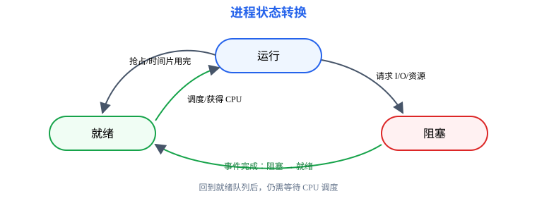
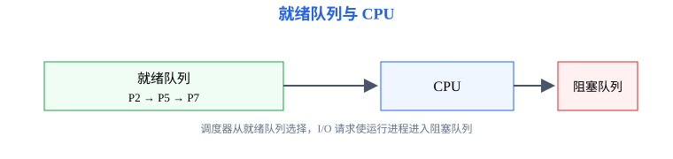

# 第2章 进程与调度：让程序成为可并发执行的对象

<span style="color:#16A34A;background:#F0FDF4;padding:2px 6px;border-radius:3px;">408 主线</span>

本章要解决的问题：程序如何拥有独立执行状态？多个进程如何共享 CPU？调度题如何从到达时间走到甘特图和指标？

本章一句话主线：

```text
程序 → 进程 → PCB → 状态转换 → 调度 → 上下文切换
```

[返回全书知识树](00_全书知识树.md) · [返回操作系统入口](../操作系统_目录总图.md)

<hr style="border:0;border-top:1px solid #D1D5DB;margin:24px 0 16px;">

## 本章知识树

- [程序与进程](#process)
  - [PCB](#pcb)
  - [进程的组成](#process-structure)
- [状态与线程](#state)
  - [状态转换](#state-transition)
  - [线程](#thread)
- [调度](#scheduling)
  - [指标](#metrics)
  - [算法](#algorithms)
- [上下文切换](#context-switch)
- [典型方法与短例](#examples)

## 先看结论

1. 进程是程序的一次执行过程，包含代码、数据、地址空间、寄存器现场和资源使用状态。
2. PCB 是操作系统感知和管理进程的主要数据结构；进程切换的核心是保存旧进程现场、恢复新进程现场。
3. 就绪表示“只差 CPU”，阻塞表示“等待事件或资源”；阻塞进程不能直接被 CPU 调度运行。
4. 调度题必须先确定抢占性、到达时间、服务时间、优先级方向和时间片规则，再画甘特图。

## 知识展开

<a id="process"></a>
### 程序与进程

程序是静态的指令和数据集合；进程是程序装入内存后的一次动态执行。相同程序可以对应多个进程，多个线程也可以共享同一进程地址空间。

<a id="process-structure"></a>
进程的复习模型包含：

- **程序段**：可执行指令；
- **数据段与堆栈**：全局数据、动态分配区和调用栈；
- **PCB**：标识、状态、PC、寄存器、调度信息、内存管理信息和打开文件等。

<a id="pcb"></a>
### PCB：进程的管理入口

PCB 不等于进程全部内容，而是内核管理进程所需的控制信息。题目问“切换时保存什么”，优先想到 PC、通用寄存器、状态寄存器、栈指针和调度相关现场；题目问“进程拥有哪些资源”，还要考虑地址空间、打开文件和 I/O 状态。



<a id="state"></a>
### 进程状态

经典三状态模型：

- **运行**：进程正在 CPU 上执行；
- **就绪**：进程具备运行条件，只等待 CPU；
- **阻塞**：进程等待 I/O 完成、信号量、子进程或其他事件。

常见转换：运行 → 就绪（时间片用完或被抢占）；运行 → 阻塞（请求 I/O 或等待资源）；阻塞 → 就绪（事件完成）；就绪 → 运行（被调度）。

<a id="state-transition"></a>
<span style="color:#d55263"><strong>边界：</strong></span>阻塞 → 运行通常不是直接转换，因为事件完成后先进入就绪队列，是否马上运行还要由调度器决定。

<a id="thread"></a>
### 线程

线程是 CPU 调度和执行的基本单位；同一进程内线程共享代码、数据、打开文件和地址空间，但拥有独立的 PC、寄存器和栈。

线程提高并发性，但共享地址空间也带来竞态条件，因此要连接到[第3章同步与死锁](03_同步与死锁.md)。

<a id="scheduling"></a>
### 调度

调度器从就绪队列选择进程或线程分配 CPU。先区分三个层次：长期调度决定作业是否进入系统；中期调度通过换入换出控制内存中的进程；短期调度决定下一次运行哪个就绪进程。

<a id="metrics"></a>
#### 调度指标

设到达时间为 \(t_a\)，完成时间为 \(t_c\)，服务时间为 \(T_s\)：

核心公式

$$
T_{周转}=t_c-t_a,
\qquad
T_{带权周转}=\frac{T_{周转}}{T_s}.
$$

作用：比较作业从到达到完成经历的总时间；带权周转时间进一步衡量相对于自身服务时间的等待程度。

成立条件：题目必须明确到达时间、完成时间和服务时间的口径；若存在 I/O 阻塞，要按题设定义服务时间。

使用信号：题干出现“平均周转时间、带权周转时间、响应时间、等待时间”。

<a id="algorithms"></a>
#### 调度算法

| 算法 | 选择规则 | 主要边界 |
|---|---|---|
| FCFS | 到达早者优先 | 非抢占，可能出现护航效应 |
| SJF | 选预计服务时间最短者 | 通常非抢占；短作业优先可能导致长作业饥饿 |
| SRTF | 剩余服务时间最短者 | 抢占式 SJF，新作业到达时可能抢占 |
| 优先级调度 | 选优先级最高者 | 必须先确认数字越大是否优先 |
| 时间片轮转 | 按队列轮流运行一个时间片 | 需处理新到达、时间片用完和结束事件的先后 |



<a id="context-switch"></a>
### 上下文切换

上下文切换包括保存当前进程的寄存器、PC、栈指针和状态信息，更新 PCB 与调度队列，再恢复下一个进程的现场。切换期间 CPU 执行内核代码，通常不直接产生用户进程的有效工作。

## 结构图 / 过程图

进程状态图表达“事件如何改变状态”；调度甘特图表达“某个具体规则如何产生运行顺序”。二者不能互相替代：状态图不提供时间尺度，甘特图不表达阻塞原因。


## 典型方法与短例

<a id="examples"></a>
### 短例1：状态转换

某进程正在运行，执行磁盘读请求；随后磁盘完成并发出中断。状态变化为：

```text
运行 --请求磁盘读--> 阻塞 --I/O 完成--> 就绪 --被调度--> 运行
```

不能把 I/O 完成立刻写成“阻塞 → 运行”，因为就绪队列中可能还有更高优先级进程。

### 短例2：FCFS 与指标

进程 P1、P2、P3 的到达时间分别为 0、1、2，服务时间分别为 4、3、2，采用 FCFS 且无 I/O。

甘特图：

```text
0        4       7     9
|   P1   |  P2   | P3  |
```

完成时间为 4、7、9；周转时间为 4、6、7；平均周转时间为 \(17/3\)。P1 的带权周转时间为 \(4/4=1\)，P2 为 \(6/3=2\)，P3 为 \(7/2=3.5\)。

### 短例3：时间片轮转

P1、P2 到达时间均为 0，服务时间分别为 5、3，时间片为 2，按 P1、P2 入队。运行序列为：

```text
P1(0-2) → P2(2-4) → P1(4-6) → P2(6-7) → P1(7-8)
```

计算时每一段结束都要判断：进程是否完成、是否重新入队、期间是否有新进程到达。

## 易错与边界

- 周转时间不是服务时间；等待时间通常还要扣除实际运行时间，具体按题设口径。
- 抢占式算法遇到新到达进程时要重新比较，不能沿用上一段顺序。
- 优先级数字方向必须由题目说明，不能凭习惯判断。
- 线程共享地址空间，但不是共享所有寄存器和栈。
- 上下文切换开销会影响有效吞吐，但许多基础题会把它设为 0；看到题设要按给定模型计算。

## 跨章节连接

- 进程因信号量和死锁进入阻塞，见[第3章](03_同步与死锁.md)。
- 缺页和 I/O 会改变进程状态，见[第4章](04_内存管理.md)和[第6章](06_输入输出系统.md)。
- 文件描述符和打开文件表属于进程资源，见[第5章](05_文件系统.md)。
