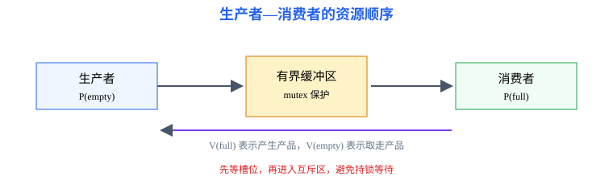
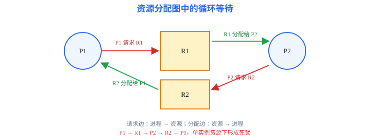

# 第3章 同步与死锁：并发执行中的顺序与资源冲突

<span style="color:#16A34A;background:#F0FDF4;padding:2px 6px;border-radius:3px;">408 主线</span>

本章要解决的问题：多个执行流同时访问共享资源时，如何保证结果正确？当进程互相等待资源时，如何判断、避免、检测和恢复死锁？

本章一句话主线（两条主枝）：

```text
并发执行 → 临界区 → 互斥/同步 → 信号量 → 经典问题
资源竞争 → 死锁条件 → 安全性判断 → 避免/检测/恢复
```

[返回全书知识树](00_全书知识树.md) · [返回操作系统入口](../操作系统_目录总图.md)

<hr style="border:0;border-top:1px solid #D1D5DB;margin:24px 0 16px;">

## 本章知识树

- [同步互斥](#synchronization)
  - [临界区与竞态](#critical-section)
  - [信号量](#semaphore)
  - [经典同步问题](#classic-problems)
- [死锁](#deadlock)
  - [必要条件](#deadlock-conditions)
  - [避免与银行家算法](#banker)
  - [检测与恢复](#detection-recovery)
- [典型方法与短例](#examples)

## 先看结论

1. 互斥解决“同一时刻谁能进入临界区”，同步解决“多个事件必须按什么先后发生”。
2. 信号量的 `P` 操作可能使进程阻塞，`V` 操作可能唤醒等待进程；顺序写错会导致竞态、死锁或资源计数错误。
3. 死锁需要互斥、占有且等待、不可剥夺、循环等待四个条件同时成立；破坏任一条件即可预防。
4. 银行家算法判断的是“分配后是否仍存在安全序列”，不是简单比较剩余资源和某一个进程的需求。

## 知识展开

<a id="synchronization"></a>
### 同步互斥

并发进程的执行顺序可能交错。若多个执行流读写同一共享数据，最终结果依赖时序，就出现竞态条件。

<a id="critical-section"></a>
#### 临界区与竞态

临界区是访问共享资源的代码片段。一个正确的临界区协议需要满足：

- **互斥**：同一时刻最多一个进程在临界区；
- **空闲让进**：临界区空闲且有进程申请时，不能无故拒绝；
- **有限等待**：进程提出申请后，不能无限等待。



<a id="semaphore"></a>
#### 信号量

信号量是带原子操作的整数。`P(S)`（wait）使资源计数减一，若结果不满足条件则阻塞；`V(S)`（signal）使计数加一，并可能唤醒等待者。

生产者—消费者的典型信号量：`empty` 表示空槽数，`full` 表示产品数，`mutex` 保护缓冲区。

```text
生产者：P(empty) → P(mutex) → 放入产品 → V(mutex) → V(full)
消费者：P(full)  → P(mutex) → 取出产品 → V(mutex) → V(empty)
```

<span style="color:#d55263"><strong>边界：</strong></span>先执行 `P(mutex)` 再执行 `P(empty)` 可能造成持锁等待：缓冲区满时生产者占有互斥锁并等待空槽，消费者无法取得锁取走产品。

<a id="classic-problems"></a>
#### 经典同步问题

| 问题 | 共享约束 | 复习重点 |
|---|---|---|
| 生产者—消费者 | 空槽、满槽和缓冲区互斥 | `empty/full/mutex` 的顺序 |
| 读者—写者 | 多个读者可并发，写者需独占 | 读者优先、写者优先的饥饿边界 |
| 哲学家进餐 | 每人需同时获得两把叉子 | 破坏循环等待或限制并发数 |

**读者优先方案**（`readCount=0`，`mutex=1`，`rw=1`）：

```text
读者：P(mutex); readCount++;
      if readCount == 1: P(rw);
      V(mutex);
      读数据;
      P(mutex); readCount--;
      if readCount == 0: V(rw);
      V(mutex);

写者：P(rw); 写数据; V(rw)
```

第一个读者取得写者互斥量，最后一个读者释放它，因此多个读者可并发、写者独占。该方案可能让写者饥饿；写者优先方案需额外设置写者计数与读写门闩。

**哲学家破环方案**：每把叉子对应一个初值为 1 的信号量，再设置初值为 (N-1) 的 `room`。

```text
思考 → P(room) → P(left) → P(right) → 进餐
     → V(right) → V(left) → V(room)
```

最多 (N-1) 人同时尝试拿叉子，可破坏“所有人各持一把并等待另一把”形成的循环等待；仍不能仅凭此保证每个人都不会饥饿。

<a id="deadlock"></a>
### 死锁

死锁是多个进程因等待对方占有的资源而永久阻塞。它和一般阻塞不同：普通阻塞等待的事件最终可能发生，死锁中的等待关系形成闭环。

<a id="deadlock-conditions"></a>
#### 必要条件

1. 互斥：资源一次只能由一个进程占用；
2. 占有且等待：进程占有已有资源，同时等待新资源；
3. 不可剥夺：资源不能被强制收回；
4. 循环等待：存在进程—资源交替构成的环。



<a id="banker"></a>
#### 避免与银行家算法

银行家算法先计算 `Need = Max - Allocation`。只有当存在一条安全序列，使每个进程都能在当前 `Work` 资源下完成并释放资源，状态才安全。

使用步骤：

1. 计算每个进程的 `Need`；
2. 找到 `Need ≤ Work` 的未完成进程；
3. 假设它完成，令 `Work = Work + Allocation`；
4. 重复直到全部完成，或找不到可推进进程。

<a id="detection-recovery"></a>
#### 检测与恢复

检测算法允许系统先分配，再周期性检查等待关系。发现死锁后，可以终止一个或多个进程、剥夺资源、回滚到安全检查点；选择策略要考虑代价和进程已完成工作量。

## 结构图 / 过程图

同步图展示“共享资源—互斥—事件顺序”；资源分配图展示“谁占有、谁请求”以及是否形成环。只有在资源类型和实例条件明确时，环才可直接推出死锁；单实例资源图中的环最容易直接判定。

## 典型方法与短例

<a id="examples"></a>
### 短例1：判断信号量顺序

缓冲区容量为 $N$，初值 `empty=N`、`full=0`、`mutex=1`。生产者先 `P(empty)`，再 `P(mutex)`；消费者先 `P(full)`，再 `P(mutex)`。这样既保证空满数量正确，也避免持有互斥锁等待槽位。

核对一次生产者操作：若缓冲区原有 (k) 件产品，执行 `P(empty)` 后先确保有空槽，进入临界区放入一件，再执行 `V(mutex)`、`V(full)`；最终产品数为 (k+1)，空槽数为 (N-k-1)。消费者过程对称。

### 短例2：银行家安全性

系统有 A、B、C 三类资源，当前 `Available=(3,3,2)`：

| 进程 | Allocation | Max | Need = Max - Allocation |
|---|---:|---:|---:|
| P0 | (0,1,0) | (7,5,3) | (7,4,3) |
| P1 | (2,0,0) | (3,2,2) | (1,2,2) |
| P2 | (3,0,2) | (9,0,2) | (6,0,0) |
| P3 | (2,1,1) | (2,2,2) | (0,1,1) |
| P4 | (0,0,2) | (4,3,3) | (4,3,1) |

令 `Work=Available`。依次检查：`P1` 的 Need 不超过 Work，完成后 `Work=(5,3,2)`；再完成 `P3` 得 `(7,4,3)`；完成 `P4` 得 `(7,4,5)`；完成 `P0` 得 `(7,5,5)`；最后完成 `P2` 得 `(10,5,7)`。因此安全序列为 $\langle P1,P3,P4,P0,P2\rangle$，该状态安全。

判断新请求时，先检查 `Request ≤ Need` 和 `Request ≤ Available`；临时分配后再运行安全性检查。找不到可推进进程表示状态不安全，不等于已经发生死锁。

### 短例3：哲学家进餐的破环

让最多四名哲学家同时尝试拿叉子，或规定奇数号先拿左叉、偶数号先拿右叉，可以破坏循环等待条件。只写“加锁”而不说明破坏了哪个条件，通常不足以完成判断。

## 易错与边界

- 互斥和同步不是同一个概念；互斥关注同时性，同步关注先后关系。
- 信号量的 P/V 必须视为原子操作，不能拆成普通读改写。
- 安全序列存在说明当前状态安全，不代表所有进程都立即运行。
- 资源分配图中的环是否必然死锁，取决于资源类型是否只有一个实例。
- 饥饿是进程长期得不到资源或 CPU，死锁是等待关系永久闭环，二者不能混为一谈。

## 跨章节连接

- 进程因等待信号量或资源从运行转为阻塞，连接[第2章](02_进程与调度.md)。
- 缺页和 I/O 也会造成阻塞，但不等于死锁，连接[第4章](04_内存管理.md)和[第6章](06_输入输出系统.md)。
- 文件锁、设备请求和缓冲区都可能成为同步与死锁的资源对象，连接[第5章](05_文件系统.md)。
