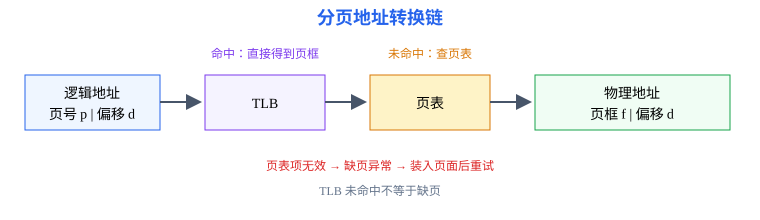
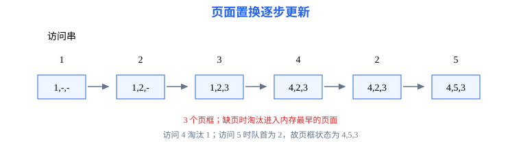

# 第4章 内存管理：从逻辑地址到物理访问

<span style="color:#16A34A;background:#F0FDF4;padding:2px 6px;border-radius:3px;">408 主线</span>

本章要解决的问题：进程看到的逻辑地址如何映射到物理内存？分页、分段、TLB、虚拟内存和页面置换之间是什么关系？

本章一句话主线：

```text
逻辑地址 → 地址转换 → 分页/分段 → 虚拟内存 → 缺页 → 页面置换
```

[返回全书知识树](00_全书知识树.md) · [返回操作系统入口](../操作系统_目录总图.md)

<hr style="border:0;border-top:1px solid #D1D5DB;margin:24px 0 16px;">

## 本章知识树

- [地址空间](#address)
  - [逻辑地址与物理地址](#address-types)
  - [连续分配](#contiguous)
- [分页与分段](#paging)
  - [页表与 TLB](#page-table)
  - [分段](#segmentation)
- [虚拟内存](#virtual-memory)
  - [缺页中断](#page-fault)
  - [页面置换](#replacement)
  - [页面分配与抖动](#frame-allocation)
- [典型方法与短例](#examples)

## 先看结论

1. 逻辑地址由进程使用，物理地址是主存实际访问位置；地址转换由硬件和操作系统共同完成。
2. 分页消除外部碎片但可能产生页内碎片；分段按逻辑意义组织，段长可变。
3. TLB 是页表项的高速缓存；TLB 未命中不等于缺页，仍要检查页表有效位。
4. 缺页会触发异常，若没有空闲页框则先按置换算法选择牺牲页；页面置换次数必须按访问串逐步模拟。

## 知识展开

<a id="address"></a>
### 地址空间

<a id="address-types"></a>
逻辑地址是 CPU 生成并被进程使用的地址；物理地址是内存总线最终访问的地址。重定位寄存器可支持连续分配中的动态地址转换，页表或段表则支持更细粒度的映射。

<a id="contiguous"></a>
#### 连续分配

连续分配要求一个进程占用一段连续物理空间。首次适应、最佳适应和最坏适应的差别在于选择空闲分区的规则；外部碎片是分散空闲区总量足够但无法形成连续大块。

<a id="paging"></a>
### 分页与分段

分页把逻辑地址空间划分为固定大小的页，把物理内存划分为同样大小的页框。逻辑地址可写成 $(\text{页号}\ p,\ \text{页内偏移}\ d)$，页表把 $p$ 映射为页框号 $f$，物理地址为 $(f,d)$。



<a id="page-table"></a>
#### 页表与 TLB

访问路径：先用页号查 TLB；命中则直接得到页框号；未命中再查页表并把有效项装入 TLB；若页表项无效，则产生缺页异常。

<span style="color:#d55263"><strong>边界：</strong></span>TLB 命中率影响访问次数和平均时间，但不改变页表中“页是否在主存”的语义。

<a id="segmentation"></a>
#### 分段

分段地址由 $(\text{段号}\ s,\ \text{段内偏移}\ d)$ 构成，段表项给出段基址和段长。转换前要检查 $d<limit$，否则产生越界异常。分段更贴合代码段、数据段、栈段等逻辑模块，但会产生外部碎片。

<a id="virtual-memory"></a>
### 虚拟内存

虚拟内存允许进程地址空间大于当前分配的物理内存，按需把页面装入页框。页表项通常包含页框号、有效位、访问位、修改位和保护位。

<a id="page-fault"></a>
#### 缺页中断

缺页处理过程：

1. CPU 访问无效页表项；
2. 产生缺页异常，保存进程现场；
3. 操作系统检查访问是否合法并寻找空闲页框；
4. 无空闲页框时按置换算法选择页面，必要时回写脏页；
5. 从外存装入目标页，更新页表和 TLB；
6. 恢复指令执行。

<a id="replacement"></a>
#### 页面置换

| 算法 | 规则 | 边界 |
|---|---|---|
| OPT | 淘汰未来最长时间不再访问的页 | 只能用于理论最优比较 |
| FIFO | 淘汰进入内存最早的页 | 可能出现 Belady 异常 |
| LRU | 淘汰最近最久未使用的页 | 需要记录访问历史或近似位 |



<a id="frame-allocation"></a>
#### 页面分配与抖动

页框可按固定数量、进程规模比例等策略分配；置换范围可采用局部策略（只在该进程页框中选牺牲页）或全局策略（可从其他进程页框中选择）。题目需按给定策略计算，不能把分配策略和置换算法混为一谈。

当进程频繁缺页、主要时间消耗在页面换入换出而非执行时，称为抖动。工作集思想通过跟踪进程近期活跃页面，帮助估计其需要的页框数；若系统无法提供所需页框，应降低同时驻留的进程数等，而不是单纯提高置换频率。

## 结构图 / 过程图

地址转换图表达“页号/偏移—TLB—页表—页框”的对象关系；页面置换图表达一次访问串如何更新页框。答题时不要把“页表查找”和“页面装入”写成一个步骤。

## 典型方法与短例

<a id="examples"></a>
### 短例1：分页地址转换

页大小为 $1\text{ KB}=2^{10}\text{ B}$，逻辑地址为 $0x1234$。拆分得页号 $p=\lfloor 0x1234/0x400\rfloor=4$，页内偏移 $d=0x1234\bmod 0x400=0x234=564$。若页表将第 4 页映射到页框 5，则物理地址为 $5\times1024+564=5684=0x1634$。

### 短例2：TLB 与缺页判断

一次访问先查 TLB 未命中，再查页表：若有效位为 1，得到页框并更新 TLB；若有效位为 0，则不是“TLB 未命中结束”，而是进入缺页处理。

### 短例3：FIFO 置换

页框数为 3，访问串为 `1, 2, 3, 1, 4, 2, 5`，初始页框为空：

| 访问页 | 1 | 2 | 3 | 1 | 4 | 2 | 5 |
|---|---:|---:|---:|---:|---:|---:|---:|
| 页框（按槽位） | 1,-,- | 1,2,- | 1,2,3 | 1,2,3 | 4,2,3 | 4,2,3 | 4,5,3 |
| 结果 | 缺页 | 缺页 | 缺页 | 命中 | 缺页 | 命中 | 缺页 |

FIFO 共缺页 5 次、命中 2 次。命中不改变先进先出队列；只有缺页装入时才更新队列。

## 易错与边界

- 页号和页内偏移的位数由页大小决定，不由页框总数决定。
- TLB 未命中、页表无效、缺页异常是三个不同层次。
- 页面置换题要先确认初始页框是否为空、访问相同页面是否算缺页、淘汰页是否按 FIFO/LRU 规则。
- 分页中的页内碎片与分段中的外部碎片不要混淆。
- 多级页表减少页表连续空间需求，但增加地址转换层次；题目必须给出级数和页表项大小后才能计算。

## 跨章节连接

- 缺页异常使当前进程阻塞，页面装入完成后回到就绪队列，连接[第2章](02_进程与调度.md)。
- 页面置换需要外存读写，连接[第5章](05_文件系统.md)和[第6章](06_输入输出系统.md)。
- 地址保护和用户态—内核态边界来自[第1章](01_系统概述.md)。
