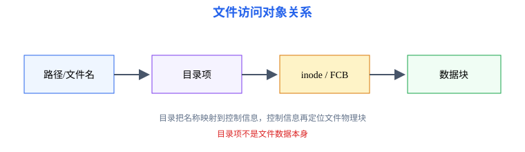
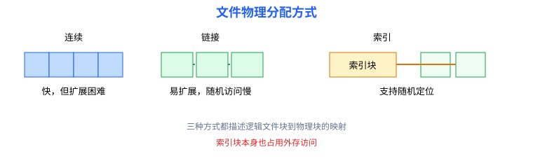

# 第5章 文件系统：从文件对象到磁盘块访问

<span style="color:#16A34A;background:#F0FDF4;padding:2px 6px;border-radius:3px;">408 主线</span>

本章要解决的问题：用户看到的文件和目录如何映射到磁盘块？打开文件时，操作系统如何沿路径找到文件控制信息并定位数据？

本章一句话主线：

```text
文件对象 → 目录组织 → 文件控制信息 → 文件分配 → 空闲空间 → 访问路径
```

[返回全书知识树](00_全书知识树.md) · [返回操作系统入口](../操作系统_目录总图.md)

<hr style="border:0;border-top:1px solid #D1D5DB;margin:24px 0 16px;">

## 本章知识树

- [文件对象与目录](#file-object)
  - [逻辑结构](#logical-file)
  - [目录与 inode](#directory-inode)
- [文件访问与分配](#file-access)
  - [打开文件](#open-file)
  - [连续/链接/索引分配](#allocation)
  - [文件块定位](#block-location)
- [空闲空间管理](#free-space)
  - [位示图与空闲链表](#free-methods)
- [典型方法与短例](#examples)

## 先看结论

1. 文件的逻辑结构面向用户组织数据，物理结构描述数据块在外存中的实际分布。
2. 目录把文件名映射到文件控制信息；inode/FCB 保存权限、长度、时间和数据块定位信息。
3. 连续分配访问快但扩展困难；链接分配便于扩展但随机访问弱；索引分配适合随机定位但需要索引块。
4. 文件块分配属于文件系统；磁盘臂调度和 SSD 特性属于第6章，通过访问路径连接。

## 知识展开

<a id="file-object"></a>
### 文件对象与目录

<a id="logical-file"></a>
文件是具有名称、类型、长度、保护属性和数据内容的逻辑对象。按逻辑结构可分为无结构文件、记录式文件和树形文件；按物理结构则关注数据块、指针和索引块如何组织。

<a id="directory-inode"></a>
目录本身也是文件，保存文件名到文件控制信息的映射。FCB 或 inode 通常记录文件类型、权限、所有者、长度、时间戳、链接数以及数据块地址。



<a id="file-access"></a>
### 文件访问与分配

<a id="open-file"></a>
#### 打开文件

打开路径 `/a/b/c` 的抽象过程：

1. 从根目录开始解析 `a`；
2. 在 `a` 目录中查找 `b`，读取其 inode；
3. 在 `b` 中查找 `c`，获得目标文件 inode；
4. 检查权限并建立系统打开文件表项；
5. 返回文件描述符给进程。

进程表项保存当前文件偏移和访问权限，系统打开文件表保存更稳定的文件控制信息；多个进程可能共享同一打开文件表项，从而共享文件偏移。

<a id="allocation"></a>
#### 文件分配

| 方式 | 数据块组织 | 优点 | 局限 |
|---|---|---|---|
| 连续分配 | 文件占用一段连续块 | 顺序和随机访问快 | 外部碎片，文件扩展困难 |
| 链接分配 | 每块含下一块指针 | 易扩展，几乎无外部碎片 | 随机访问慢，指针占空间 |
| 索引分配 | 索引块保存数据块号 | 支持随机访问和扩展 | 需要索引块，多级索引有层次开销 |



<a id="block-location"></a>
#### 文件块定位

索引分配中，若块大小为 $B$，逻辑字节偏移为 $x$，则逻辑块号为 $q=\lfloor x/B\rfloor$，块内偏移为 $r=x\bmod B$。随后根据直接索引、一级间接或多级间接索引定位物理块。

<a id="free-space"></a>
### 空闲空间管理

<a id="free-methods"></a>
常见方法：

- **位示图**：每个磁盘块对应一位，适合快速查找连续空闲块并计算空间占用；
- **空闲链表**：把空闲块串成链，分配时沿链取块；
- **成组链接**：把一组空闲块号集中记录，再链接下一组，降低链表访问次数。

## 结构图 / 过程图

文件结构图说明“名字—目录—inode—数据块”的对象关系；分配图说明文件逻辑块如何映射到物理块。不要把目录项本身误认为文件数据，目录项首先是名字到控制信息的索引。

## 典型方法与短例

<a id="examples"></a>
### 短例1：索引块定位

块大小为 1 KB，文件偏移为 2500 B，则逻辑块号为 $\lfloor2500/1024\rfloor=2$，块内偏移为 452 B。若 inode 的直接地址项覆盖逻辑块 0～11，则第 2 块可由直接地址项直接得到。

再看多级索引。假设每块 1 KB、每个块号占 4 B，因此一个索引块有 256 个地址项；inode 有 12 个直接项、1 个一级间接项和 1 个二级间接项。逻辑块号从 0 起：0～11 走直接项，12～267 走一级间接，268 起走二级间接。偏移 $x=300\times1024+100$ 对应逻辑块 300、块内偏移 100；二级索引的相对序号为 $300-268=32$，所以先查二级索引块的第 0 项，再查其下级索引块的第 32 项，得到数据块号后访问块内偏移 100。实际地址项数量以题设 inode 格式为准。

### 短例2：位示图计算

假设磁盘有 32 个块，位号与块号一一对应，`1` 表示占用、`0` 表示空闲；第 0、3、7 位为 1，其余为 0。按块号递增分配两个空闲块：先分配块 1 并将第 1 位改为 1，再分配块 2 并将第 2 位改为 1。分配后占用块号为 0、1、2、3、7，共 5 块；空闲块数由 29 降为 27。若题目规定位序或 0/1 含义不同，应先按题设转换。

### 短例3：路径访问

访问 `/home/u/a.txt` 至少要依次定位根目录、`home`、`u` 和 `a.txt` 的控制信息。若中途权限检查失败，不能继续假设已经得到数据块地址。

## 易错与边界

- 文件名、目录项、FCB/inode、文件描述符是不同层次的对象。
- 连续分配的“连续”是物理块连续，不是文件内容逻辑上连续。
- 链接分配的指针可能占用数据块空间；索引分配的索引块也需要外存访问。
- 位示图的 0/1 含义必须按题目约定，不要默认某一编码。
- 文件系统负责块组织，磁盘调度负责请求顺序；二者都涉及外存但问题不同。

## 跨章节连接

- 文件打开、读写系统调用跨越用户态—内核态边界，连接[第1章](01_系统概述.md)。
- 打开文件表项属于进程资源，连接[第2章](02_进程与调度.md)。
- 文件读写最终通过设备接口、中断或 DMA 完成，连接[第6章](06_输入输出系统.md)。
- 页面换入换出也需要外存块访问，连接[第4章](04_内存管理.md)。
