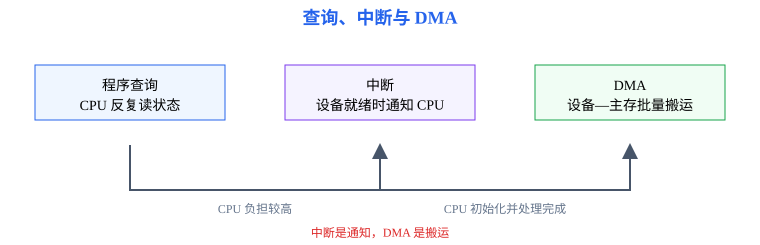
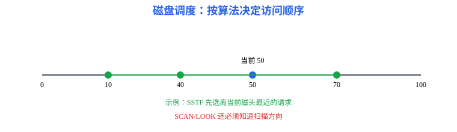

# 第6章 输入输出系统：设备、传输与完成通知

<span style="color:#16A34A;background:#F0FDF4;padding:2px 6px;border-radius:3px;">408 主线 · 现代实现单独短注</span>

本章要解决的问题：外设如何向 CPU 和主存提供数据？程序查询、中断和 DMA 如何选择？磁盘请求如何调度？

本章一句话主线：

```text
设备 → I/O 接口 → 查询/中断/DMA → 缓冲 → 总线与磁盘 → I/O 完成
```

[返回全书知识树](00_全书知识树.md) · [返回操作系统入口](../操作系统_目录总图.md)

<hr style="border:0;border-top:1px solid #D1D5DB;margin:24px 0 16px;">

## 本章知识树

- [设备与接口](#interface)
  - [I/O 编址](#addressing)
  - [数据、状态、控制寄存器](#registers)
- [I/O 方式](#io-methods)
  - [程序查询](#polling)
  - [中断与 DMA](#interrupt-dma)
- [缓冲与外存](#buffer-spooling)
  - [缓冲与 SPOOLing](#buffering)
  - [磁盘调度](#disk-scheduling)
  - [SSD 短注](#ssd)
- [典型方法与短例](#examples)

## 先看结论

1. I/O 接口连接设备与系统总线，通常提供数据、状态和控制寄存器。
2. 程序查询简单但占用 CPU；中断适合事件驱动；DMA 适合成块数据传输，通常完成后再中断通知 CPU。
3. 中断处理要区分响应、保存现场、执行服务程序和恢复现场；DMA 搬运期间 CPU 与设备可能竞争总线。
4. 磁盘调度改变请求顺序以减少磁头移动；SSD 没有机械寻道，但仍受并行通道、队列和擦写特性的影响。

## 知识展开

<a id="interface"></a>
### 设备与接口

设备控制器把设备的电气/机械细节转换成处理器可读写的寄存器和状态。接口通常包含数据寄存器、状态寄存器和控制寄存器，并提供就绪、忙、错误和中断请求等信号。

<a id="addressing"></a>
#### I/O 编址

统一编址把 I/O 寄存器映射到存储器地址空间，用普通访存指令访问；独立编址为 I/O 设置专用地址空间和指令。判断题目时要看地址空间是否统一，以及访问寄存器使用什么指令。

<a id="registers"></a>
#### 三类寄存器

| 寄存器 | 作用 | 典型访问 |
|---|---|---|
| 数据寄存器 | 暂存输入或输出数据 | 读数据、写数据 |
| 状态寄存器 | 反映就绪、忙、错误、中断等 | 查询或读状态 |
| 控制寄存器 | 写入启动、复位、方向和中断使能 | 发出控制命令 |

<a id="io-methods"></a>
### I/O 方式

<a id="polling"></a>
#### 程序查询

CPU 反复读取状态寄存器，发现设备就绪后再读写数据。流程简单，但 CPU 在等待期间不能有效执行其他工作。

<a id="interrupt-dma"></a>
#### 中断与 DMA

中断方式由设备在准备好或完成时请求 CPU，CPU 响应后保存现场、执行中断服务程序并恢复。DMA 控制器获得总线控制权后直接在设备和主存之间搬运数据，CPU 只负责初始化和完成处理。



<a id="buffer-spooling"></a>
### 缓冲与外存

<a id="buffering"></a>
缓冲可以平滑设备和 CPU 的速度差异，常见单缓冲、双缓冲和循环缓冲。SPOOLing 用磁盘等共享设备模拟独占设备，把作业输出先写入假脱机文件，再由后台程序统一送往设备。

<a id="disk-scheduling"></a>
#### 磁盘调度

传统磁盘由盘片、磁道、扇区和磁头组成；同一半径上的磁道构成柱面。一次磁盘访问时间可拆成寻道时间、旋转等待时间和数据传输时间。题目若只给磁道号并要求“磁头移动距离”，只累计寻道移动，不应把旋转等待或传输时间混入。

磁盘请求包含柱面/磁道位置、读写方向和到达时间。FCFS 按到达顺序处理；SSTF 选择距离当前磁头最近的请求；SCAN/LOOK 按一个方向扫描后反向，减少极端等待。



<a id="ssd"></a>
#### SSD 短注

SSD 没有旋转盘片和机械磁头，传统寻道距离不再是主要成本；但闪存擦写、磨损均衡、垃圾回收和并行通道会影响访问延迟。408 题目若未给出这些模型，仍按题设的磁盘调度或块访问模型计算。

## 结构图 / 过程图

对象关系图展示设备、接口、CPU 和主存之间的数据/控制方向；过程图展示查询、中断和 DMA 在时间上的差异。DMA 不是“CPU 不参与”，而是 CPU 不逐字节搬运，仍需初始化和处理完成事件。

## 典型方法与短例

<a id="examples"></a>
### 短例1：方式选择

低速键盘每次只产生少量数据，适合中断方式；高速磁盘连续传输大块数据，适合 DMA；若设备极简单且等待时间短，程序查询实现成本最低。

### 短例2：中断处理链

设备置位状态寄存器并发出请求 → CPU 在当前指令结束后响应 → 保存 PC 和状态 → 执行服务程序读走数据并清除请求 → 恢复现场继续运行。服务程序不应把“设备尚未就绪”误写成“数据已经完成”。

### 短例3：磁盘调度距离

当前磁头在 50，待服务请求为 40、10、70，采用 SSTF：先服务 40（移动 10），再服务 10（移动 30），最后服务 70（移动 60），总移动距离为 100。若题目指定 SCAN，则必须先确认扫描方向，不能套用 SSTF。

### 短例4：DMA 总线竞争

设 DMA 以周期窃取方式传送 1024 个字，每字占用一个 100 ns 总线周期。DMA 共占用 \(1024\times100\text{ ns}=102.4\ \mu\text{s}\) 的总线时间。若本题模型下整个传送窗口为 1 ms，则总线被 DMA 占用比例为 \(102.4/1000=10.24\%\)。突发传送若传同样字数，累计占用时间相同，但占用集中为连续区间；CPU 可用总线时段会被集中推迟。题目没有给总线周期和传送单位时，只能判断机制，不能给出数值损失。

## 易错与边界

- 中断是通知机制，DMA 是数据搬运机制，二者不是互斥选项。
- 查询方式中 CPU 忙等的是设备状态，不是“进程一定阻塞”；具体还要看操作系统是否让出 CPU。
- 独立编址和统一编址的区别在地址空间与指令，不在设备速度。
- 磁盘调度的移动距离要从当前磁头位置开始，并按题目指定方向和服务规则计算。
- SSD 短注不能替代 408 经典磁盘模型，除非题目明确给出现代设备参数。

## 跨章节连接

- I/O 请求使进程阻塞，完成中断使其回到就绪队列，连接[第2章](02_进程与调度.md)。
- 设备请求和缓冲区可能形成同步与死锁问题，连接[第3章](03_同步与死锁.md)。
- 文件读写和页面换入换出都通过 I/O 系统访问外存，连接[第4章](04_内存管理.md)和[第5章](05_文件系统.md)。
