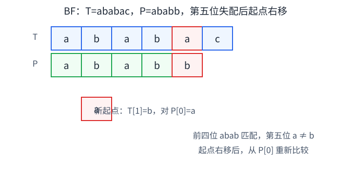

# 第4章 串

> **本章要解决的问题：** 在主串中寻找连续出现的模式串，失配后怎样避免重复比较？

<strong>主线：</strong>
字符序列与存储 → 主串/模式串 → BF 更换起点 → KMP 复用已匹配的前后缀信息。

[返回全书知识树](00_全书总览.md) · [返回书籍入口](../数据结构_目录总图.md)

## 知识树

<strong style="color:#4b8ee8;">串：字符组成的有限序列</strong>
<ul style="list-style:none;margin:6px 0 0 8px;padding:0 0 0 18px;border-left:2px solid #8893a3;">
<li>─ <strong>串的基础</strong>
<ul style="list-style:none;margin:0 0 6px 4px;padding-left:18px;border-left:1px solid #8893a3;">
<li>─ <a href="#string-basics">字符序列</a>：串长、空串、空格串、子串与子序列</li>
<li>─ <a href="#string-storage-ops">存储与基本操作</a>：顺序 / 链式表示；比较、连接、取子串、插删替换</li>
</ul></li>
<li>─ <strong>模式匹配：在主串中定位连续的模式串</strong>
<ul style="list-style:none;margin:0 0 0 4px;padding-left:18px;border-left:1px solid #8893a3;">
<li>─ <a href="#matching-objects">主串 T / 模式串 P</a>：明确搜索范围和目标</li>
<li>─ <a href="#bf">BF</a>：失配后换起点，可能重复比较</li>
<li>─ <a href="#kmp">KMP</a>：主串不回退，按前后缀信息回退模式状态
<ul style="list-style:none;margin:0 0 0 4px;padding-left:18px;border-left:1px solid #8893a3;">
<li>─ <a href="#kmp-prefix">π / next</a>：记录失配后的回退位置</li>
<li>─ <a href="#nextval">nextval</a>：跳过必然重复的比较</li>
</ul></li>
</ul></li>
</ul>

## 先看结论

- <strong>串是字符组成的特殊线性表：</strong>元素是字符，且匹配要求字符连续。
- <strong>子串不等于子序列：</strong>`acb` 是 `abc` 的子序列但不是子串。
- <strong>BF 与 KMP 的核心差别在失配处理：</strong>BF 换起点并可能重看字符；KMP 保留主串位置，只回退模式串状态。
- <strong>`next` 定义与下标有教材约定：</strong>计算前先固定一套定义；不要混用别的表格。
- <strong>复杂度：</strong>BF 最坏 `O(nm)`；KMP 预处理 `O(m)`、匹配 `O(n)`。

## 串、子串与子序列

- **串：** 由零个或多个字符组成的有限序列。
- **串长：** 字符数；空串长度为 0。
- **空格串：** 含空格字符的非空串，不能与空串混淆。
- **子串：** 从原串中截取的连续字符段。
- **子序列：** 保持字符相对次序，但允许跳过中间字符。
- **前缀/后缀：** 分别从串首开始、到串尾结束的子串；真前后缀不包括串本身。

例：`T = abcab` 中，`cab` 是子串；`acb` 保持了 `a→c→b` 的先后次序但不连续，只是子序列。

## 串的存储与基本操作

串的逻辑对象是字符序列；顺序存储和链式存储是不同表示，不改变字符先后关系。

- **顺序存储：** 字符连续保存，便于按位置访问；插入或删除中间字符通常要移动后缀。
- **链式存储：** 结点链接字符，便于局部修改已有链接，但按位访问需沿链定位，且每个字符有链接开销。

常见操作包括求长度、比较、连接、取子串、插入、删除和替换。字典序比较从首字符开始找第一个不同处；若一串是另一串的前缀，较短者通常较小。具体时间代价取决于存储表示和实现，不应脱离实现给一个统一复杂度。

## 主串和模式串

- **主串 `T`：** 被搜索的字符序列，长度为 `n`。
- **模式串 `P`：** 希望在 `T` 中寻找的连续序列，长度为 `m`。

若匹配成功，通常返回模式串在主串中的起始位置；失败则报告不存在。采用从 0 起始还是从 1 起始，需按题目/教材约定转换。

## BF：失配后换一个起点重来

<strong>BF（朴素匹配）</strong>在每个可能的主串起点逐字符比较：

1. 字符相同，`T` 与 `P` 的比较位置同时前进；
2. 遇到失配，模式串回到开头；
3. 主串起点向后移一位，重新比较；
4. 候选起点用尽仍未匹配则失败。

最坏可比较约 `(n-m+1)×m` 次，时间 `O((n-m+1)m)`，通常写成 `O(nm)`；辅助空间 `O(1)`。它实现简单、不需要预处理，但相邻起点的比较信息没有被利用。

## KMP：保留主串进度，回退模式串状态

KMP 利用模式串中**已经匹配部分的最长相等真前缀与真后缀**。失配时，把模式串移到仍可能匹配的位置，而不让主串指针倒退。

### 固定本页的 `next` 约定

为了让图和说明一致，本页使用**前缀函数**：

`π[j] = P[0..j] 的最长相等真前后缀长度`

<strong>失配处理：</strong>如果已匹配长度为 `q`，令 `q = π[q-1]`，继续比较 `P[q]` 与当前主串字符；无需回退主串。匹配到完整模式后，如要继续找重叠匹配，也令 `q = π[m-1]`。

**例：** `P = ababb`。其前缀函数为 `[0, 0, 1, 2, 0]`。若已匹配 `abab` 后失配，`q=4`，转到 `π[3]=2`，因为已知后缀 `ab` 等于模式串前缀 `ab`，可保留这两位信息。

![KMP失配例子：主串 T=ababac，模式串 P=ababb；前四位 abab 已匹配，第五位 a 对 b 失配；前缀函数将 q 从 4 回退到 2，主串指针保持在当前 a，并与 P[2]=a 比较。](assets/ch04/02-kmp.svg)

`next` 常是这类失配信息在教材指定下标下的编码；有的教材存“下一次比较位置”，有的存“最长前后缀长度”，表值可差一位。本页的 `π` 直接采用前缀长度定义，不与其他定义的 `next` 表混算。

### `nextval`

`nextval` 会在已有回退关系上跳过某些“回退后仍会与当前模式字符相等、随后必然再次失配”的比较。它是特定实现中的优化表，不改变 KMP 利用前后缀信息的基本思想，也不改变渐进复杂度。

### 复杂度

构造前缀函数为 `O(m)`；匹配过程为 `O(n)`，合计 `O(n+m)`，辅助表空间 `O(m)`。此线性结论基于回退状态单调下降的实现。

## BF 与 KMP：差异发生在失配以后

| 比较项 | BF | KMP |
|---|---|---|
| 失配后 | 主串候选起点右移，模式串回到开头 | 主串当前位置保留，模式串回到可复用前缀长度 |
| 已比较信息 | 通常丢弃，后续可能重比 | 用模式自身前后缀关系保留 |
| 预处理 | 不需要 | 需计算前缀/失配表 |
| 最坏时间 | `O(nm)` | `O(n+m)` |
| 辅助空间 | `O(1)` | `O(m)` |

短模式串、数据很小时 BF 可能更直接；当文本较长或需要重复使用模式串时，KMP 的预处理更有价值。

## 易错与边界

- `next` 是 KMP 失配信息；第2章链表的 `next` 常指向后继结点，只是符号相同。
- KMP 不靠“模式串移动得更快”，而是用已匹配结构减少无效重比。
- BF 的 `O(nm)` 是最坏上界；不同文本和模式会产生不同实际比较次数。
- 本章找连续字符模式；第7章查找表根据关键字定位记录，问题对象不同。

## 跨章节连接

<strong>串沿用线性表的序列思想，但匹配对象是连续字符片段：</strong>

- [第2章：线性表](02_线性表.md#linear-list)：串是字符元素构成的特殊线性表。
- [第7章：查找](07_查找.md#search-basics)：串匹配定位字符区间，查找定位记录。
