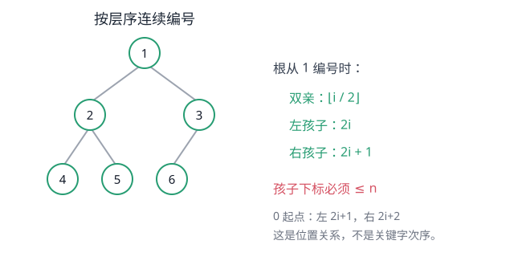
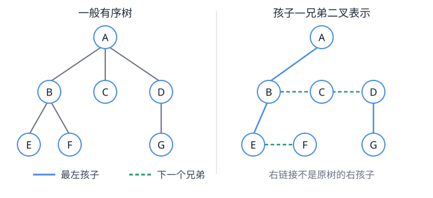
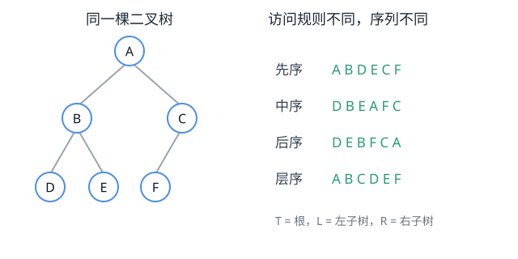
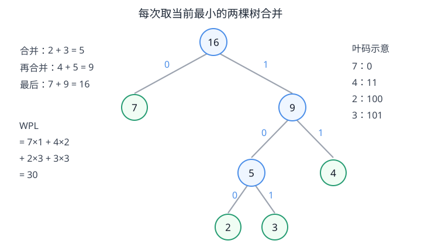

# 第5章 树与二叉树

树的层次关系怎样存储和访问？一般树怎样转成二叉表示，又怎样用于编码与集合管理？

<strong>本章主线：</strong>
先描述一般树和森林的层次关系，再收束到有左右位置的二叉树；随后依次解决表示、转换、遍历和线索化问题，最后区分哈夫曼树这一应用结构与并查集这一关联结构。

[返回全书知识树](00_全书总览.md) · [返回书籍入口](../数据结构_目录总图.md)

## 知识树

<strong style="color:#4b8ee8;">树与二叉树：层次关系的组织、表示和访问</strong>
<ul style="list-style:none;margin:6px 0 0 8px;padding:0 0 0 18px;border-left:2px solid #9CA3AF;">
<li>─ <strong>一般树与森林</strong>
<ul style="list-style:none;margin:0 0 6px 4px;padding-left:18px;border-left:1px solid #D1D5DB;">
<li>─ <a href="#tree-basics">树、森林与结点关系</a>：双亲、孩子、兄弟、祖先与子孙</li>
</ul></li>
<li>─ <strong>二叉树</strong>
<ul style="list-style:none;margin:0 0 6px 4px;padding-left:18px;border-left:1px solid #D1D5DB;">
<li>─ <a href="#binary-tree">左、右子树与二叉树定义</a>：孩子位置有区别</li>
<li>─ <a href="#binary-shapes">形状与计数性质</a>：满、完全、严格及结点数关系</li>
</ul></li>
<li>─ <strong>表示与转换</strong>
<ul style="list-style:none;margin:0 0 6px 4px;padding-left:18px;border-left:1px solid #D1D5DB;">
<li>─ <a href="#tree-storage">树与二叉树的存储</a>：双亲、孩子、孩子—兄弟、二叉链</li>
<li>─ <a href="#binary-sequential-storage">完全二叉树顺序存储</a>：层序编号与父子下标</li>
<li>─ <a href="#tree-forest-conversion">一般树 / 森林 → 孩子—兄弟二叉表示</a>：左链表示孩子，右链表示兄弟</li>
</ul></li>
<li>─ <strong style="color:#269c72;">遍历与线索</strong>
<ul style="list-style:none;margin:0 0 6px 4px;padding-left:18px;border-left:1px solid #D1D5DB;">
<li>─ <a href="#traversal">先序 / 中序 / 后序 / 层序</a></li>
<li>─ <a href="#traversal-recovery">遍历序列恢复二叉树</a>：通常需要中序和互异结点</li>
<li>─ <a href="#threaded-tree">线索二叉树</a>：让空链接保存指定次序的前驱 / 后继</li>
</ul></li>
<li>─ <strong>树结构应用</strong>
<ul style="list-style:none;margin:0 0 0 4px;padding-left:18px;border-left:1px solid #D1D5DB;">
<li>─ <a href="#huffman">哈夫曼树</a>：最小带权路径长度与前缀编码</li>
</ul></li>
<li>─ <strong>关联结构</strong>
<ul style="list-style:none;margin:0 0 0 4px;padding-left:18px;border-left:1px solid #D1D5DB;">
<li>─ <a href="#union-find">并查集</a>：用双亲森林维护集合划分</li>
</ul></li>
<li>─ <strong>跨章边界</strong>
<ul style="list-style:none;margin:0 0 0 4px;padding-left:18px;border-left:1px solid #D1D5DB;">
<li>─ <a href="#boundaries">BST、平衡树和堆的归属</a>：分别见第7、8章</li>
</ul></li>
</ul>

## 先看结论

- <strong>树表达一对多的层次关系：</strong>根是入口，结点间由双亲、孩子关系组织；森林是若干棵互不相交的树。
- <strong>二叉树不只是“每个结点最多两个孩子”：</strong>左、右位置有区别。只有一个孩子时，作为左孩子还是右孩子仍是不同结构。
- <strong>遍历顺序是访问规则：</strong>先序、中序、后序决定根相对左右子树的访问时机；层序按层推进。遍历不是存储方式。
- <strong>形状性质有明确前提：</strong>`n₀ = n₂ + 1`适用于任意**非空**二叉树；数组父子下标公式则依赖完全二叉树和所用下标起点。
- <strong>名称相似不代表同一结构：</strong>BST增加关键字次序、AVL 等增加平衡要求，二叉堆增加父子堆序；其完整内容分别在第7、8章。

## 1. 一般树与森林：描述层次关系

### 树的基本关系

树是 `n` 个结点构成的有限集合。`n=0` 时为空树；`n>0` 时有且只有一个根结点，其余结点可分成若干棵互不相交的子树。每个非根结点有且只有一个双亲。

- **结点的度：** 该结点直接拥有的孩子数；**树的度：** 所有结点度的最大值。
- **叶结点：** 度为 0 的结点；**分支结点：** 度不为 0 的结点。
- **祖先 / 子孙：** 沿双亲链向上 / 沿孩子链向下可到达的结点；父子是相邻一层的直接关系。
- **结点的层次：** 若根为第 1 层，孩子层次比双亲大 1；**树的高度（深度）：** 最大结点层次。若有教材把根层记为 0，计算时须按题目定义整体换算。
- **有序树：** 同一结点的孩子有从左到右的次序；交换两个孩子会改变有序树。无序树不保留这种顺序。

**森林**是 `m ≥ 0` 棵互不相交树的集合。删去一棵非空树的根，余下各子树构成森林；反过来，为森林增加一个新根并将各树作为它的子树，就得到一棵树。

<strong>这一层解决的问题：</strong>树适合表示“一对多”的层次关系，但它没有规定每个结点的孩子数，也没有天然的左、右位置。

## 2. 二叉树：左右子树有位置

二叉树是空树，或由根及两个互不相交的左、右子树组成；左右子树本身也都是二叉树。因此它的两个孩子位置有序，不能把“至多两个孩子”理解为无序树的度限制。

<strong>边界：</strong>一个根只有一个孩子时，“左孩子”和“右孩子”各自形成不同的二叉树。一般树中一个结点的若干孩子没有“左子树 / 右子树”这一二叉位置含义。

## 3. 二叉树形状与计数性质

### 形状名称

- **满二叉树（按本书定义）：** 每一层都达到允许的最大结点数。根所在层记为 1，高度为 `h` 时，结点总数是 `2^h−1`，叶结点位于第 `h` 层。部分材料把“满”与“严格/正则”用词混用；做题按题干定义，不把“每个分支结点都有两个孩子”误当作满二叉树的充分条件。
- **完全二叉树：** 除最后一层外各层都满；最后一层的结点从左至右连续排列。满二叉树是完全二叉树的特例。
- **严格（正则）二叉树：** 每个分支结点都有两个孩子；它不要求所有叶子在同一层，所以不一定是满二叉树。

### 高频计数关系

设二叉树有 `n₀` 个叶结点、`n₁` 个只有一个孩子的结点、`n₂` 个有两个孩子的结点，则：

`n = n₀ + n₁ + n₂`

`n − 1 = n₁ + 2n₂`

第二式来自边数计算：除根外每个结点恰有一条来自双亲的边，所以边数为 `n−1`；按孩子数计，每个度为 1 的结点贡献一条边，每个度为 2 的结点贡献两条边。两式相减得：

`n₀ = n₂ + 1`

这条结论对任意**非空**二叉树成立，与是否完全、是否平衡无关。空树没有根，`n₀`、`n₁`、`n₂` 的上述结点分类不用于推出这条等式。

根在第 1 层时，第 `i` 层最多有 `2^(i−1)` 个结点；高度为 `h` 的二叉树最多有 `2^h−1` 个结点。给定 `n>0` 个结点，完全二叉树高度为 `⌊log₂n⌋+1`，因为层序编号中第 `i` 层占编号区间 `[2^(i−1), 2^i−1]`。

## 4. 存储表示：怎样保存树的关系

| 表示方式 | 每个结点保存什么 | 适合什么操作 | 代价或限制 |
|---|---|---|---|
| 双亲表示 | 双亲下标/指针 | 找双亲、沿祖先方向回溯 | 找一个结点的全部孩子通常要扫描结点表 |
| 孩子表示 | 孩子链表或孩子指针集合 | 枚举某结点的孩子 | 结点的孩子数不同，表示可能不等长 |
| 孩子—兄弟表示 | 第一个孩子、下一个兄弟 | 统一表示任意度的有序树；转为二叉链 | “右链接”表示兄弟，不是原树中的右孩子 |
| 二叉链表 | 数据、左孩子链接、右孩子链接 | 表示有左右位置的二叉树 | 每个结点两个链接，空指针可用于线索化 |

### 完全二叉树顺序存储：用层序编号表达位置

完全二叉树适合按层序连续放入数组。以下使用**根编号为 1**：

- 结点 `i>1` 的双亲下标是 `⌊i/2⌋`；
- 左孩子下标为 `2i`，仅当 `2i ≤ n` 时存在；
- 右孩子下标为 `2i+1`，仅当 `2i+1 ≤ n` 时存在。

若数组从 0 编号，则结点 `i` 的双亲为 `⌊(i−1)/2⌋`；左右孩子为 `2i+1`、`2i+2`，但须小于 `n`。这些公式只描述完全二叉树的**位置关系**，不提供关键字大小次序；普通稀疏二叉树强行顺序存储会留下大量空槽。

<strong>前提：</strong>“按下标直接找父子”依赖完全二叉树的层序连续编号；不能把公式直接套到任意链式二叉树。

### 一般树与森林 → 孩子—兄弟二叉表示

对一棵有序树，令原结点的**最左孩子**成为二叉表示中的左孩子；令该结点的**下一个兄弟**成为右孩子。依此转换，树根开始的第一个孩子链向下延伸，兄弟链向右延伸。还原时，沿左链接表示“进入孩子”，沿右链接依次列举同一双亲的兄弟结点。

对森林，把各棵树的根视作同一层的兄弟：第一棵树的根作为二叉表示的根，其余树根沿右链接连接。因而森林也可统一成一棵二叉链式结构；右链接在这种表示中仍解释为下一个兄弟。

<strong>不要按图形位置猜语义：</strong>孩子—兄弟表示中的“左孩子 / 右孩子”是二叉编码中的链接名。转换后的右链接一般表示原树的兄弟关系，不能直接当作原树的右孩子。

## 5. 遍历与线索：怎样访问二叉树

遍历要求每个结点恰好访问一次。递归定义中，`T` 是根，`L`、`R` 分别是左右子树：

- **先序：** `T → L → R`，先访问根，再遍历左、右子树。
- **中序：** `L → T → R`，左子树之后访问根，再遍历右子树；仅对二叉树定义自然。
- **后序：** `L → R → T`，左右子树完成后才访问根。
- **层序：** 从根开始逐层、每层从左到右访问，通常用队列保存已发现但尚未处理的结点。

<strong>操作过程：</strong>在二叉链表递归遍历中，每个结点处理一次，时间为 `O(n)`；递归栈辅助空间为 `O(h)`，其中 `h` 是树高，最坏退化成链时为 `O(n)`。用队列做层序遍历，时间为 `O(n)`，队列空间最多保存当前层尾部与下一层头部的已发现结点，最坏为 `O(n)`。非递归遍历可用显式栈模拟递归状态。

### 遍历序列恢复结构

若结点标识**互不相同**，则：

- 先序 + 中序可唯一确定二叉树；
- 后序 + 中序可唯一确定二叉树。

恢复的关键是中序序列给出左右子树的分界：先序首项是根；后序末项是根。找到根在中序中的位置后，可确定左右子树各含哪些结点，再递归处理两侧，并据此切分另一个序列。

仅有先序和后序通常不能唯一恢复一般二叉树。只有一个孩子的结点究竟把孩子放在左边还是右边，先序与后序都无法说明。若结点值重复，即使有中序也可能产生多个分割位置，必须额外提供唯一标识或其他约束。恢复序列还须来自同一棵树、长度相同且元素集合一致。

### 线索二叉树：用空链接记录遍历邻接关系

普通二叉链表中，叶结点的左右链接都空；单孩子结点也有一个空链接。线索化可把空链接改作指向指定遍历次序中的前驱或后继：

- **中序线索：** 空左链接可指向中序前驱，空右链接可指向中序后继；
- **先序 / 后序线索：** 同样可依相应序列定义前驱、后继，但找后继时需留意子树访问规则，后序从根出发尤其不如中序直接。
- **标志位：** `ltag/rtag` 等标记用于区分链接是孩子指针还是线索。没有标志就无法知道该沿链接下树，还是把它当作遍历邻接结点。

线索树可以在指定次序下不使用递归栈来寻找后继、顺序访问结点，但线索本身不会改变树的逻辑结构，也不保证任意查询都变快。建立线索时通常要按选定次序遍历并维护前驱；是否设头结点、空树与首尾线索如何处理，按具体实现约定。

## 6. 树结构应用

### 哈夫曼树：把高频符号安排得更浅

给定 `n` 个带权叶结点，哈夫曼树是使**带权路径长度**最小的二叉树。令叶结点 `i` 的权值为 `wᵢ`，根到该叶的路径长度（边数）为 `lᵢ`，则：

`WPL = Σ(wᵢ × lᵢ)`

<strong>构造过程：</strong>反复从当前森林中取权值最小的两棵树，合并为一棵新树，新根权值是二者之和，再放回森林；直到只剩一棵树。新合并的两个根成为新根的孩子。每一步选最小的两项，可以让较小权值累积更深，所得 WPL 最优。

将每次合并的左右边分别标 `0`、`1`，从根到叶的位串就是该符号编码。由于符号只放在叶子上，任一编码都不会是另一编码的前缀，故可无歧义地逐位译码。左右标号互换会得到另一组等价码字，不改变树的 WPL。权值相同可能导致多种不同形状的最优树。

**构造代价取决于选最小项的实现：** 每轮线性扫描找两棵最小树，整体为 `O(n²)`；用最小优先队列维护候选树，插入与删除最小项各为 `O(log n)`，总计 `O(n log n)`。哈夫曼树优化的是给定权值下的 WPL，不保证最小高度、固定码长或某个特定符号的固定编码。

## 7. 关联结构：并查集不是普通二叉树

### 并查集：用双亲森林维护集合划分

<strong>边界：</strong>并查集使用“森林”形式保存代表元关系，但它的目标是集合的合并与判断，不是普通二叉树的左右孩子关系或遍历。

并查集维护一组**互不相交集合**，常用于反复判断两个元素是否属于同一集合，以及合并两个集合：

- **`Find(x)`：** 沿双亲链接向上找到集合代表元；同集合元素最终到达同一根。
- **`Union(x,y)`：** 先找两者代表元；代表元相同则不改变集合，否则让一棵树根指向另一棵树根。

一种常见存储是双亲数组：根可令 `parent[root]=root`，也有实现用负值记录根及集合大小。根值约定不同，但判根和合并语义一致。只做任意方向合并可能形成很高的树；按秩或按大小合并，让较小树挂到较大树下，可限制高度。路径压缩则在查找途中把经过结点直接连向根，缩短后续路径。

对 `m` 次操作、`n` 个元素，同时使用按秩/大小合并和路径压缩时，总体时间为 `O(m α(n))` 的摊还界（不同教材会以操作数或规模的等价参数书写）；`α` 是增长极慢的反阿克曼函数。它表示一串操作的平均摊还代价，不表示每次 `Find` 严格 `O(1)`。初始化空间为 `O(n)`。在 Kruskal 中，`Find` 判断当前边的两个端点是否已连通，`Union` 合并两个分量。

## 8. 易错边界与跨章连接

- **树 / 森林 / 二叉树：** 森林允许多棵根；二叉树还把左右位置写入结构。一般树的孩子数可以大于 2。
- **完全 / 满 / 严格二叉树：** 完全描述层序形状，满描述每层达到上限，严格描述每个分支结点都有两个孩子；不要仅凭名称推算另一种性质。
- **形状 / 次序：** 完全二叉树只给下标位置关系；BST 是关键字范围约束；二叉堆是父子关键字堆序。它们可能共享树形，却不是同一约束。
- **遍历 / 存储：** 先中后序是递归访问规则；数组、二叉链和孩子—兄弟是表示方法。
- **哈夫曼 / 并查集：** 前者优化带权编码长度，后者维护集合分组。并查集的双亲森林不是按左右孩子遍历的普通二叉树。
<strong>跨章归属：</strong>BST、AVL、红黑树的查找性质集中在[第7章查找](07_查找.md#binary-search-tree)；堆及堆排序集中在[第8章排序](08_排序.md#heap-sort)。
- [第3章栈、队列和数组](03_栈队列数组.md)：深度遍历借助栈/递归，层序遍历用队列，完全二叉树常用数组下标。
- [第6章图](06_图.md#mst)：Kruskal 使用本章并查集检测边是否连接两个既有分量。
- [第8章排序](08_排序.md#external-sort)：最佳归并树也按合并代价组织，但优化对象与哈夫曼编码的符号路径长度需按题目定义区分。

