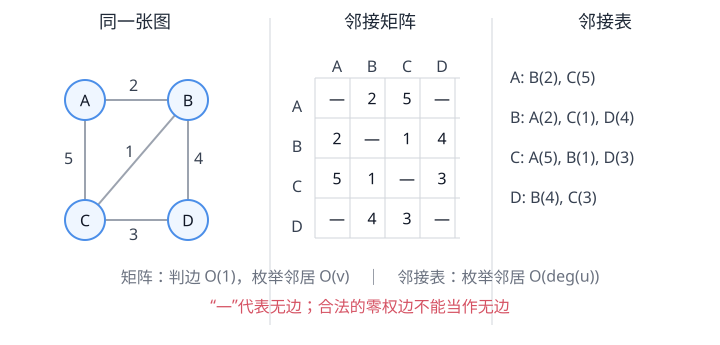
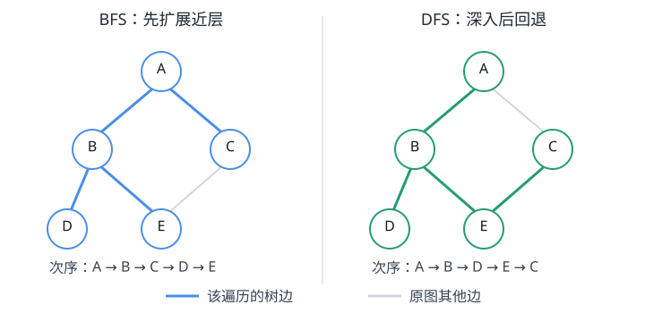
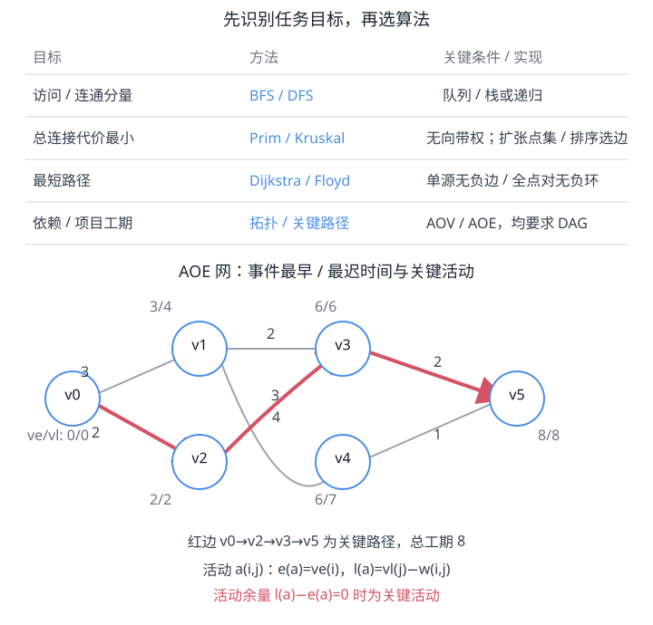

# 第6章 图

当关系不再只有“一个前驱、一个后继”或“一个双亲、若干孩子”，怎样存储多对多联系？访问、连通、路径和依赖又分别应选什么算法？

<strong>本章主线：</strong>
先用顶点和边描述关系，再依图的稀疏/稠密特点选择存储；最后先明确任务目标，再选遍历、生成树、最短路径、拓扑排序或关键路径方法。

[返回全书知识树](00_全书总览.md) · [返回书籍入口](../数据结构_目录总图.md)

## 知识树

<strong style="color:#4b8ee8;">图：多对多关系的表示、访问和任务算法</strong>
<ul style="list-style:none;margin:6px 0 0 8px;padding:0 0 0 18px;border-left:2px solid #9CA3AF;">
<li>─ <strong><a href="#graph-basics">对象与关系</a></strong>：顶点、边/弧及其性质</li>
<li>─ <strong><a href="#graph-storage">存储表示</a></strong>：矩阵、邻接表及链式扩展</li>
<li>─ <strong>遍历与连通</strong>
<ul style="list-style:none;margin:0 0 6px 4px;padding-left:18px;border-left:1px solid #D1D5DB;">
<li>─ <a href="#graph-traversal">BFS / DFS</a>：遍历森林、层次与回溯</li>
</ul></li>
<li>─ <strong>图算法按问题选择</strong>
<ul style="list-style:none;margin:0 0 6px 4px;padding-left:18px;border-left:1px solid #D1D5DB;">
<li>─ <a href="#mst">最小生成树</a>：Prim / Kruskal，最小化总连接代价</li>
<li>─ <a href="#shortest-path">Dijkstra / Floyd</a>：单源 / 所有顶点对最短路径</li>
<li>─ <a href="#topological-sort">AOV / 拓扑排序</a>：先后依赖与环检测</li>
<li>─ <a href="#critical-path">AOE / 关键路径</a>：事件时间、活动余量与工期</li>
</ul></li>
<li>─ <strong><a href="#algorithm-choice">算法选择与边界</a></strong>：目标、前提、实现和代价必须一并判断</li>
</ul>

## 先看结论

- <strong>图记作 `G=(V,E)`：</strong>顶点表示对象，边/弧表示关系；方向、权值、连通性是不同分类维度。
- <strong>先问要解决什么：</strong>访问用 BFS/DFS，最低总连接代价用 Prim/Kruskal，最短路径用 Dijkstra/Floyd，先后依赖用拓扑排序，工程工期用关键路径。
- <strong>前提决定算法是否成立：</strong>Dijkstra 要求非负边权；Floyd 可含负边但不能有负权回路；拓扑排序和关键路径以 DAG 为基础。
- <strong>复杂度必须连同表示一起记：</strong>矩阵扫描邻接点需 `O(v)`，邻接表按邻接点数扫描；BFS/DFS 因而分别常见 `O(v²)` 与 `O(v+e)`。
- <strong>最小生成树不是最短路径树：</strong>前者最小化整棵树的边权总和，后者最小化源点到各点的路径距离。

## 图的基本概念

图表示对象之间一般的多对多关系，记作 `G=(V,E)`。`V` 是顶点集合，`E` 是边（无向关系）或弧（有向关系）的集合。以下令 `v=|V|` 为顶点数，`e=|E|` 为边/弧数；空间复杂度按图结构本身计。

- **有向 / 无向：** 有向边 `(u,w)` 有起点与终点，方向不能随意反转；无向边 `{u,w}` 没有方向。
- **带权 / 无权：** 权值可表示距离、费用、时间等；无权路径常按边数计。权值为 0 的边与“没有边”是不同概念。
- **度：** 无向图中顶点关联边数；有向图中分别计入度（进入的弧数）和出度（离开的弧数）。
- **路径与回路：** 路径由连续相接的边/弧组成；起点终点相同的闭合路径称回路（教材也常称环）。
- **连通：** 无向图任意两顶点间均有路径为连通图；极大连通子图为连通分量。有向图若任意两点相互可达，则为强连通图。
- **DAG：** 有向无环图。AOV 和 AOE 网络均要求弧方向形成 DAG，才能用拓扑次序推进计算。

简单图没有自环和重边。简单无向图最多有 `v(v−1)/2` 条边；简单有向图（不计自环）最多有 `v(v−1)` 条弧。无向图各顶点度数之和为 `2e`；有向图入度总和、出度总和都等于 `e`。

## 存储结构：边查询还是邻接枚举

### 邻接矩阵

用 `v×v` 矩阵 `A` 记录顶点对是否相邻或边权。无向图矩阵对称；有向图 `A[i][j]` 对应 `i→j`。矩阵中要另定“无边”标记（如无穷或特殊值），避免与合法的零权边混淆。

- 空间 `O(v²)`；判断指定两点是否有边通常 `O(1)`。
- 枚举某顶点邻接点要扫描一整行，`O(v)`；枚举图中所有边需扫描矩阵，`O(v²)`。
- 用矩阵实现 BFS/DFS，若对每个顶点扫描整行，时间为 `O(v²)`。
- 稠密图、频繁判边，或算法本身需要遍历所有顶点对时较方便。

### 邻接表

每个顶点保存其邻接点列表，列表结点可附权值。无向边通常在两个端点各存一次，故总邻接项为 `2e`；有向弧只放在弧尾对应的出边表中。

- 空间 `O(v+e)`；枚举顶点 `u` 的邻接点为 `O(deg(u))`（有向时用出度）。
- 查询任意指定的 `u-v` 边需在 `u` 的表中查找，未加索引时为 `O(deg(u))`，不保证 `O(1)`。
- 邻接表 BFS/DFS 总计 `O(v+e)`，前提是访问标记能在 `O(1)` 时间读写。
- 稀疏图只需保存实际出现的边，存储和遍历更经济。

### 适配有向 / 无向边的链式表示

- **十字链表：** 每条有向弧结点同时串入弧尾的出弧链和弧头的入弧链；适合同时访问顶点的入边与出边。
- **邻接多重表：** 每条无向边只建一个边结点，再分别链接到两个端点的关联边链；删除或标记一条边时不必同步维护两份独立记录。

复杂度不是表示的孤立标签：同一操作在矩阵和邻接表上会扫不同数量的单元，选型时先说清要查边、枚举邻居还是遍历全图。

## BFS 与 DFS：访问同一张图的两种次序

对未访问顶点 `s` 开始遍历，先标记后访问，之后只能扩展未访问邻接点。若图不连通，从 `s` 到不了的顶点仍未被访问；要得到完整遍历森林，就按顶点表顺序为每个剩余未访问顶点重新启动一次。

### BFS：先扩展离起点近的一层

<strong>操作过程：</strong>BFS 用队列保存已发现但未扩展的顶点：起点入队；每次取队头，把所有尚未访问的邻接点标记并入队。先发现的层全部扩展后，才进入更远层。

- 在无权图中，或所有边权相同的图中，BFS 首次到达顶点所用边数最少，因此可求按边数计的最短路径。
- 边权不同时，边数最少不代表权值总和最小；普通 BFS 不能替代带权最短路算法。
- 邻接表实现全图遍历 `O(v+e)`；邻接矩阵实现 `O(v²)`。队列及访问标记最坏需要 `O(v)` 空间。

### DFS：一路深入，走不通再回退

<strong>操作过程：</strong>DFS 访问当前顶点后，选择一个尚未访问的邻接点继续深入；没有可走邻接点时回退到最近仍有未访问邻接点的顶点。可用递归调用栈或显式栈保存待续状态。

- 深入与回退形成 DFS 树；非树边的分类及用途还取决于有向/无向图和遍历实现，不能一概把所有非树边叫作回边。
- 邻接表、邻接矩阵复杂度分别为 `O(v+e)`、`O(v²)`；递归/显式栈最坏占 `O(v)`，递归深度可达 `v`。
- 遍历次序会受邻接表顺序影响；除题目指定邻接次序外，同一图可能得到不同合法遍历序列。

## 最小生成树：让全部顶点连通且总权最小

对**无向、带权、连通图**，生成树连接全部 `v` 个顶点且无回路，必有 `v−1` 条边。最小生成树（MST）在所有生成树中使边权总和最小。边权可以相同，故 MST 不一定唯一。若原图不连通，只能对每个连通分量求最小生成树，合起来是最小生成森林。

### Prim：从一个顶点集合向外扩张

<strong>操作过程：</strong>任取起点，维护已纳入顶点集合 `S`。每一步选取一条连接 `S` 与 `V−S` 的最小权边，把新顶点及该边加入；直到纳入全部顶点。它每步扩张的是<strong>顶点集合边界</strong>，适合稠密图的矩阵实现。

- 邻接矩阵朴素实现：每轮扫描未纳入顶点的最小连接代价，`O(v²)` 时间、`O(v)` 额外数组空间。
- 邻接表 + 二叉最小堆实现：维护每个未纳入顶点的当前最佳连接边，常见界为 `O((v+e)log v)`，具体与堆更新策略有关。
- 若没有可用的跨边，说明原图不连通；算法只能覆盖起点所在分量。

### Kruskal：按全局边权从小到大选

<strong>操作过程：</strong>将边按权值递增处理；若一条边连接的两个端点当前属于不同连通分量，则接受它并合并分量，否则拒绝它以避免成环。接受 `v−1` 条边即可结束。并查集负责分量查询与合并。

- 主要代价为排序 `O(e log e)`；并查集在路径压缩与按秩/大小合并时，总体处理代价近似 `O(e α(v))`。常写总时间 `O(e log e)`。
- Kruskal 按边全局排序，稀疏图常较合适；边若一开始排序好，也可用并查集近线性扫描。

Prim 和 Kruskal 都解决总连接代价最小问题，但贪心选择的候选边范围不同；MST 中某条边被选，不意味着它属于任意两点的最短路径。

## 最短路径：从一个源点出发，或一次求所有点对

路径长度是路径上各边权之和。若无权，通常令每条边权为 1；若带权，需明确边权代表的代价。最短路径可有多条，算法通常还需保存前驱以还原具体路径。

### Dijkstra：非负权单源最短路径

给定源点 `s`，维护当前已知距离 `dist[v]`。初始化 `dist[s]=0`，其他为无穷；反复从未确定顶点中选 `dist` 最小者 `u`，将其确定，再对每条 `u→w` 边松弛：

`若 dist[u] + w(u,w) < dist[w]，则更新 dist[w] = dist[u] + w(u,w)`

**前提：所有边权非负。** 该条件保证当前最小的暂定距离不会再被尚未确定路径变得更小。存在负权边时，已确定顶点可能后来出现更短路径，Dijkstra 的贪心结论不再可靠；即使图里没有负权回路，也不能据此放心使用。

- 邻接矩阵朴素实现每轮扫描顶点并扫描该行，时间 `O(v²)`，空间 `O(v)`（不含图）。
- 邻接表 + 二叉最小堆实现常见 `O((v+e)log v)`；若使用不支持高效 decrease-key 的惰性入堆，表达式和常数应按实际实现分析。
- 不可达顶点距离保持无穷；有向图只沿弧方向松弛。

### Floyd：所有顶点对最短路径

<strong>状态转移：</strong>令 `D⁽ᵏ⁾[i][j]` 表示从 `i` 到 `j` 且只允许编号不超过 `k` 的顶点作中间点时的最短距离。逐个放开新中间点 `k`：

`D[i][j] = min(D[i][j], D[i][k] + D[k][j])`

原地更新时按 `k` 为最外层循环；这是动态规划的状态递推。初始化对角线为 0、直接边为权值、无边为无穷，并可按需要维护 next/前驱矩阵还原路径。

Floyd 可处理负权边，但要求不存在负权回路；有负权回路时，绕圈可无限降低路径权值，不存在有限最短路。完成后若某个 `D[i][i]<0`，可检测出负权回路。时间 `O(v³)`、距离矩阵空间 `O(v²)`，适合需要大量或全部点对距离、顶点数不太大的情况。

## AOV 与拓扑排序：线性化先后依赖

**AOV 网**用 DAG 表示活动间的先后关系：顶点表示活动，有向边 `u→v` 表示 `u` 是 `v` 的前置活动。弧只说明依赖，不直接携带活动工期。

<strong>操作过程：</strong>Kahn 入度法：

1. 计算每个顶点入度，把所有入度为 0 的顶点放入队列（或栈）。
2. 取出一个顶点并输出，再删除它的所有出弧；对应邻接点入度减 1。
3. 新变成入度 0 的顶点加入容器，重复处理。

若输出顶点数小于 `v`，剩余部分含有环，无法满足所有先后约束。每一步若有多个入度为 0 的候选，选择不同候选会形成不同合法拓扑序，因此序列未必唯一。邻接表实现时间 `O(v+e)`、额外空间 `O(v)`；邻接矩阵需扫描顶点对，常见 `O(v²)`。

## AOE 与关键路径：由活动工期求项目总工期

**AOE 网**是带权 DAG：顶点表示事件，弧表示活动，弧权是该活动持续时间。从源事件到汇事件的最长路径长度决定最短可能工程工期；路径上的活动为关键活动。这里“最长”是活动时间之和，不是边数最多。

<strong>操作过程：</strong>设事件 `i` 的最早发生时间为 `ve(i)`，最迟允许发生时间为 `vl(i)`。按拓扑序前推、逆拓扑序回推：

`ve(源)=0；ve(j)=max(ve(i)+w(i,j))`（对所有进入 `j` 的活动 `i→j`）

`vl(汇)=ve(汇)；vl(i)=min(vl(j)−w(i,j))`（对所有从 `i` 发出的活动 `i→j`）

对活动 `a=(i,j)`，设工期为 `w(i,j)`，则其最早开始时间 `e(a)=ve(i)`，最迟开始时间 `l(a)=vl(j)−w(i,j)`，时间余量为：

`余量(a)=l(a)−e(a)`

余量为 0 的活动是关键活动；由源到汇连接起来的关键活动路径是关键路径。多条关键路径可同时决定总工期；只缩短其中一条上的活动不一定缩短项目总工期。若有多个源点或汇点，可增加零工期虚活动统一源、汇。求事件时间和检查活动余量可在拓扑排序基础上以邻接表 `O(v+e)` 完成，另需 `O(v)` 时间数组。

## 按问题目标选择算法

| 目标 | 算法 | 前提与主要实现 | 常见时间代价 |
|---|---|---|---|
| 访问顶点、分层或回溯 | BFS / DFS | 图存储已建立；矩阵/邻接表 | `O(v²)` / `O(v+e)` |
| 连通全部顶点且总权最小 | Prim / Kruskal | 无向带权连通图；Prim 矩阵或堆，Kruskal 排序 + 并查集 | `O(v²)`；`O(e log e)` |
| 单源最短路径 | Dijkstra | 边权非负；矩阵或邻接表 + 堆 | `O(v²)`；`O((v+e)log v)` |
| 所有顶点对最短路径 | Floyd | 可有负边，但无负权回路 | `O(v³)` |
| 先后依赖的一种线性次序 | 拓扑排序 | 有向图；若为 DAG 才能输出全部顶点 | 邻接表 `O(v+e)` |
| 工程工期与关键活动 | 关键路径 | AOE DAG；事件最早/最迟时间、活动余量 | 邻接表 `O(v+e)` |

这些常见界假设顶点/边操作、比较、堆更新等基本步骤为常数或按所列数据结构计，不含输入图构造、输出全部路径等额外成本。完整选型先确认：图是否有向、是否带权、权值是否可能为负、要单源还是全源、关心的是总连接代价还是路径代价、图用何种表示。

## 易错边界与跨章连接

- **连通 / 可达 / 强连通：** 无向连通关注任意两点之间有路径；有向强连通要求两两相互可达。单次从某点遍历不到所有顶点，不代表图中没有任何连通分量。
- **邻接矩阵 / 邻接表：** 前者判边快、枚举邻居要扫一行；后者空间随 `v+e` 增长、枚举邻居高效，但指定边查询仍需找。
- **BFS / DFS：** 都是遍历；BFS 在无权图可得最少边数路径，DFS 的深入顺序不是最短路保证。
- **Prim / Kruskal：** 都最小化生成树总权，不解决给定源点到每个点的距离最小化。
- **Dijkstra / Floyd：** Dijkstra 是非负权单源；Floyd 是允许负边但无负权回路的全点对动态规划。
- **AOV / AOE：** AOV 顶点是活动、弧是依赖；AOE 弧是带工期活动、顶点是事件。关键路径时间来自活动权值。
- <strong>跨章关联：</strong>[第3章栈、队列和数组](03_栈队列数组.md)：BFS 使用队列，DFS 使用栈或递归；邻接矩阵是二维数组的应用。
- [第5章树与二叉树](05_树与二叉树.md#union-find)：Kruskal 的并查集用双亲森林维护连通分量。
- 图上结点访问不等于[第7章查找](07_查找.md#search-basics)的关键字查找；按关键字重排记录则属于[第8章排序](08_排序.md#sorting-criteria)。

