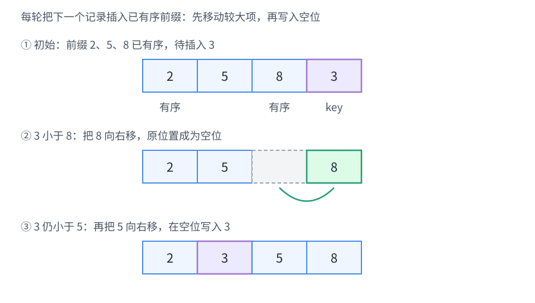
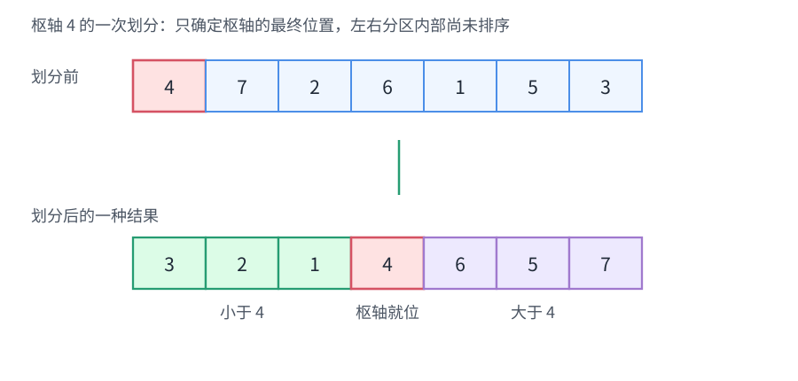
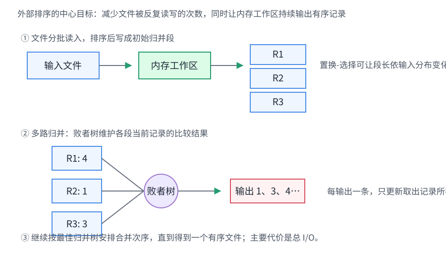

# 第8章 排序

要按关键字重排一组记录，应该根据数据规模、初始次序、稳定性要求、内存容量和 I/O 成本选择什么机制？

<strong>主线：</strong>
先明确要比较什么、数据能否全部装入内存，再看算法如何扩大有序范围或生成有序段，最后同时评价时间、辅助空间、稳定性与适用条件。

[返回全书知识树](00_全书总览.md) · [返回书籍入口](../数据结构_目录总图.md)

## 知识树

<strong style="color:#4b8ee8;">排序：按关键字重排记录</strong>
<ul style="list-style:none;margin:6px 0 0 8px;padding:0 0 0 18px;border-left:2px solid #8893A3;">
<li>─ <a href="#sorting-criteria">排序对象与评价</a>：时间、空间、稳定性、内外存</li>
<li>─ <strong>内部排序</strong>
<ul style="list-style:none;margin:0 0 6px 4px;padding-left:18px;border-left:1px solid #8893A3;">
<li>─ <strong>比较排序</strong>
<ul style="list-style:none;margin:0 0 6px 4px;padding-left:18px;border-left:1px solid #8893A3;">
<li>─ <strong>插入</strong>
<ul style="list-style:none;margin:0 0 6px 4px;padding-left:18px;border-left:1px solid #8893A3;">
<li>─ <a href="#insertion-sort">直接插入</a>：插入已有序前缀</li>
<li>─ <a href="#binary-insertion">折半插入</a>：少比较，仍需移动</li>
<li>─ <a href="#shell-sort">希尔排序</a>：按增量分组插入</li>
</ul></li>
<li>─ <strong>交换</strong>
<ul style="list-style:none;margin:0 0 6px 4px;padding-left:18px;border-left:1px solid #8893A3;">
<li>─ <a href="#bubble-sort">冒泡排序</a>：相邻逆序交换</li>
<li>─ <a href="#quick-sort">快速排序</a>：枢轴划分后递归</li>
</ul></li>
<li>─ <strong>选择</strong>
<ul style="list-style:none;margin:0 0 6px 4px;padding-left:18px;border-left:1px solid #8893A3;">
<li>─ <a href="#selection-sort">简单选择排序</a>：扫描未排序区选出极值</li>
<li>─ <a href="#heap-sort">堆排序</a>：利用堆顶反复确定极值位置</li>
</ul></li>
<li>─ <a href="#merge-sort">归并</a>：合并已有序段</li>
</ul></li>
<li>─ <a href="#non-comparison-sort">非比较排序</a>：基数 / 计数，利用关键字结构或值域</li>
</ul></li>
<li>─ <a href="#external-sort">外部排序</a>：置换-选择 / 败者树 / 最佳归并树</li>
<li>─ <a href="#boundaries">易错边界</a>：复杂度、稳定性与实现条件</li>
<li>─ <a href="#connections">跨章节连接</a>：完全二叉树、线性表与查找</li>
</ul>

## 先看结论

- <strong>排序不只看时间：</strong>同时核对辅助空间、稳定性、数据初始次序，以及数据是否能全部进入内存。
- <strong>比较排序的机制要分清：</strong>插入扩大有序前缀，快速排序划分区间，堆排序反复取堆顶，归并排序合并有序段。
- <strong>复杂度结论都绑定标准实现：</strong>快速排序的枢轴划分可能退化；希尔排序依赖增量序列；非比较排序依赖关键字表示或值域大小。
- <strong>稳定性是相等关键字记录的相对次序：</strong>若后续还按次关键字排序，稳定性可能直接影响最终结果。
- <strong>外部排序首先关心磁盘 I/O：</strong>减少归并趟数、改善初始归并段长度，常比减少少量内存比较更重要。

## 排序对象与评价

排序把记录按指定关键字的非降或非升关系重新排列。关键字相等时，若算法保持这些记录原有相对次序，则称为**稳定**；稳定不等于运行时间稳定，也不代表算法一定更快。

**时间复杂度**按比较、移动或分配操作随记录数 `n` 的增长分析；**辅助空间**包括临时数组和递归栈等额外存储，原地算法通常指只需常数级额外工作空间（递归栈是否计入应按题目口径）；**内部排序**可把待排记录整体放入内存处理，**外部排序**则需在外存文件与内存工作区之间分批读写。

<strong>评价要看约束：</strong>同样的时间复杂度下，稳定性、辅助空间、输入初始次序与数据所在存储层级，都可能决定算法是否合适。

## 插入排序：扩大已有序前缀

### 直接插入排序

把首条记录视为已有序前缀。每轮取出下一条记录，将较大的前缀记录向右移动，再把该记录放进空位；有序前缀长度随之增加 1。

*图示：取出 3 后先右移 8、5，再把 3 放入空位，有序前缀因此扩大。*

<strong>过程：</strong>每轮插入一个记录到有序前缀中，移动的是比它大的记录。

常见数组实现最好时间 `O(n)`（输入已非降序，内层无需移动），平均和最坏 `O(n²)`，辅助空间 `O(1)`；从后向前移动且只在关键字严格较大时移动，通常稳定。小规模或接近有序数据下移动较少；逆序时移动量最大。

### 折半插入排序

在已有序前缀中用折半查找决定插入位置，可把比较次数降到 `O(n log n)`；数组后缀仍要整体移动，最坏移动量为 `O(n²)`，所以总时间仍为 `O(n²)`。

<strong>稳定性条件：</strong>插入位置应放在已有相等关键字之后；若放到相等项之前，会改变相等记录的先后。

### 希尔排序

选一组逐步缩小并最终为 1 的增量，对相距该增量的记录分组做插入排序。大增量先跨步消除远距离逆序，最终增量 1 完成普通插入排序。它通常为原地且不稳定。

<strong>复杂度不能脱离增量序列：</strong>时间还取决于输入和具体实现，不能写成唯一固定阶；每个子序列排好也不代表全局已经有序。

## 交换排序：通过交换消除逆序

### 冒泡排序

多趟比较相邻记录，遇到逆序就交换；一次从左到右的扫描可把较大记录推向右端（也可反向扫描，把较小项推向左端）。标准相邻交换实现稳定、辅助空间 `O(1)`。

<strong>最好时间的条件：</strong>只有加入“本趟没有交换则提前结束”的标志，最好时间才为 `O(n)`；平均和最坏仍为 `O(n²)`。省略提前结束判断时，最好情况也需完成预定扫描。

### 快速排序

选一个枢轴，将区间划分为关键字不大于枢轴与不小于枢轴的两侧，再递归排序子区间。划分结束时枢轴位置确定，但两侧内部不一定有序。

*图示：一次划分只确定枢轴位置，左右两侧还需递归排序。*

常见原地划分实现平均时间 `O(n log n)`；每次枢轴都把区间分得极不均匀时，递归深度可到 `n`，最坏时间 `O(n²)`。随机枢轴或三数取中等策略改善常见输入的退化风险，但不改变最坏上界。常规原地实现不稳定；平均递归栈约 `O(log n)`，最坏可达 `O(n)`，尾递归优化可降低部分栈风险，但不消除坏划分的时间退化。

## 选择排序：每轮确定一个最终位置

### 简单选择排序

每趟扫描未排序区，选出最小项放到有序区末端。无论初始次序如何，常见实现都进行约 `n(n-1)/2` 次关键字比较，时间为 `Θ(n²)`；交换次数至多为 `n-1`，辅助空间 `O(1)`。

直接把最小项与边界项交换的版本通常不稳定，例如跨过相等关键字时会改变它们的相对次序。

### 堆排序

二叉堆使用完全二叉树的形状，并额外满足堆序：大根堆中父结点不小于孩子，小根堆则不大于孩子。堆序只约束父子，不代表左右子树整体有序。数组下标表示时，从 0 开始的结点 `i` 的孩子位置通常为 `2i+1`、`2i+2`；非叶结点自底向上筛选建大根堆，整体建堆为 `O(n)`。

升序堆排序先建大根堆，再交换堆顶与当前有效区末项，缩小有效堆区，并对新堆顶向下调整。每轮将当前最大值放到最终位置；约 `n` 次调整，每次 `O(log n)`，总时间最坏 `O(n log n)`。常见迭代原地实现辅助空间 `O(1)`，通常不稳定。

<strong>结构关联：</strong>堆的形状来自[第5章的完全二叉树](05_树与二叉树.md#binary-shapes)，但堆不是 BST；根的极值不能支持沿左右子树进行 BST 式查找。

## 归并排序：合并已有序段

二路归并把两个已有序段逐项比较，较小项先写入输出区；一个段耗尽后，把另一段剩余记录接到末尾。递归版反复拆分并合并；自底向上版从长度 1 的小段开始，两两合并、逐轮扩大段长。

数组版时间 `O(n log n)`、通常需 `O(n)` 辅助空间；相等关键字优先取左段可保持稳定。链表归并可通过改接链接减少额外数组，但实现和空间口径与数组版不同。

## 非比较排序：利用关键字结构或值域

### 基数排序

把关键字拆成有限位或若干位段，按位分配、收集。LSD 版本从最低位向最高位处理，每趟必须稳定，才能保留此前已排好的低位次序。若有 `d` 位、每位 `r` 种可能值，常见稳定分配实现时间为 `O(d(n+r))`，辅助空间通常 `O(n+r)`；结论依赖位数固定或受控且分配过程确实稳定。

### 计数排序

对整数或可映射到整数的有限值域计数，再用累计计数确定记录输出位置。值域大小为 `K` 时，常见实现时间和空间约为 `O(n+K)`；当 `K` 远大于 `n` 时，初始化计数表的代价会让它不划算。

若需要稳定排序，应从累计计数构造输出位置，并以保持原次序的方向扫描输入；直接把相同值写回计数槽的简化版本不一定保留记录稳定性。基数、计数排序是否属于必考范围以指定教材和考试范围为准。

## 外部排序：控制归并趟数与磁盘读写

**外部排序：让 I/O 趟数成为设计中心。** 文件大于可用内存时，先把若干批记录读入内存排序，写成**初始归并段**（run），再做多路归并。每一趟将输入段读入缓冲区、持续输出最小当前记录，并写出结果段；归并趟数、每趟读写量和缓冲区组织共同决定 I/O 成本。

*图示：内存分批生成初始有序段，再通过多路归并生成最终有序文件。*

- **置换-选择**生成初始段：工作区装满后，反复输出当前可接续本段的最小记录；新读入记录若不小于刚输出值，可继续留在当前段竞争，否则冻结到下一段。输入分布适合时，平均初始段可能长于内存容量，但不是固定长度，也不能无条件保证恰为两倍内存。
- **败者树**支持多路归并：叶端保存各段当前记录，内部结点保留比较中落败者，根路径可快速确定当前胜者。`k` 路归并每输出一条记录，常见调整代价为 `O(log k)` 次 CPU 比较；它减少选最小项的开销，不会自动减少必须读取的数据量。
- **最佳归并树**决定段的合并次序：较短段尽量较早参与合并，可降低各段被重复读写的总量；归并代价常按“段长 × 参与层数”求和。二路情形可用类似哈夫曼的最小权合并思想；若采用固定 `k` 路且段数不满足满 `k` 叉结构，需加入适当零长度虚段。它优化合并计划，不负责产生初始段或执行每条记录的选择。

## 重要方法比较

下表针对教材中常见的数组或顺序实现。不同枢轴策略、增量序列、稳定分配方式和辅助存储实现会改变相应结论。

| 方法 | 最好 / 平均 / 最坏时间 | 辅助空间 | 稳定性 | 结论成立的常见条件 |
|---|---|---|---|---|
| 直接插入 | `O(n)` / `O(n²)` / `O(n²)` | `O(1)` | 稳定 | 已序时内层不移动；最坏按逆序计 |
| 折半插入 | 比较 `O(n log n)`；移动最坏 `O(n²)` | `O(1)` | 可稳定 | 插入到相等项之后；数组仍需移动 |
| 希尔 | 依赖增量序列 | 常见 `O(1)` | 不稳定 | 不给增量序列不能断言唯一复杂度 |
| 冒泡 | `O(n)` / `O(n²)` / `O(n²)` | `O(1)` | 稳定 | 最好 `O(n)` 要有提前结束标志 |
| 快速 | `O(n log n)` / 平均 `O(n log n)` / `O(n²)` | 递归栈平均 `O(log n)`、最坏 `O(n)` | 常规实现不稳定 | 平均依赖划分较均衡；重复关键字处理也影响表现 |
| 简单选择 | `Θ(n²)` / `Θ(n²)` / `Θ(n²)` | `O(1)` | 通常不稳定 | 标准逐趟扫描选极值实现 |
| 堆排序 | `O(n log n)` / `O(n log n)` / `O(n log n)` | 迭代 `O(1)` | 通常不稳定 | 自底向上建堆 `O(n)`，每次根替换后筛选 `O(log n)` |
| 归并 | `O(n log n)` / `O(n log n)` / `O(n log n)` | 数组版常见 `O(n)` | 可稳定 | 合并相等项时优先取左段 |
| 基数 | `O(d(n+r))` | 常见 `O(n+r)` | 可稳定 | 每趟稳定，位数/基数受控 |
| 计数 | `O(n+K)` | 常见 `O(n+K)` | 可稳定 | 值域大小 `K` 适中；稳定输出需正确构造位置 |

<strong>据约束选方法：</strong>近乎有序的小表可考虑直接插入；要最坏 `O(n log n)` 且辅助空间紧张，可考虑堆排序；需要稳定且可用辅助空间时，常考虑归并；平均速度重要时可用快速排序，但须接受最坏退化风险；关键字位数或值域受控时再考虑基数或计数；文件不能整体装入内存时，按 I/O 量规划外部归并。

## 易错与边界

- **折半插入没有消除移动：** 它减少比较次数，不会把数组插入排序的总时间降为 `O(n log n)`。
- **希尔排序没有脱离增量序列的统一阶数：** 必须给出序列与分析模型。
- **快速排序平均快，不等于最坏有保证：** 枢轴持续偏斜时递归层数和时间都可能退化。
- **稳定性针对记录，不只针对数值：** 相等关键字记录之间的相对次序才是判断对象。
- **堆不是全局有序树：** 只保证父子堆序；取堆顶后必须缩小有效堆区并重新筛选。
- **归并排序的空间与实现有关：** 常见数组实现需 `O(n)` 暂存；链表改接的空间结论不能直接照搬。
- **基数排序逐趟稳定不可省：** 某一位排序若打乱低位已形成的相对次序，最终结果就可能错误。
- **计数排序看值域：** `K` 很大时，`O(n+K)` 可能比比较排序更耗时、占空间更多。
- **外部排序要算完整 I/O：** 败者树的 `O(log k)` 是选段的 CPU 比较开销，不代表总文件处理只需对数时间。
- **空间统计口径先说清：** 原地递归算法仍可能使用递归栈；题目对辅助空间的约定可能不同。

## 跨章节连接

- <strong>数组实现关联：</strong> [第3章：栈、队列和数组](03_栈队列数组.md)中的数组地址映射支持常见内部排序的下标访问。
- <strong>树结构关联：</strong> [第5章：树与二叉树](05_树与二叉树.md#binary-shapes)提供堆的完全二叉树形状；哈夫曼的带权合并思想也与最佳归并树相通。
- <strong>查找关联：</strong> [第7章：查找](07_查找.md#binary-search)中折半查找依赖关键字有序，排序可建立该条件，但动态维护有序性也有代价。

