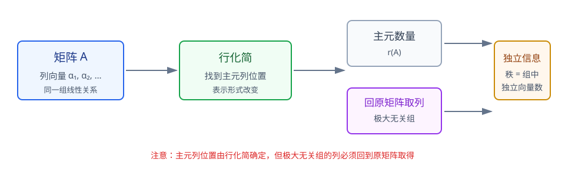
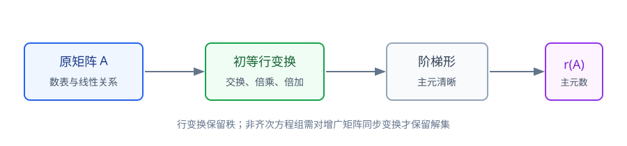
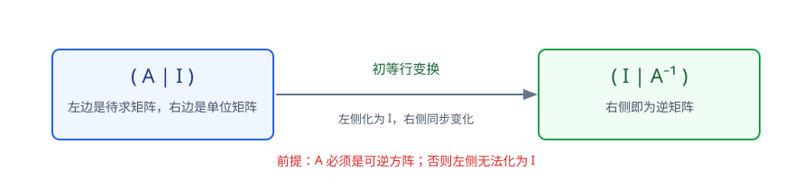

# 第2章 矩阵

> **本章要解决的问题：** 怎样用矩阵表示线性关系，再通过初等变换提取秩、求逆并解决矩阵方程？

<strong style="color:#16A34A;background:#F0FDF4;padding:2px 6px;border-radius:3px;">数学二主线</strong>

<strong style="color:#2563EB">一句话主线：</strong>
矩阵表示 → 初等变换 → 阶梯形与秩 → 逆矩阵 → 矩阵方程与关系边界。

[返回全书知识树](00_全书知识树.md) · [返回线性代数入口](../线性代数_目录总图.md)

## 本章知识树

<strong style="color:#2563EB;">矩阵：把线性关系表示出来，再把隐藏结构提取出来</strong>
<ul style="list-style:none;margin:8px 0;padding-left:18px;border-left:2px solid #94A3B8;">
  <li>├─ <a href="#operations">矩阵对象与运算</a>
    <ul style="list-style:none;margin:0;padding-left:18px;border-left:1px solid #CBD5E1;">
      <li>├─ 维数与可乘条件</li>
      <li>└─ 乘法、转置、单位矩阵</li>
    </ul>
  </li>
  <li>├─ <a href="#elementary">初等变换与行等价</a>
    <ul style="list-style:none;margin:0;padding-left:18px;border-left:1px solid #CBD5E1;">
      <li>├─ 阶梯形与主元</li>
      <li>└─ 同步变换与解集边界</li>
    </ul>
  </li>
  <li>├─ <a href="#rank">秩：数出独立信息</a>
    <ul style="list-style:none;margin:0;padding-left:18px;border-left:1px solid #CBD5E1;">
      <li>├─ 主元数</li>
      <li>└─ 满秩与可逆性</li>
    </ul>
  </li>
  <li>├─ <a href="#inverse">可逆性与逆矩阵</a>
    <ul style="list-style:none;margin:0;padding-left:18px;border-left:1px solid #CBD5E1;">
      <li>├─ 行列式/秩判据</li>
      <li>└─ 伴随矩阵与增广矩阵求逆</li>
    </ul>
  </li>
  <li>├─ <a href="#matrix-equation">矩阵方程</a>：先看未知矩阵在左边还是右边</li>
  <li>└─ <a href="#relations">行等价、相似、合同</a>：三种关系不混用</li>
</ul>

## 先看结论

- <strong style="color:#2563EB">核心：</strong>矩阵是数表；它的维数决定矩阵能否相加、相乘以及方程结果的形状。
- <strong style="color:#16A34A">方法：</strong>初等行变换把矩阵化为阶梯形，主元数给出秩。
- <strong style="color:#2563EB">关系：</strong>对 \(n\times n\) 方阵，\(r(A)=n\Longleftrightarrow |A|\ne0\Longleftrightarrow A^{-1}\) 存在。
- <strong style="color:#DC2626">边界：</strong>对非齐次方程组，只有对增广矩阵 \((A\mid b)\) 同步做行变换，才保持解集。
- <strong style="color:#9333EA">关联：</strong>矩阵秩会在向量组、线性方程组和特征子空间中反复出现。

## 1. 矩阵对象与基本运算

矩阵是按行、列排列的数表。若 \(A\in\mathbb R^{m\times p}\)，\(B\in\mathbb R^{p\times n}\)，则 \(AB\) 有定义且属于 \(\mathbb R^{m\times n}\)：

$$
(AB)_{ij}=\sum_{k=1}^{p}a_{ik}b_{kj}.
$$

<strong>变量角色：</strong>
\(p\) 是前一个矩阵的列数，也是后一个矩阵的行数；它是乘法的内维，不应固定写成结果矩阵的列数 \(n\)。

常用关系：

$$
(AB)^T=B^TA^T,\qquad AI=IA=A.
$$

矩阵乘法满足结合律和分配律，但一般不满足交换律。\(AB=0\) 也不能推出 \(A=0\) 或 \(B=0\)。

<strong>易错：</strong>
先检查维数，再判断运算；不能把矩阵乘法当作对应元素相乘，也不能随意交换因子顺序。

## 2. 初等变换与行等价

三类初等行变换是：

1. 交换两行；
2. 某行乘非零常数；
3. 某行加上另一行的倍数。

它们把矩阵改写成更容易判断的形式。最重要的目标是得到阶梯形，使主元位置清楚。

<strong>图注：</strong>该图只保留“主元数量决定秩”的关系；极大无关组的完整判断和取列规则在[第3章向量组](03_向量组.md#rank)展开。

<strong>核心过程：</strong>
原矩阵 → 初等行变换 → 阶梯形 → 识别主元 → 读取秩或解结构。

<strong>条件边界：</strong>
对齐次方程组 \(Ax=0\)，对系数矩阵 \(A\) 做初等行变换可以保持解集；对非齐次方程组 \(Ax=b\)，必须对增广矩阵 \((A\mid b)\) 同步变换。

若两个同型矩阵可以互相通过初等行变换得到，则称它们行等价。行等价主要服务于消元、求秩和解方程组。

## 3. 秩：从阶梯形读出独立信息

把矩阵化为阶梯形后，非零行数或主元数量就是矩阵的秩：

$$
r(A)=\text{阶梯形中的主元数}.
$$

<strong>图注：</strong>求秩的稳定流程是“行化简—找主元—数主元”，不能把原矩阵中的非零元素数量直接当作秩。

常用性质：

$$
r(A)=r(A^T),\qquad r(AB)\le \min\{r(A),r(B)\}.
$$

对 \(n\times n\) 方阵：

$$
r(A)=n\Longleftrightarrow |A|\ne0\Longleftrightarrow A^{-1}\text{存在}.
$$

<strong>限制：</strong>
不能直接数原矩阵中的非零元素判断秩；必须先利用等价变换得到阶梯形，或使用其他等价判据。

### 短例：从阶梯形读取秩

$$
A=\begin{pmatrix}1&2&3\\2&4&6\\1&1&1\end{pmatrix}
\xrightarrow{R_2-2R_1,\ R_3-R_1}
\begin{pmatrix}1&2&3\\0&0&0\\0&-1&-2\end{pmatrix}
\sim
\begin{pmatrix}1&2&3\\0&-1&-2\\0&0&0\end{pmatrix}.
$$

阶梯形有两个主元，所以 \(r(A)=2\)。中间结果还需要交换非零行与全零行的位置，才能符合标准阶梯形顺序。

矩阵的列向量组构成一个向量组，其秩等于矩阵秩；极大无关组的完整解释见[第3章向量组](03_向量组.md#rank)。

## 4. 可逆性与逆矩阵

若存在矩阵 \(A^{-1}\)，使

$$
AA^{-1}=A^{-1}A=I,
$$

则称方阵 \(A\) 可逆。可逆方阵的等价条件是：

$$
|A|\ne0
\Longleftrightarrow r(A)=n
\Longleftrightarrow A^{-1}\text{存在}
\Longleftrightarrow Ax=0\text{只有零解}.
$$

### 伴随矩阵求逆

记 \(A^*\) 为代数余子式矩阵的转置，则

$$
AA^*=A^*A=|A|I.
$$

当 \(|A|\ne0\) 时：

$$
A^{-1}=\frac{1}{|A|}A^*.
$$

<strong>成立条件：</strong>
该公式要求 \(A\) 是可逆方阵；非方阵不能直接套用 \(A^{-1}\)。

### 增广矩阵求逆

$$
(A\mid I)\longrightarrow(I\mid A^{-1}).
$$

<strong>图注：</strong>左侧 \(A\) 与右侧单位矩阵 \(I\) 必须同步进行同一组行变换；左侧化为 \(I\) 时，右侧正好变成 \(A^{-1}\)。

### 短例：增广矩阵求逆

$$
\left[\begin{array}{cc|cc}1&2&1&0\\3&4&0&1\end{array}\right]
\longrightarrow
\left[\begin{array}{cc|cc}1&0&-2&1\\0&1&\frac32&-\frac12\end{array}\right].
$$

因此

$$
\begin{pmatrix}1&2\\3&4\end{pmatrix}^{-1}
=\begin{pmatrix}-2&1\\\frac32&-\frac12\end{pmatrix}.
$$

<strong>使用信号：</strong>
题目要求实际算出逆矩阵时，通常优先写 \((A\mid I)\)，再通过行变换把左侧化为 \(I\)。

## 5. 矩阵方程：先看未知矩阵在哪一侧

若 \(A\) 可逆：

$$
AX=B\Longrightarrow X=A^{-1}B,
\qquad
XA=B\Longrightarrow X=BA^{-1}.
$$

<strong>解题步骤：</strong>
先确认方程两边维数一致 → 看未知矩阵 \(X\) 在左侧还是右侧 → 从相反侧乘 \(A^{-1}\) → 代回检查。

### 短例：左右乘法不能混

若 \(AX=B\)，只能在左侧乘 \(A^{-1}\)：

$$
A^{-1}(AX)=A^{-1}B\Longrightarrow X=A^{-1}B.
$$

若 \(XA=B\)，则应在右侧乘 \(A^{-1}\)：

$$
(XA)A^{-1}=BA^{-1}\Longrightarrow X=BA^{-1}.
$$

<strong>易错：</strong>
矩阵一般不可交换，因此不能把两个结果写成同一个顺序。

### 短例：实际解一个矩阵方程

设

$$
A=\begin{pmatrix}1&1\\0&1\end{pmatrix},
\qquad
B=\begin{pmatrix}2&3\\1&2\end{pmatrix},
\qquad AX=B.
$$

因为 \(A^{-1}=\begin{pmatrix}1&-1\\0&1\end{pmatrix}\)，所以

$$
X=A^{-1}B
=\begin{pmatrix}1&1\\1&2\end{pmatrix}.
$$

回代可得 \(AX=B\)，这一步同时检查了乘法顺序和计算结果。

## 6. 行等价、相似、合同：变换目的不同

| 关系 | 形式 | 主要用途 | 典型保持量 |
|---|---|---|---|
| 行等价 | 初等行变换 | 消元、求秩、解方程组 | 秩；对增广矩阵同步变换时保持解集 |
| 相似 | \(B=P^{-1}AP\) | 特征值与对角化 | 特征多项式、迹、行列式 |
| 合同 | \(B=P^TAP\) | 二次型标准形与正定性 | 实对称二次型的惯性结构 |

<strong>边界：</strong>
“都是把矩阵变成另一种形式”不代表三种关系可以互换。相似变换处理特征结构，合同变换处理二次型，行等价处理消元结构。

## 7. 典型方法

1. **求秩：**化阶梯形 → 数主元 → 检查参数是否改变主元。
2. **求逆：**确认是可逆方阵 → 写 \((A\mid I)\) → 化为 \((I\mid A^{-1})\)。
3. **解矩阵方程：**先看 \(X\) 的左右位置 → 检查维数 → 从对应一侧乘逆矩阵。
4. **处理非齐次方程组：**对 \((A\mid b)\) 同步行变换，不能只改 \(A\)。

## 8. 易错与边界

- \(r(A)\) 的主元数必须从阶梯形读取，不能数原矩阵非零元素。
- 只对系数矩阵 \(A\) 行变换，不足以保证非齐次 \(Ax=b\) 的解集不变。
- 满秩与可逆等价只在方阵语境下直接使用。
- \(A^2=0\) 不代表 \(A=0\)。
- 相似、合同和行等价的形式与保持量不同。

## 9. 跨章节连接

<strong>关联：</strong>矩阵是后续章节的共同表示工具。

- [行列式](01_行列式.md#invertibility)：行列式给出方阵可逆性判据。
- [向量组](03_向量组.md#rank)：列向量组秩等于矩阵秩。
- [线性方程组](04_线性方程组.md#elimination)：消元直接使用初等行变换。
- [特征值](05_特征值与特征向量.md#definition)：特征向量问题是特殊齐次方程组。
- [二次型](06_二次型.md#congruence)：二次型使用合同变换。
