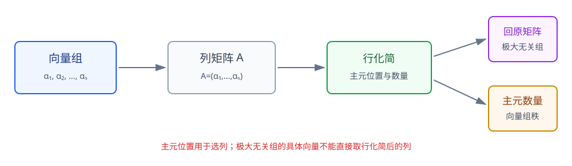

# 第3章 向量组

> **本章要解决的问题：** 一个向量能否由其他向量表示？表示是否唯一？一组向量中有多少独立信息？

<strong style="color:#16A34A;background:#F0FDF4;padding:2px 6px;border-radius:3px;">数学二主线：表示、相关性、极大无关组与秩</strong>
<strong style="color:#9333EA;background:#FAF5FF;padding:2px 6px;border-radius:3px;">基、维数、坐标、内积与施密特：教材扩展</strong>

<strong style="color:#2563EB">一句话主线：</strong>
线性组合 → 表示存在与唯一 → 相关/无关 → 极大无关组 → 向量组秩与生成空间。

[返回全书知识树](00_全书知识树.md) · [返回线性代数入口](../线性代数_目录总图.md)

## 本章知识树

<strong style="color:#2563EB;">向量组：研究生成能力、表示唯一性和独立信息</strong>
<ul style="list-style:none;margin:8px 0;padding-left:18px;border-left:2px solid #94A3B8;">
  <li>├─ <a href="#combination">线性表示</a>
    <ul style="list-style:none;margin:0;padding-left:18px;border-left:1px solid #CBD5E1;">
      <li>├─ 线性组合</li>
      <li>└─ <a href="#existence">表示存在性</a>：<i>β</i>∈span</li>
    </ul>
  </li>
  <li>├─ <a href="#dependence">相关与无关</a>
    <ul style="list-style:none;margin:0;padding-left:18px;border-left:1px solid #CBD5E1;">
      <li>├─ 齐次组合</li>
      <li>└─ 秩判据</li>
    </ul>
  </li>
  <li>├─ <a href="#uniqueness">表示唯一性</a>：存在 + 生成组无关</li>
  <li>├─ <a href="#equivalent-groups">等价向量组</a>：生成空间相同
  </li>
  <li>├─ <a href="#max-independent">极大无关组与向量组秩</a>
    <ul style="list-style:none;margin:0;padding-left:18px;border-left:1px solid #CBD5E1;">
      <li>├─ 主元列位置</li>
      <li>└─ 回原矩阵取列</li>
    </ul>
  </li>
  <li>└─ <a href="#geometry">向量的几何结构</a>
    <ul style="list-style:none;margin:0;padding-left:18px;border-left:1px solid #CBD5E1;">
      <li>├─ 基、维数与坐标</li>
      <li>└─ 内积与施密特正交规范化</li>
    </ul>
  </li>
</ul>

## 先看结论

- <strong style="color:#2563EB">核心：</strong>把向量按列组成矩阵，表示问题就变成 $Ax=\beta$ 的方程组问题。
- <strong style="color:#2563EB">判据：</strong>$\beta$ 可表示 $\Longleftrightarrow r(A)=r(A\mid\beta)$。
- <strong style="color:#2563EB">关系：</strong>表示唯一需要两个条件：表示存在，且生成向量组线性无关。
- <strong style="color:#16A34A">方法：</strong>行化简找主元列位置，再回到原矩阵取列构造极大无关组。
- <strong style="color:#2563EB">结构：</strong>向量组秩 = 极大无关组向量个数 = 列矩阵秩 = 生成空间维数。
- <strong style="color:#DC2626">边界：</strong>行变换后矩阵的列一般不再对应原向量，不能直接拿变换后的列当极大无关组。

## 1. 线性组合与表示

若

$$
\beta=k_1\alpha_1+\cdots+k_s\alpha_s,
$$

则称 $\beta$ 可由向量组 $\alpha_1,\ldots,\alpha_s$ 线性表示。把向量按列组成

$$
A=(\alpha_1,\ldots,\alpha_s),
$$

并令 $x=(k_1,\ldots,k_s)^T$，就得到

$$
Ax=\beta.
$$

因此，向量组的生成能力可以通过矩阵和方程组统一研究。

### 表示存在性

$\beta$ 至少有一种表示，当且仅当

$$
r(A)=r(A\mid\beta).
$$

<strong>使用步骤：</strong>
组成列矩阵 $A$ → 把 $\beta$ 添到右侧 → 比较两个秩 → 若相等，再求具体系数。

<strong>易错：</strong>
秩相等只能说明“至少有一种表示”，不能自动说明表示唯一。

### 完整短例：判断表示、求系数并判断唯一性

取

$$
\alpha_1=\begin{pmatrix}1\\0\\1\end{pmatrix},\quad
\alpha_2=\begin{pmatrix}0\\1\\1\end{pmatrix},\quad
\beta=\begin{pmatrix}2\\3\\5\end{pmatrix}.
$$

组成列矩阵 $A=(\alpha_1,\alpha_2)$。求 $Ax=\beta$：

$$
c_1\alpha_1+c_2\alpha_2=\beta
\Longleftrightarrow
\begin{cases}
c_1=2,\\
c_2=3,\\
c_1+c_2=5.
\end{cases}
$$

因此 $\beta=2\alpha_1+3\alpha_2$。由于 $\alpha_1,\alpha_2$ 线性无关，表示唯一。这里也可看到：先判断存在，再用生成组无关性判断唯一。

## 2. 线性相关与无关

若

$$
k_1\alpha_1+\cdots+k_s\alpha_s=0
$$

只有全零解，则向量组线性无关；存在不全为零的系数使等式成立，则向量组线性相关。

若 $A=(\alpha_1,\ldots,\alpha_s)$，则

$$
\alpha_1,\ldots,\alpha_s\text{线性无关}
\Longleftrightarrow
Ax=0\text{只有零解}
\Longleftrightarrow
r(A)=s.
$$

在 $n$ 维空间中，向量个数超过 $n$ 时必相关；但具体题目仍要结合秩、方程组或明显的线性关系判断。

<strong>边界：</strong>
两两不成比例只能排除最简单的相关情形，不能保证整个向量组无关。

## 3. 表示的唯一性

若 $\beta$ 可由 $\alpha_1,\ldots,\alpha_s$ 表示，则表示唯一当且仅当生成向量组线性无关。

也就是说：

$$
\text{表示唯一}
\Longleftrightarrow
\text{表示存在}+\text{生成组线性无关}.
$$

若生成向量组相关，则存在非零系数 $c$ 使 $Ac=0$。一组表示 $Ax=\beta$ 可以沿着 $c$ 改变，因而通常不唯一。

<strong>短例：</strong>
若 $\alpha_3=\alpha_1+\alpha_2$，则同一向量的表示可以把 $\alpha_3$ 换成 $\alpha_1+\alpha_2$，所以生成组相关时要警惕表示不唯一。

## 4. 等价向量组

若两个向量组中的每个向量都能由另一个向量组线性表示，则称它们等价。等价向量组生成同一个空间：

$$
\operatorname{span}\{\alpha_1,\ldots,\alpha_s\}
=
\operatorname{span}\{\beta_1,\ldots,\beta_t\}.
$$

等价向量组的秩相同，但具体向量个数可以不同。求极大无关组，本质上是在原向量组中选出一个与原组等价且线性无关的子组。

<strong>边界：</strong>
向量个数相同或秩相同不自动说明两个向量组等价，还要确认它们生成的空间相同。

### 短例：实际判断两个向量组是否等价

设

$$
\mathcal A=(\alpha_1,\alpha_2,\alpha_1+\alpha_2),\qquad
\mathcal B=(\alpha_1,\alpha_2).
$$

$\mathcal A$ 中每个向量都能由 $\mathcal B$ 表示，$\mathcal B$ 中的向量又直接属于 $\mathcal A$，所以两组生成同一空间，因而等价。第三个向量增加了组内冗余，但不增加生成空间的维数。

## 5. 极大无关组与向量组秩

极大无关组同时满足：

1. 其中向量线性无关；
2. 原向量组中的每个向量都能由它表示。

把向量组作为列矩阵行化简后，主元列的位置确定原矩阵中的哪些列可以作为极大无关组。**取列时必须回到原矩阵。**

### 向量组的秩

向量组的秩定义为极大无关组中向量的个数：

$$
\operatorname{rank}(\alpha_1,\ldots,\alpha_s)
=r(A)
=\dim\operatorname{span}\{\alpha_1,\ldots,\alpha_s\}.
$$

极大无关组可能不唯一，但其向量个数唯一。

<strong>图注：</strong>向量组先按列组成矩阵，行化简只用于确定主元位置；取极大无关组时要回到原矩阵读取对应主元列，不能直接把阶梯形的列当作原向量。

<strong>典型方法：</strong>
列向量排成矩阵 → 行化简 → 记录主元列位置 → 回原矩阵取对应列 → 写出秩。

### 短例：相关性与秩

$$
\alpha_1=\begin{pmatrix}1\\0\\1\end{pmatrix},\quad
\alpha_2=\begin{pmatrix}0\\1\\1\end{pmatrix},\quad
\alpha_3=\begin{pmatrix}1\\1\\2\end{pmatrix}.
$$

因为 $\alpha_3=\alpha_1+\alpha_2$，所以三向量相关，向量组秩为 $2$；$\{\alpha_1,\alpha_2\}$ 是一个极大无关组。

## 6. 基、维数、坐标与正交（教材扩展）

### 基与维数

一个向量空间的基是其中一组线性无关且能生成整个空间的向量组。基中向量的个数称为空间的维数。相对于固定基，每个向量都有唯一的坐标表示。

<strong>关系：</strong>
“能生成”保证表示存在，“线性无关”保证表示唯一；二者合起来才构成基。

### 内积与正交

在 $\mathbb R^n$ 中，常用内积为

$$
\langle \alpha,\beta\rangle=\alpha^T\beta.
$$

若 $\langle\alpha,\beta\rangle=0$，则称两向量正交；长度为 $1$ 的正交向量组称为规范正交组。

### 施密特正交规范化

对线性无关组 $\alpha_1,\ldots,\alpha_s$，依次消去前面方向的投影：

$$
\beta_k=\alpha_k-\sum_{j=1}^{k-1}
\frac{\langle\alpha_k,\beta_j\rangle}{\langle\beta_j,\beta_j\rangle}\beta_j,
\qquad
e_k=\frac{\beta_k}{\|\beta_k\|}.
$$

<strong>使用信号：</strong>
题目要求正交组、规范正交基或正交矩阵时，先用施密特方法得到彼此正交的向量，再逐个单位化。

<strong>条件：</strong>
施密特正交化的输入必须是线性无关组；若某一步得到零向量，说明输入组存在相关性或前置计算有误。

## 7. 典型方法

1. <strong>判断能否表示：</strong>比较 $r(A)$ 与 $r(A\mid\beta)$。
2. <strong>判断唯一性：</strong>先确认表示存在，再检查生成向量组是否无关。
3. <strong>求极大无关组：</strong>行化简找主元位置，回原矩阵取列。
4. <strong>求向量组秩：</strong>用列矩阵主元数或极大无关组个数。
5. <strong>求规范正交组：</strong>施密特正交化，再统一单位化。

## 8. 易错与边界

- 极大无关组不一定唯一，但其个数唯一。
- 主元列位置由行化简确定，主元列本身必须从原矩阵取得。
- 表示存在不等于表示唯一。
- 向量组秩不是向量个数，也不是矩阵元素个数。
- 施密特正交化要求输入向量组线性无关。

## 9. 跨章节连接

<strong>关联：</strong>
向量组把矩阵秩解释成独立信息，并把表示问题连接到方程组；正交规范化又是实对称矩阵正交对角化的前置工具。

- [矩阵的秩](02_矩阵.md#rank)：列向量组秩等于矩阵秩。
- [线性方程组](04_线性方程组.md#model)：$Ax=\beta$ 就是表示问题。
- [特征值与特征向量](05_特征值与特征向量.md#symmetric)：正交特征向量和正交矩阵。
