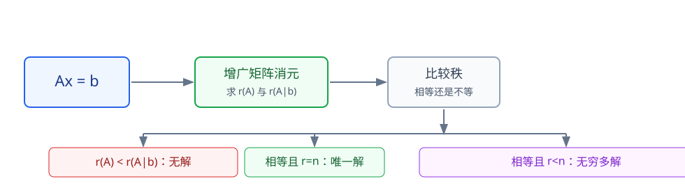
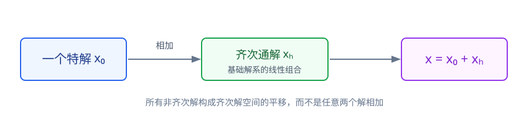
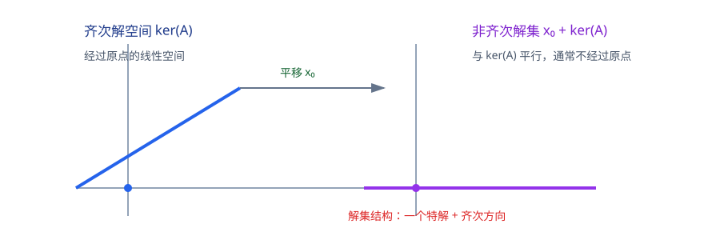

# 第4章 线性方程组

> **本章要解决的问题：** 方程组何时有解、解有多少，以及怎样把解写成“特解 + 齐次解”的结构？

<strong style="color:#16A34A;background:#F0FDF4;padding:2px 6px;border-radius:3px;">数学二主线</strong>

<strong style="color:#2563EB">一句话主线：</strong>
$Ax=b$ → 增广矩阵 → 秩判定 → 高斯消元 → 自由变量 → 解空间与通解。

[返回全书知识树](00_全书知识树.md) · [返回线性代数入口](../线性代数_目录总图.md)

## 本章知识树

<strong style="color:#2563EB;">线性方程组：从 <i>Ax</i>=<i>b</i> 判断相容性，再描述解空间</strong>
<ul style="list-style:none;margin:8px 0;padding-left:18px;border-left:2px solid #94A3B8;">
  <li>├─ <a href="#model">矩阵模型</a>
    <ul style="list-style:none;margin:0;padding-left:18px;border-left:1px solid #CBD5E1;">
      <li>├─ 系数矩阵与增广矩阵</li>
      <li>└─ 列向量表示</li>
    </ul>
  </li>
  <li>├─ <a href="#rank-judgement">秩一致性与解的类型</a>
    <ul style="list-style:none;margin:0;padding-left:18px;border-left:1px solid #CBD5E1;">
      <li>├─ 无解</li>
      <li>├─ 唯一解</li>
      <li>└─ 无穷多解</li>
    </ul>
  </li>
  <li>├─ <a href="#elimination">高斯消元</a>
    <ul style="list-style:none;margin:0;padding-left:18px;border-left:1px solid #CBD5E1;">
      <li>├─ 主元与矛盾行</li>
      <li>└─ 自由变量与参数化</li>
    </ul>
  </li>
  <li>├─ <a href="#homogeneous">齐次方程组</a>：零解、基础解系与解空间</li>
  <li>└─ <a href="#nonhomogeneous">非齐次方程组</a>：特解 + 齐次通解</li>
</ul>

## 先看结论

- <strong style="color:#2563EB">相容性：</strong>$Ax=b$ 有解 $\Longleftrightarrow r(A)=r(A\mid b)$。
- <strong style="color:#2563EB">解的类型：</strong>相容后，$r=n$ 是唯一解，$r<n$ 是无穷多解；这里 $n$ 是未知数个数。
- <strong style="color:#16A34A">方法：</strong>增广矩阵消元 → 识别主元和自由变量 → 参数化 → 回代检查。
- <strong style="color:#2563EB">结构：</strong>齐次解空间的维数为 $n-r(A)$；非齐次解集是一个特解平移齐次解空间。
- <strong style="color:#DC2626">边界：</strong>自由变量个数是维数，不是解的总数；无解时不能讨论自由变量对应的通解。

## 1. 从方程组到矩阵模型

线性方程组写成

$$
Ax=b,
$$

其中 $A$ 是系数矩阵，$x$ 是未知向量，$b$ 是常数向量。把 $b$ 拼到 $A$ 的右侧得到增广矩阵 $(A\mid b)$。

从列向量角度看，$Ax=b$ 就是判断 $b$ 能否由 $A$ 的列向量组线性表示：

$$
b=x_1\alpha_1+\cdots+x_n\alpha_n.
$$

<strong>关联：</strong>
这正是第3章的向量表示问题；本章进一步关心解是否存在、是否唯一，以及所有解怎样组成一个集合。

## 2. 秩一致性：先判断解的类型

设未知数有 $n$ 个。对非齐次方程组：

$$
r(A)<r(A\mid b)\Longrightarrow\text{无解}.
$$

若

$$
r(A)=r(A\mid b)=r,
$$

则方程组有解；进一步：

$$
\begin{cases}
r=n &\Longrightarrow \text{唯一解},\\
r<n &\Longrightarrow \text{无穷多解}.
\end{cases}
$$

<strong>判断顺序：</strong>
先比较 $r(A)$ 和 $r(A\mid b)$ 判断是否相容；只有相容后，才能用 $r$ 与 $n$ 的关系区分唯一解和无穷多解。

<strong>图注：</strong>先比较 $r(A)$ 与 $r(A\mid b)$ 判断是否有解，再在有解时比较它们与未知数个数 $n$ 的关系。

## 3. 高斯消元：把解结构显出来

<strong>基本流程：</strong>

1. 写出增广矩阵 $(A\mid b)$；
2. 选择主元，必要时交换行；
3. 用主元消去下方元素，得到阶梯形；
4. 检查是否出现矛盾行 $[0\ \cdots\ 0\mid c]$，其中 $c\ne0$；
5. 若相容，区分主元变量和自由变量，再回代或参数化。

初等行变换不会改变方程组的解集，前提是对完整增广矩阵同步操作。

### 完整短例：从原方程组到通解

考虑

$$
\begin{cases}
x+y+z=1,\\
2x+2y+2z=2,\\
x-y+z=3.
\end{cases}
$$

增广矩阵为

$$
\left[
\begin{array}{ccc|c}
1&1&1&1\\
2&2&2&2\\
1&-1&1&3
\end{array}
\right].
$$

作 $R_2\leftarrow R_2-2R_1$、$R_3\leftarrow R_3-R_1$，得到一个尚未按阶梯形顺序整理的中间矩阵：

$$
\left[
\begin{array}{ccc|c}
1&1&1&1\\
0&-2&0&2\\
0&0&0&0
\end{array}
\right].
$$

交换第二、三行后得到标准阶梯形，于是 $y=-1$，而 $x+z=2$。令自由变量 $z=t$，得到

$$
x=2-t,\qquad
\mathbf{x}=
\begin{pmatrix}2\\-1\\0\end{pmatrix}
+t\begin{pmatrix}-1\\0\\1\end{pmatrix}.
$$

<strong>读法：</strong>
第一项是一个特解，第二项是齐次解空间中的方向；自由变量 $z$ 只有一个，所以解空间维数为 $1$。

## 4. 齐次方程组：基础解系与解空间

齐次方程组

$$
Ax=0
$$

总有零解。若 $r(A)=n$，则只有零解；若 $r(A)=r<n$，则有 $n-r$ 个自由变量，并可取 $n-r$ 个线性无关解组成基础解系。

齐次通解可以写成

$$
x=c_1\eta_1+\cdots+c_{n-r}\eta_{n-r}.
$$

这里的解集记作 $\ker(A)$，它是一个维数为 $n-r$ 的线性空间。

### 完整短例：从自由变量构造基础解系

考虑

$$
\begin{cases}
x_1+x_2+x_3=0,\\
x_1-x_2+x_3=0.
\end{cases}
$$

相减得 $2x_2=0$，所以 $x_2=0$，再由第一式得 $x_1=-x_3$。令自由变量 $x_3=t$，则

$$
x=t\begin{pmatrix}-1\\0\\1\end{pmatrix}.
$$

因此基础解系可取

$$
\eta_1=\begin{pmatrix}-1\\0\\1\end{pmatrix},
$$

它线性无关且能表示齐次方程组全部解；这里 $r(A)=2$、未知数个数 $n=3$，所以
$\dim\ker(A)=n-r(A)=1$。

<strong>边界：</strong>
“方程个数少于未知数”只是提示，严格结论仍要由 $r(A)$ 判断；基础解系必须线性无关且能表示齐次方程组的全部解。

## 5. 非齐次方程组：特解加齐次通解

若 $x_0$ 是 $Ax=b$ 的一个特解，$x_h$ 是 $Ax=0$ 的通解，则

$$
x=x_0+x_h
$$

是 $Ax=b$ 的全部解。

<strong>图注：</strong>非齐次解集不是齐次解空间本身，而是特解 $x_0$ 沿着 $\ker(A)$ 平移得到的集合 $x_0+\ker(A)$。

<strong>图注：</strong>图中把齐次解空间和非齐次解集并列表示，强调二者方向相同但位置可能不同。

<strong>几何关系：</strong>
$\ker(A)$ 经过原点；非齐次解集 $x_0+\ker(A)$ 与它平行，但通常不经过原点。

## 6. 典型方法

| 目标 | 操作顺序 | 必要条件 |
|---|---|---|
| 判断有无解 | 比较 $r(A)$ 与 $r(A\mid b)$ | 两个秩相等才相容 |
| 判断唯一解 | 消元后无自由变量 | $r(A)=r(A\mid b)=n$ |
| 写无穷多解通解 | 阶梯形 + 自由变量参数化 | $r(A)=r(A\mid b)=r<n$ |
| 求齐次基础解系 | 解 $Ax=0$，令自由变量逐个取值 | 基础解系线性无关 |
| 讨论参数 | 分参数取值检查主元变化 | 参数可能改变秩 |

## 7. 易错与边界

- 无解的标志是增广矩阵出现矛盾行，等价于 $r(A)<r(A\mid b)$。
- 自由变量数是 $n-r$，不是解的总数。
- “特解 + 齐次通解”中的特解必须确实满足 $Ax=b$。
- 只对 $A$ 行变换而不变 $b$，不能直接声称非齐次解集不变。

## 8. 跨章节连接

<strong>关联：</strong>
方程组是矩阵秩、向量表示和特征值问题的共同落点。

- [矩阵初等变换](02_矩阵.md#elementary)：消元使用同一套行变换。
- [向量组表示](03_向量组.md#existence)：$Ax=b$ 等价于判断 $b$ 是否在列向量生成空间中。
- [特征值](05_特征值与特征向量.md#definition)：$(A-\lambda I)x=0$ 是特殊齐次方程组。
