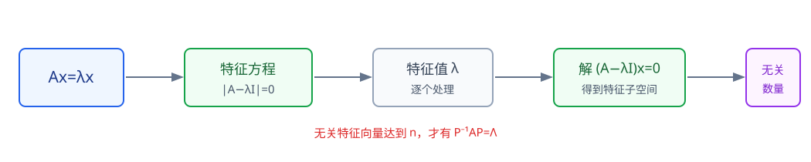
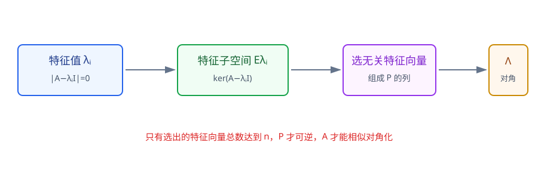
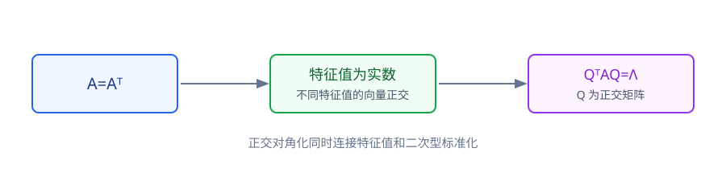

# 第5章 特征值与特征向量

> **本章要解决的问题：** 哪些方向经过矩阵作用后方向不变，只改变一个倍数？矩阵什么时候可以换一组基变成对角矩阵？

<strong style="color:#16A34A;background:#F0FDF4;padding:2px 6px;border-radius:3px;">数学二主线</strong>

<strong style="color:#2563EB">一句话主线：</strong>
特征方程 → 特征子空间 → 重数比较 → 相似对角化 → 实对称矩阵正交对角化。

[返回全书知识树](00_全书知识树.md) · [返回线性代数入口](../线性代数_目录总图.md)

## 本章知识树

<strong style="color:#2563EB;">特征结构：从不变方向找到更简单的矩阵表示</strong>
<ul style="list-style:none;margin:8px 0;padding-left:18px;border-left:2px solid #94A3B8;">
  <li>├─ <a href="#definition">特征方程</a>
    <ul style="list-style:none;margin:0;padding-left:18px;border-left:1px solid #CBD5E1;">
      <li>└─ \(|A-\lambda I|=0\)</li>
    </ul>
  </li>
  <li>├─ <a href="#eigenspace">特征子空间</a>
    <ul style="list-style:none;margin:0;padding-left:18px;border-left:1px solid #CBD5E1;">
      <li>└─ \(\ker(A-\lambda I)\)</li>
    </ul>
  </li>
  <li>├─ <a href="#multiplicity">代数重数与几何重数</a>
    <ul style="list-style:none;margin:0;padding-left:18px;border-left:1px solid #CBD5E1;">
      <li>└─ 重数比较 → 对角化判断</li>
    </ul>
  </li>
  <li>├─ <a href="#diagonalization">相似对角化</a>：无关特征向量组成换基矩阵 \(P\)</li>
  <li>└─ <a href="#symmetric">实对称矩阵</a>
    <ul style="list-style:none;margin:0;padding-left:18px;border-left:1px solid #CBD5E1;">
      <li>├─ 实特征值</li>
      <li>└─ 正交特征向量与正交对角化</li>
    </ul>
  </li>
</ul>

## 先看结论

- <strong style="color:#2563EB">定义：</strong>\(\lambda\) 是特征值，当且仅当存在非零向量 \(x\) 使 \(Ax=\lambda x\)。
- <strong style="color:#16A34A">方法：</strong>特征方程求 \(\lambda\) → 解 \((A-\lambda I)x=0\) → 得特征子空间。
- <strong style="color:#2563EB">判据：</strong>有 \(n\) 个线性无关特征向量，才可相似对角化。
- <strong style="color:#2563EB">关系：</strong>特征值之和等于迹，特征值之积等于行列式，均按代数重数计。
- <strong style="color:#DC2626">边界：</strong>特征值重复不等于不能对角化，必须比较每个特征值的几何重数。

## 1. 定义与特征方程

若存在非零向量 \(x\)，使

$$
Ax=\lambda x,
$$

则称 \(\lambda\) 为特征值，\(x\) 为对应特征向量。移项得到

$$
(A-\lambda I)x=0.
$$

要有非零解，必须满足

$$
|A-\lambda I|=0.
$$

这就是特征方程。对 \(n\times n\) 矩阵，特征多项式的根按代数重数计数。

<strong>易错：</strong>
零向量永远不称为特征向量；特征值是标量，特征向量是非零向量，二者角色不同。

## 2. 特征子空间：同一特征值对应一组方向

对已知特征值 \(\lambda_i\)，解

$$
(A-\lambda_i I)x=0
$$

得到特征子空间

$$
E_{\lambda_i}=\ker(A-\lambda_i I).
$$

其中所有非零向量都是对应特征向量，零向量属于特征子空间但不属于特征向量集合。

<strong>图注：</strong>流程的关键不是只求出特征值，而是继续求每个特征值的特征子空间；后续能否找到足够多的无关特征向量，决定是否可对角化。

## 3. 代数重数与几何重数

- **代数重数：**\(\lambda\) 作为特征多项式根的重复次数；
- **几何重数：**特征子空间的维数，即
  \[
  \dim E_\lambda=\dim\ker(A-\lambda I).
  \]

对每个特征值总有

$$
1\le \text{几何重数}\le \text{代数重数}.
$$

矩阵可对角化，当且仅当所有特征值对应的特征子空间维数之和为 \(n\)，等价地，每个特征值的几何重数等于其代数重数。

### 重复特征值短例

设

$$
A=\begin{pmatrix}1&1\\0&1\end{pmatrix}.
$$

特征多项式为 \((1-\lambda)^2\)，所以 \(\lambda=1\) 的代数重数为 \(2\)。但

$$
(A-I)x=0
$$

只有一个独立方向，因此几何重数为 \(1\)，矩阵不能对角化。

具体地，

$$
(A-I)x=
\begin{pmatrix}0&1\\0&0\end{pmatrix}
\begin{pmatrix}x_1\\x_2\end{pmatrix}=0
\Longrightarrow x_2=0,
$$

所以

$$
E_1=\ker(A-I)=\operatorname{span}\left\{\begin{pmatrix}1\\0\end{pmatrix}\right\},
\qquad \dim E_1=1.
$$

### 重复特征值但可以对角化

设

$$
B=\begin{pmatrix}2&0\\0&2\end{pmatrix}=2I.
$$

此时特征多项式为 \((2-\lambda)^2\)，所以 \(\lambda=2\) 的代数重数为 \(2\)。但

$$
E_2=\ker(B-2I)=\mathbb R^2,
\qquad \dim E_2=2,
$$

几何重数等于代数重数，任选两条线性无关特征向量即可组成 \(P\)，因此 \(B\) 可以对角化。重复特征值本身不是障碍，关键是特征子空间的维数。

<strong>边界：</strong>
判断能否对角化不能只数不同特征值的个数，要数线性无关特征向量的总数。

## 4. 相似与对角化

若存在可逆矩阵 \(P\)，使

$$
B=P^{-1}AP,
$$

则称 \(A\) 与 \(B\) 相似。若 \(A\) 有 \(n\) 个线性无关特征向量，把它们作为 \(P\) 的列，就有

$$
P^{-1}AP=\Lambda,
$$

其中 \(\Lambda\) 的对角元是相应特征值。

<strong>图注：</strong>每个特征子空间先提供特征向量，再把跨特征值选出的无关特征向量按列组成 \(P\)，最后得到 \(P^{-1}AP=\Lambda\)。

相似变换保持特征多项式、特征值、迹和行列式，但不等同于二次型的合同变换。

## 5. 实对称矩阵：正交对角化

实对称矩阵满足 \(A^T=A\)，其重要性质是：

1. 所有特征值都是实数；
2. 不同特征值对应的特征向量彼此正交；
3. 存在正交矩阵 \(Q\)，使

$$
Q^TAQ=\Lambda.
$$

其中 \(Q^{-1}=Q^T\)。这把第3章的正交规范化和本章的特征结构连接起来。

<strong>图注：</strong>实对称性把“特征值为实数、不同特征值的特征向量正交、可以正交对角化”连成一条稳定结论链。

### 迹与行列式

按代数重数计，特征值满足

$$
\operatorname{tr}(A)=\lambda_1+\cdots+\lambda_n,\qquad
|A|=\lambda_1\cdots\lambda_n.
$$

<strong>检查：</strong>
若已知部分特征值，可以用迹或行列式检查计算结果；这类关系不能替代特征方程求特征向量。

### 短例：用迹和行列式互相检查

对

$$
C=\begin{pmatrix}2&1\\1&2\end{pmatrix},
$$

特征方程给出特征值 \(3,1\)。同时

$$
\operatorname{tr}(C)=2+2=4=3+1,
\qquad |C|=4-1=3=3\cdot1.
$$

因此迹检查和行列式检查都通过；但若要求特征向量，仍必须分别解 \((C-3I)x=0\) 与 \((C-I)x=0\)。

## 6. 典型方法

1. **求特征值：**写 \(|A-\lambda I|=0\)，求全部根。
2. **求特征向量：**对每个 \(\lambda_i\) 解 \((A-\lambda_iI)x=0\)，写出特征子空间。
3. **判断可对角化：**逐个比较代数重数和几何重数，或直接统计无关特征向量数量。
4. **实对称矩阵：**先利用实特征值和正交性，再构造正交矩阵 \(Q\)。

## 7. 易错与边界

- 特征向量不能取零向量，但零向量属于特征子空间。
- 特征值重复不等于不可对角化。
- 几何重数不超过代数重数。
- 相似变换使用 \(P^{-1}AP\)，二次型标准化使用合同变换 \(P^TAP\)。

## 8. 跨章节连接

<strong>关联：</strong>
特征向量问题是特殊齐次方程组；实对称矩阵的正交对角化又是二次型正交变换的基础。

- [线性方程组](04_线性方程组.md#homogeneous)：求特征向量就是解齐次方程组。
- [向量组](03_向量组.md#geometry)：正交、规范正交组和施密特方法。
- [二次型](06_二次型.md#orthogonal)：用正交变换消去交叉项。
