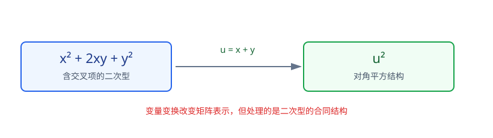

# 第6章 二次型

> **本章要解决的问题：** 怎样把二次表达式写成矩阵形式，通过变量变换消去交叉项，并判断正负性？

<strong style="color:#16A34A;background:#F0FDF4;padding:2px 6px;border-radius:3px;">数学二主线</strong>

<strong style="color:#2563EB">一句话主线：</strong>
矩阵表示 → 合同变换 → 标准形与规范形 → 正交变换 → 正定性判定。

[返回全书知识树](00_全书知识树.md) · [返回线性代数入口](../线性代数_目录总图.md)

## 本章知识树

<strong style="color:#2563EB;">二次型：把二次表达式变成可判断的平方结构</strong>
<ul style="list-style:none;margin:8px 0;padding-left:18px;border-left:2px solid #94A3B8;">
  <li>├─ <a href="#representation">矩阵表示</a>
    <ul style="list-style:none;margin:0;padding-left:18px;border-left:1px solid #CBD5E1;">
      <li>├─ 对称矩阵表示</li>
      <li>└─ 交叉项与矩阵位置</li>
    </ul>
  </li>
  <li>├─ <a href="#congruence">合同变换</a>：<i>A</i> ↦ <i>C</i>T<i>AC</i>
    <ul style="list-style:none;margin:0;padding-left:18px;border-left:1px solid #CBD5E1;">
      <li>├─ 配方法</li>
      <li>└─ 初等合同变换</li>
    </ul>
  </li>
  <li>├─ <a href="#canonical">标准形、规范形与惯性</a>
    <ul style="list-style:none;margin:0;padding-left:18px;border-left:1px solid #CBD5E1;">
      <li>├─ 具体系数</li>
      <li>└─ 正、负、零项结构</li>
    </ul>
  </li>
  <li>├─ <a href="#orthogonal">正交变换</a>：实对称矩阵的特例</li>
  <li>└─ <a href="#positive-definite">正定性</a>
    <ul style="list-style:none;margin:0;padding-left:18px;border-left:1px solid #CBD5E1;">
      <li>├─ 定义</li>
      <li>└─ 特征值与顺序主子式判据</li>
    </ul>
  </li>
</ul>

## 先看结论

- <strong style="color:#2563EB">表示：</strong>二次型可写成 $f(x)=x^TAx$，其中 $A$ 取唯一的对称矩阵。
- <strong style="color:#16A34A">方法：</strong>配方法、合同变换和正交变换都能消去交叉项，但使用条件和目标不同。
- <strong style="color:#2563EB">关系：</strong>变量变换 $x=Cy$ 导致矩阵按 $A\mapsto C^TAC$ 变化。
- <strong style="color:#2563EB">结构：</strong>标准形保留具体系数，规范形只保留正、负、零项数量；惯性指数在合同变换下保持。
- <strong style="color:#DC2626">边界：</strong>正定判据要求实对称矩阵，且标准形中的全部 $n$ 个对角系数都严格为正。

## 1. 二次型的矩阵表示

含 $n$ 个变量的二次型可以写成

$$
f(x)=x^TAx,
\qquad
x=(x_1,\ldots,x_n)^T.
$$

对任意二次型，真正用于判断和标准化的是唯一的对称矩阵

$$
A_s=\frac{A+A^T}{2}.
$$

例如交叉项 $2a_{ij}x_ix_j$ 对应对称矩阵中 $(i,j)$ 和 $(j,i)$ 两个位置的系数 $a_{ij}$。

<strong>易错：</strong>
交叉项前的系数要平均分配到对称位置；不能把 $2xy$ 直接写成矩阵中的一个 $2$ 而忽略另一侧。

## 2. 合同变换：变量变化带来的矩阵变化

令 $x=Cy$，其中 $C$ 可逆，则

$$
f(x)=x^TAx
=y^T(C^TAC)y.
$$

因此二次型矩阵按

$$
A\longmapsto C^TAC
$$

变化，这叫合同变换。它的目标是消去交叉项、得到对角结构，而不是保持特征值。

<strong>图注：</strong>变量替换 $x=Cy$ 同时改变表达式和矩阵；核心计算是 $A\mapsto C^TAC$，而不是把 $x$ 与 $y$ 当作同一组变量。

### 交叉项短例

$$
x^2+4xy+5y^2=(x+2y)^2+y^2.
$$

令

$$
y_1=x+2y,\qquad y_2=y,
$$

则反变换为

$$
x=y_1-2y_2,\qquad y=y_2,
$$

对应的变换矩阵为

$$
x=Cy,\qquad C=\begin{pmatrix}1&-2\\0&1\end{pmatrix},\qquad |C|=1\ne0.
$$

因此变换可逆，且原二次型化为 $y_1^2+y_2^2$。这里正、负惯性指数分别为 $2,0$，矩阵秩为 $2$。

<strong>图注：</strong>图中应同时看到原变量、完整可逆替换和消去交叉项后的平方和；只写一个新变量会丢失变换是否可逆这一条件。

<strong>选择信号：</strong>
变量少、交叉项明显时可先试配方法；题目要求惯性指数或规范形时，应明确使用合同变换。

## 3. 标准形、规范形与惯性

经过合同变换，二次型可化为标准形

$$
d_1y_1^2+d_2y_2^2+\cdots+d_ny_n^2.
$$

标准形保留具体的非零系数。若只关心正、负、零项的数量，可进一步化为规范形：

$$
y_1^2+\cdots+y_p^2
-y_{p+1}^2-\cdots-y_{p+q}^2.
$$

其中 $p$ 为正惯性指数，$q$ 为负惯性指数，零项数量为 $n-p-q$，并且

$$
p+q=\operatorname{rank}(A).
$$

<strong>关系：</strong>
标准形看具体系数；规范形看正负零结构；正、负惯性指数在合同变换下保持，这就是惯性定律的复习接口。

<strong>边界：</strong>
标准形和规范形都来自合同变换，不是相似变换；相似变换保持特征结构，合同变换处理二次型结构。

## 4. 正交变换：实对称矩阵的特例

当 $A$ 为实对称矩阵时，存在正交矩阵 $Q$，使

$$
Q^TAQ=\Lambda.
$$

令 $x=Qy$，则

$$
f(x)=y^T\Lambda y.
$$

正交变换是合同变换的特殊情形，因为 $Q^{-1}=Q^T$。它同时利用了第5章的特征值和正交特征向量。

<strong>跨章接口：</strong>
第5章负责说明为什么实对称矩阵能正交对角化；本章负责说明正交对角化如何把二次型变成平方和。

## 5. 正定性：从定义到等价判据

若对任意非零向量 $x$，都有

$$
x^TAx>0,
$$

则称二次型正定。对实对称矩阵，常用等价判据是：

1. 定义成立：对所有 $x\ne0$，$x^TAx>0$；
2. 所有特征值都严格大于 $0$；
3. 所有顺序主子式都严格大于 $0$；
4. 正交标准形中的全部 $n$ 个对角系数都严格大于 $0$。

<strong>图注：</strong>正定性的几条判据只有在实对称矩阵前提下才可作为等价条件使用；图中连接方向应从同一前提分别指向各判据。

### 短例：顺序主子式判定

$$
A=\begin{pmatrix}2&1\\1&2\end{pmatrix}.
$$

其顺序主子式为

$$
\Delta_1=2>0,\qquad \Delta_2=|A|=3>0,
$$

所以对应二次型正定。

<strong>易错：</strong>
若标准形出现零系数，只能说明可能是半正定或退化情形，不能判为正定；“所有非零系数为正”不够，必须是全部 $n$ 个系数严格为正。

## 6. 典型方法

| 题目要求 | 优先方法 | 主要条件 |
|---|---|---|
| 变量少、交叉项明显 | 配方法 | 适合直接消去交叉项 |
| 要求标准形或惯性指数 | 合同变换 | 追踪正、负、零结构 |
| 已知实对称且特征值易求 | 正交变换 | 利用正交对角化 |
| 只判断正定性 | 顺序主子式或特征值 | 必须确认实对称矩阵前提 |

## 7. 易错与边界

- 二次型矩阵应取对称表示，交叉项系数要分到对称位置。
- 正定要求对所有非零 $x$ 都为正，不是只检查一个向量。
- 顺序主子式判据不能直接用于任意非对称矩阵。
- 相似变换保持特征结构，合同变换处理二次型和惯性结构。

## 8. 跨章节连接

<strong>关联：</strong>
二次型把矩阵表示、合同变换、实对称特征结构和正定性组织到同一个判断链中。

- [特征值与特征向量](05_特征值与特征向量.md#symmetric)：实对称矩阵的正交对角化。
- [矩阵关系](02_矩阵.md#relations)：行等价、相似、合同的边界。
- [向量组](03_向量组.md#geometry)：正交与规范正交组。
