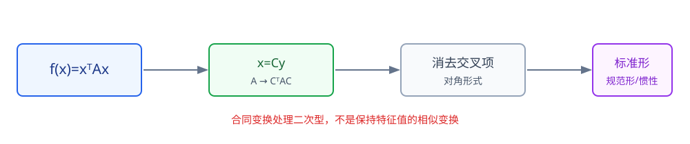

# 第6章 二次型

> **本章要解决的问题：** 怎样通过变量变换消去交叉项，并判断二次表达式的正负性质？

<strong style="color:#16A34A;background:#F0FDF4;padding:2px 6px;border-radius:3px;">数学二主线</strong>

[返回全书知识树](00_全书知识树.md) · [返回线性代数入口](../线性代数_目录总图.md)

## 本章知识树

<strong style="color:#2563EB;">二次型：把二次表达式变成可判断的平方结构</strong>
<ul style="list-style:none;margin:8px 0;padding-left:18px;border-left:2px solid #94A3B8;">
  <li>├─ <a href="#representation">矩阵表示</a>：$f(x)=x^TAx$</li>
  <li>├─ <a href="#congruence">合同变换</a>：$x=Cy$ 导致 $A\mapsto C^TAC$</li>
  <li>├─ <a href="#canonical">标准形、规范形与惯性</a>：消去交叉项，读出正负零结构</li>
  <li>├─ <a href="#orthogonal">正交变换</a>：利用实对称矩阵的特征结构</li>
  <li>└─ <a href="#positive-definite">正定性</a>：定义、主子式和特征值判别</li>
</ul>

## 先看结论

- <strong style="color:#2563EB">核心：</strong>二次型可以写成 $f(x)=x^TAx$，其中 $A$ 通常取对称矩阵。
- <strong style="color:#16A34A">方法：</strong>配方法、合同变换和正交变换都能消去交叉项，但适用场景不同。
- <strong style="color:#2563EB">关系：</strong>正交变换是合同变换的特殊情形；相似变换不能替代合同变换。
- <strong style="color:#2563EB">核心：</strong>实对称矩阵正定 $\Longleftrightarrow$ 所有特征值为正 $\Longleftrightarrow$ 所有顺序主子式为正。
- <strong style="color:#DC2626">边界：</strong>顺序主子式判据要求矩阵为实对称矩阵。

## 1. 二次型的矩阵表示

含 $n$ 个变量的二次型可以写成

$$f(x)=x^TAx,$$

其中 $x=(x_1,\ldots,x_n)^T$，通常取 $A$ 为对称矩阵。交叉项 $2a_{ij}x_ix_j$ 对应矩阵中的两个对称位置 $a_{ij}=a_{ji}$。

<strong style="color:#DC2626">易错：</strong>同一个二次型可以有不同的非对称表示，但判断正定性和进行标准化时通常先取对称矩阵。

## 2. 合同变换：变量变化带来的矩阵变化

令 $x=Cy$，其中 $C$ 可逆，则

$$f(x)=y^T(C^TAC)y.$$

因此二次型矩阵按

$$A\mapsto C^TAC$$

变化，这叫合同变换。它的目标不是保持特征值，而是消去交叉项并保留二次型的惯性结构。

## 3. 标准形、规范形与惯性

标准形通常写成

$$d_1y_1^2+d_2y_2^2+\cdots+d_ry_r^2,$$

其中系数仍保留具体数值。若只关心正、负、零项的数量，可进一步化为规范形：

$$y_1^2+\cdots+y_p^2-y_{p+1}^2-\cdots-y_{p+q}^2.$$

其中 $p$ 是正惯性指数，$q$ 是负惯性指数，剩余项对应零惯性部分。

<strong style="color:#DC2626">区分：</strong>标准形强调具体系数；规范形只保留正负零结构。二者都来自合同变换，不是相似变换。

## 4. 两种主要变换方法

### 配方法

适合变量较少、交叉项结构明显的题目。例如

$$x^2+2xy+y^2=(x+y)^2.$$

优点是直观，缺点是变量多时容易漏项。

### 正交变换

当 $A$ 为实对称矩阵时，存在正交矩阵 $Q$，使

$$Q^TAQ=\Lambda.$$

令 $x=Qy$，则二次型变成

$$f(x)=y^T\Lambda y.$$

正交变换同时利用了特征值和正交特征向量。

## 5. 正定性

若对任意非零向量 $x$，都有

$$x^TAx>0,$$

则称二次型正定。对实对称矩阵，常用等价判据包括：

- 所有特征值均大于 $0$；
- 所有顺序主子式均大于 $0$；
- 正交标准形中的所有非零平方项系数均为正。

### 短例：顺序主子式判定

$$A=\begin{pmatrix}2&1\\1&2\end{pmatrix}.$$

$$\Delta_1=2>0,\qquad \Delta_2=|A|=3>0,$$

所以对应二次型正定。

## 6. 典型方法

| 题目要求 | 优先方法 | 主要原因 |
|---|---|---|
| 变量少、交叉项明显 | 配方法 | 计算直观 |
| 要求标准形或惯性指数 | 合同变换 | 直接追踪正负零结构 |
| 已知实对称且特征值易求 | 正交变换 | 同时得到正交对角化和正定性信息 |
| 只判断正定性 | 顺序主子式或特征值 | 不必完整求出变换矩阵 |

## 7. 易错与边界

- 正定要求对所有非零 $x$ 都为正，不是只检查某个向量。
- 半正定允许存在非零 $x$ 使 $x^TAx=0$。
- 顺序主子式判据不能直接用于任意非对称矩阵。
- 相似变换保持特征结构，合同变换处理二次型，二者目的不同。

## 8. 跨章节连接

<strong>关联：</strong>二次型把矩阵的对称性、特征值和变换关系组织到同一个判断问题中。

- [特征值与特征向量](05_特征值与特征向量.md#symmetric)：实对称矩阵的正交对角化。
- [矩阵关系](02_矩阵.md#relations)：相似、合同和行等价的边界。
