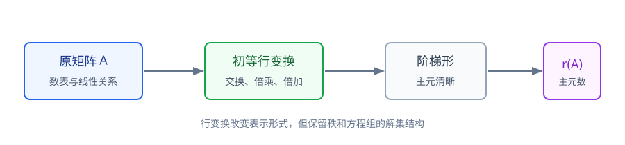

# 第2章 矩阵

> **本章要解决的问题：** 怎样用矩阵表示、组合和变换线性运算，并用初等变换求秩、求逆和解矩阵方程？

<strong style="color:#16A34A;background:#F0FDF4;padding:2px 6px;border-radius:3px;">数学二主线 · 全书核心样章</strong>

[返回全书知识树](00_全书知识树.md) · [返回线性代数入口](../线性代数_目录总图.md)

## 本章知识树

<strong style="color:#2563EB;">矩阵：表示线性关系，并通过变换提取结构</strong>
<ul style="list-style:none;margin:8px 0;padding-left:18px;border-left:2px solid #94A3B8;">
  <li>├─ <a href="#operations">矩阵对象与运算</a>：加法、数乘、乘法、转置</li>
  <li>├─ <a href="#elementary">初等变换与行等价</a>：把矩阵化为便于判断的形状</li>
  <li>├─ <a href="#rank">秩</a>：阶梯形中的主元数量与独立信息</li>
  <li>├─ <a href="#inverse">逆矩阵</a>：可逆条件与求逆流程</li>
  <li>├─ <a href="#matrix-equation">矩阵方程</a>：左右乘法方向和解的条件</li>
  <li>└─ <a href="#relations">行等价、相似、合同</a>：三种变换关系的边界</li>
</ul>

## 先看结论

- <strong style="color:#2563EB">核心：</strong>矩阵乘法要求前一个矩阵的列数等于后一个矩阵的行数，且一般不满足交换律。
- <strong style="color:#16A34A">方法：</strong>求秩、求逆和解方程组都可以统一使用初等行变换。
- <strong style="color:#2563EB">关系：</strong>对 $n\times n$ 方阵，$A$ 可逆 $\Longleftrightarrow |A|\ne0\Longleftrightarrow r(A)=n$。
- <strong style="color:#DC2626">边界：</strong>行等价、相似、合同都叫“变换”，但保持量和用途完全不同。

## 1. 矩阵对象与基本运算

矩阵是按行列排列的数表。矩阵乘法定义为

$$
(AB)_{ij}=\sum_{k=1}^{n}a_{ik}b_{kj},
$$

其中前一个矩阵的列数必须等于后一个矩阵的行数。转置满足

$$
(AB)^T=B^TA^T.
$$

<strong style="color:#DC2626">易错：</strong> $AB=0$ 不必推出 $A=0$ 或 $B=0$；$AB=BA$ 也不是普遍成立。结合律成立，但不能随意交换因子顺序。

## 2. 初等变换与行等价

三类初等行变换是：交换两行；某行乘非零常数；某行加上另一行的倍数。它们把同一矩阵改写成更容易观察的形式。

<strong>核心过程：</strong>原矩阵 → 初等行变换 → 阶梯形 → 数非零行或主元 → 得到秩。

若两个同型矩阵可以互相通过初等行变换得到，则称它们行等价。行等价主要服务于消元和求秩，不等同于相似或合同。

## 3. 秩：数出独立信息

把矩阵化为阶梯形后，非零行数或主元数量就是矩阵的秩。秩还满足

$$
r(A)=r(A^T),\qquad r(AB)\le \min\{r(A),r(B)\}.
$$

对 $n\times n$ 方阵：

$$
r(A)=n\Longleftrightarrow A\text{可逆}\Longleftrightarrow |A|\ne0.
$$

<strong style="color:#DC2626">条件：</strong>“数主元得秩”依赖于矩阵已经化为阶梯形；不能直接数原矩阵中非零元素。

### 矩阵秩与向量组秩

矩阵的列向量组组成一个向量组，其秩等于矩阵秩。向量组章节会完整解释极大无关组；本章只保留这个接口。

## 4. 逆矩阵：可逆性和求法

若存在矩阵 $A^{-1}$，使

$$AA^{-1}=A^{-1}A=I,$$

则称 $A$ 可逆。对方阵，以下条件等价：

$$
|A|\ne0\Longleftrightarrow r(A)=n\Longleftrightarrow A^{-1}\text{存在}.
$$

若 $|A|\ne0$，可用伴随矩阵表示

$$
A^{-1}=\frac{1}{|A|}A^*.
$$

实际计算更常用增广矩阵：

$$
(A\mid I)\longrightarrow(I\mid A^{-1}).
$$

<strong style="color:#DC2626">限制：</strong>逆矩阵通常只对方阵讨论；非方阵不能直接套用 $A^{-1}$ 的公式。

## 5. 矩阵方程：先看乘法方向

若 $A$ 可逆：

$$
AX=B\Longrightarrow X=A^{-1}B,
$$

而

$$
XA=B\Longrightarrow X=BA^{-1}.
$$

<strong>易错：</strong>不能把 $AX=B$ 和 $XA=B$ 当成普通一元方程，乘逆矩阵时必须从正确的一侧相乘。

### 短例：增广矩阵求逆

$$
A=\begin{pmatrix}1&2\\2&5\end{pmatrix},\qquad
(A\mid I)\longrightarrow
\left(\begin{array}{cc|cc}1&0&5&-2\\0&1&-2&1\end{array}\right).
$$

因此 $A^{-1}=\begin{pmatrix}5&-2\\-2&1\end{pmatrix}$。

## 6. 三种关系：不要只看“变形”二字

| 关系 | 形式或操作 | 主要用途 | 典型保持量 |
|---|---|---|---|
| 行等价 | 初等行变换 | 消元、求秩、判断方程组 | 秩、解集结构 |
| 相似 | $B=P^{-1}AP$ | 特征值、对角化 | 特征值、迹、行列式 |
| 合同 | $B=P^TAP$ | 二次型标准形、正定性 | 惯性结构 |

## 7. 典型方法

1. **求秩：**化阶梯形 → 数主元 → 检查参数导致的主元变化。
2. **求逆：**先确认方阵可逆 → 写 $(A\mid I)$ → 化为 $(I\mid A^{-1})$。
3. **解矩阵方程：**先确认未知矩阵在左侧还是右侧，再从相反侧乘逆矩阵。

## 8. 易错与边界

- 初等行变换不一定保持行列式值，但保持秩和线性方程组解集。
- $A^2=0$ 不代表 $A=0$。
- 相似变换和合同变换的乘法形式、保持量和用途不同。
- “满秩”必须结合矩阵的行列规模；方阵满秩才等价于可逆。

## 9. 跨章节连接

<strong>关联：</strong>矩阵是后续章节的共同表示工具。

- [向量组](03_向量组.md#rank)：矩阵的列向量组秩等于矩阵秩。
- [线性方程组](04_线性方程组.md#elimination)：消元直接使用初等行变换。
- [特征值](05_特征值与特征向量.md#definition)：特征向量问题是特殊的齐次方程组。
- [二次型](06_二次型.md#congruence)：二次型使用合同变换，而不是相似变换。
