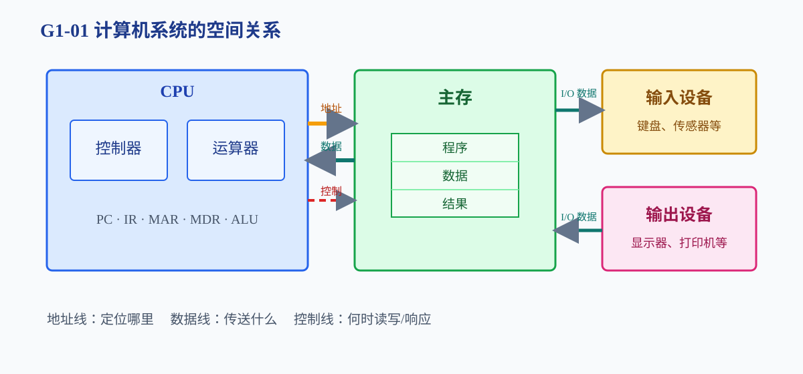
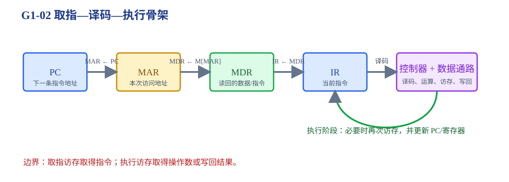

# 第1章 计算机系统概述

一台计算机如何把“程序和数据”组织成可执行的动作？

<strong>本章主线：</strong>先建立计算机系统的部件和层次，再说明存储程序、关键寄存器和一条指令的基本执行骨架。本章只建立整机语言，具体的数据表示、存储映射和控制实现分别在后续章节展开。

[返回全书知识树](00_全书知识树.md) · [返回书籍入口](../计算机组成_目录总图.md)

## 本章知识树

<strong style="color:#2563EB;">整机骨架：程序、数据和硬件部件如何协同</strong><ul style="list-style:none;margin:6px 0;padding-left:18px;border-left:1px solid #CBD5E1;"><li>├─ <strong>系统层次</strong><ul style="list-style:none;margin:0 0 6px 4px;padding-left:18px;border-left:1px solid #E2E8F0;"><li>├─ <a href="#system-structure">CPU、主存、I/O、总线</a></li><li>└─ <a href="#software-hardware-levels">软件层、ISA、微体系结构</a></li></ul></li><li>├─ <strong>存储程序</strong><ul style="list-style:none;margin:0 0 6px 4px;padding-left:18px;border-left:1px solid #E2E8F0;"><li>└─ <a href="#stored-program">程序和数据进入主存</a></li></ul></li><li>├─ <strong>CPU 状态</strong><ul style="list-style:none;margin:0 0 6px 4px;padding-left:18px;border-left:1px solid #E2E8F0;"><li>└─ <a href="#register-roles">PC、IR、MAR、MDR</a></li></ul></li><li>└─ <strong>指令执行</strong><ul style="list-style:none;margin:0 0 6px 4px;padding-left:18px;border-left:1px solid #E2E8F0;"><li>├─ <a href="#fetch-overview">取指骨架</a></li><li>└─ <a href="#system-boundaries">408 抽象模型与实现边界</a></li></ul></li></ul>

## 先看结论

1. CPU 负责解释指令、运算和控制；主存保存当前运行的程序、数据和中间结果；I/O 负责与外部环境交换；总线提供共享通路。
2. 存储程序思想把指令和数据都编码成位模式，CPU 依据 PC 逐条取得指令。
3. PC 保存下一条指令地址，IR 保存当前指令，MAR 保存本次访问地址，MDR 保存读写数据。
4. 取指是一次访存，执行阶段还可能有访存；取到指令不等于取到操作数。
5. ISA 是软件看到的指令和状态接口；微体系结构是实现 ISA 的内部数据通路和控制方式。

## 1. 系统层次与功能部件

计算机系统可按功能分为运算器、控制器、存储器、输入设备和输出设备。在 408 常用模型中，运算器与控制器合称 CPU，主存保存当前运行内容，I/O 设备与外部环境交换信息，总线传递地址、数据和控制信号。

| 部件 | 主要职责 | 不能混淆 |
|---|---|---|
| CPU | 解释指令、运算、产生控制信号 | CPU 不等于只做算术的 ALU |
| 主存 | 保存当前程序、数据和中间结果 | 主存不等于所有存储层次 |
| I/O 接口 | 缓冲、状态反馈、控制外设时序 | 外设通常不能直接替代接口 |
| 总线 | 共享地址、数据和控制通路 | 总线不是保存数据的部件 |

### 软件层、ISA 和微体系结构

- 应用程序和操作系统通过指令集使用计算机。
- ISA 规定指令格式、寄存器、寻址方式和可见行为，是软件与硬件的接口。
- 微体系结构用数据通路、Cache、流水线和控制器实现 ISA。
- 逻辑门、寄存器和存储器件属于更底层的实现。

<strong>边界：</strong>不同 CPU 可以实现同一 ISA；“指令语义相同”不代表内部数据通路和流水线完全相同。

## 2. 存储程序：程序和数据进入同一主存

存储程序的核心是：指令和数据都以编码形式存储，CPU 可以按地址取得指令；顺序执行时 PC 通常前移，分支、调用、返回或中断可以改变 PC。

**短例 1：**若指令位于地址 100、每条指令 4 字节，顺序执行下一条通常从 104 开始；若当前指令是跳转指令，PC 改为目标地址。前移量必须按题目给出的指令长度和编址方式计算。

## 3. 关键寄存器：同一个取指动作中的不同角色

| 寄存器 | 保存什么 | 作用 |
|---|---|---|
| PC | 下一条指令地址 | 提供取指地址并更新 |
| IR | 当前取到的指令 | 供译码器分析 |
| MAR | 当前一次访问的地址 | 把地址送往存储器 |
| MDR | 读出的数据或待写数据 | 暂存指令字、操作数或结果 |

<strong>易错：</strong>MDR 也可能称数据缓冲寄存器；无论名称如何，它保存数据，不保存访问地址。

## 4. 取指到执行：地址、数据和控制叠加

典型取指过程：

1. $MAR\leftarrow PC$。
2. 启动主存读，$MDR\leftarrow M[MAR]$。
3. $IR\leftarrow MDR$。
4. $PC\leftarrow PC+\text{指令长度}$，或在后续阶段装入转移目标。
5. 控制器译码 IR，驱动寄存器、ALU、主存和总线。

**短例 2：**若 $M[200]=\text{ADD }R_1,R_2$，取指开始时 $PC=200$，先有 $MAR=200$，读出后 $MDR$ 保存指令，再装入 $IR$。指令长 4 字节且未跳转时，顺序下一条 PC 为 204。

## 5. 典型方法与短例

<strong>方法入口：</strong>先判断四个寄存器分别保存的是下一条指令、当前指令、访问地址还是读写数据。

### 读题时先画四个角色

遇到“某时刻 PC、IR、MAR、MDR 的内容”题，先判断题目问的是下一条指令、当前指令、地址还是数据；再判断当前动作是取指、读操作数还是写结果。

**短例 3：**若当前正在执行 `LOAD R1,[1000]`，PC/IR 仍描述指令状态，而 MAR/MDR 在执行访存时分别转为保存 1000 和从主存读回的数据。不能因为四个寄存器都参与同一条指令，就把它们看成同一个状态。

## 6. 易错与边界

- “主机”通常指 CPU、主存及其连接部分，不等于整台计算机。
- 存储程序不排斥 Cache、虚拟地址等实现；408 题目先按抽象主存关系判断。
- PC 的更新时机可能按教材微操作顺序描述，要以题目时序为准。
- 控制器发出信号，数据通路执行搬运和运算；两者是协同关系。

## 7. 跨章节连接

<strong>跨章关联：</strong>

- [第2章](02_数据的表示和运算.md#representation)：指令、地址和操作数都以位模式存储。
- [第3章](03_存储系统.md#addressing)：展开 MAR/MDR 连接的主存、Cache 和虚拟地址。
- [第4章](04_指令系统.md#instruction-format)：解释 IR 中的操作码、地址字段和寻址方式。
- [第5章](05_中央处理器.md#datapath)：把取指骨架展开为数据通路和流水线。
