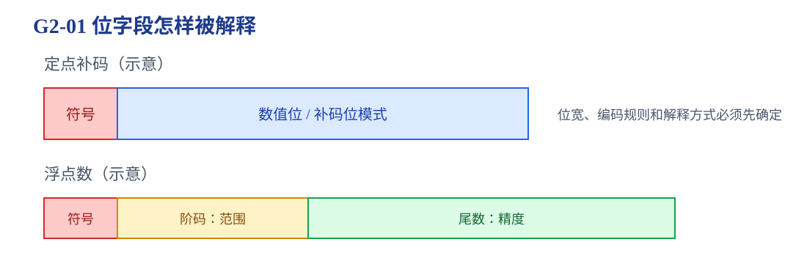
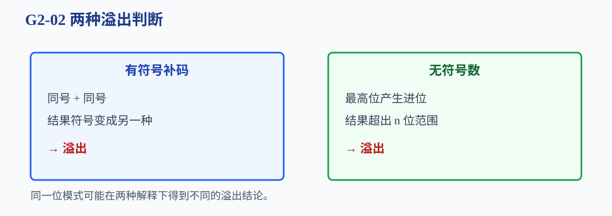
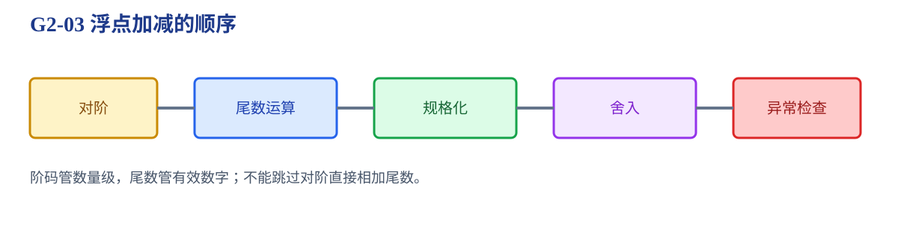
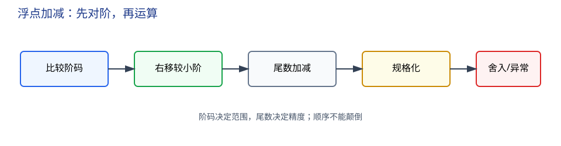

# 第2章 数据的表示和运算

机器只有有限位，如何用同一组 0/1 表示整数、字符、浮点数，并让运算器判断结果是否可信？

<strong>本章主线：</strong>先确认位模式的编码规则，再处理定点数、补码加减、扩展和移位，最后进入浮点数的字段、对阶、规格化和舍入。任何计算题都先写清位宽和编码。

[返回全书知识树](00_全书知识树.md) · [返回书籍入口](../计算机组成_目录总图.md)

## 本章知识树

<strong style="color:#2563EB;">位模式：编码决定解释，位宽决定范围</strong><ul style="list-style:none;margin:6px 0;padding-left:18px;border-left:1px solid #CBD5E1;"><li>├─ <strong>编码规则</strong><ul style="list-style:none;margin:0 0 6px 4px;padding-left:18px;border-left:1px solid #E2E8F0;"><li>├─ <a href="#representation">数制与字符编码</a></li><li>└─ <a href="#code-comparison">原码、反码、补码、移码</a></li></ul></li><li>├─ <strong>定点数</strong><ul style="list-style:none;margin:0 0 6px 4px;padding-left:18px;border-left:1px solid #E2E8F0;"><li>├─ <a href="#fixed-point">范围与扩展</a></li><li>├─ <a href="#fixed-arithmetic">补码加减</a></li><li>└─ <a href="#shifts">移位与乘除</a></li></ul></li><li>├─ <strong>可靠性判断</strong><ul style="list-style:none;margin:0 0 6px 4px;padding-left:18px;border-left:1px solid #E2E8F0;"><li>└─ <a href="#overflow">有符号/无符号溢出</a></li></ul></li><li>└─ <strong>浮点数</strong><ul style="list-style:none;margin:0 0 6px 4px;padding-left:18px;border-left:1px solid #E2E8F1;"><li>├─ <a href="#floating-point">字段与范围/精度</a></li><li>└─ <a href="#floating-operations">对阶、规格化、舍入</a></li></ul></li></ul>

## 先看结论

1. 同一位模式按不同编码解释会得到不同数值；做题先确认位数、编码和符号约定。
2. $n$ 位补码范围为 $-2^{n-1}$ 到 $2^{n-1}-1$，最小负数没有对应正数。
3. 补码减法用加法实现：$A-B=A+(-B)$，固定字长下最高进位丢弃。
4. 有符号补码相加看“同号相加是否变号”，无符号加法看最高位进位。
5. 逻辑右移补 0，算术右移通常保留符号位；左移可能丢失有效位。
6. 浮点数中阶码主要决定范围，尾数主要决定精度；对阶、规格化、舍入和异常检查不能省略。

## 1. 数制和编码

二进制、八进制和十六进制只是同一位模式的不同书写方式。字符编码把字符映射为整数位模式，不能把字符编码与整数补码混为一谈。

### 原码、反码、补码和移码

| 编码 | 负数构造 | 特点 |
|---|---|---|
| 原码 | 符号位 1，数值位取绝对值 | 有正负零，运算复杂 |
| 反码 | 原码数值位按位取反 | 有正负零，减法仍需处理循环进位 |
| 补码 | 反码加 1 | 只有一个零，加减可统一 |
| 移码 | 在补码基础上整体加偏置 | 常用于浮点阶码比较 |

## 2. 定点数：范围、扩展、补码加减和移位

### 范围与扩展

符号扩展把有符号数扩展到更宽位数时复制符号位；零扩展把无符号数扩展时在高位补 0。扩展必须保持原数值，否则只是换了位模式。

**短例 1：**8 位补码 `11110110` 表示 -10，扩展到 16 位应为 `1111111111110110`；若补 0 会变成正数 246，说明零扩展不能用于有符号负数。

### 补码加减

以 8 位为例，$5=00000101$，$-3$ 的补码为 $11111101$：

$$00000101+11111101=1\,00000010$$

固定 8 位时丢弃最高进位，留下 $00000010$，即 2。

<strong>做题步骤：</strong>统一位宽 → 写出减数相反数的补码 → 按位相加 → 丢弃最高进位 → 单独判断溢出。

### 移位与乘除

- 逻辑左移：通常相当于无符号乘 2，但高位丢失会溢出。
- 逻辑右移：高位补 0，适合无符号数。
- 算术右移：高位通常复制符号位，适合有符号数除以 2 的近似过程。

移位丢失的位、负数取整规则和是否允许循环移位，都必须按题目约定。

## 3. 溢出：结果是否超出当前位宽

有符号补码：正 + 正得到负，或负 + 负得到正，发生溢出；正 + 负不会因符号相反而发生这种溢出。无符号数：最高位产生进位即超出范围。

**短例 2：**4 位补码 $0111(+7)+0011(+3)=1010$。位模式 1010 解释为 -6，但真实结果 10 超出 -8～7，因此发生有符号溢出；若按无符号解释，7+3=10，没有超过 0～15。

## 4. 浮点数：范围与精度分工

浮点数通常由符号、阶码和尾数组成。阶码决定数量级，尾数决定有效数字；规格化让尾数保持统一形式，减少同一数的多种表示。

### 浮点加减流程

1. 比较阶码；
2. 将阶码较小者的尾数右移，完成对阶；
3. 尾数相加减；
4. 规格化并调整阶码；
5. 按舍入规则处理多余位；
6. 检查阶码上溢、下溢和特殊值。

<strong>边界：</strong>阶码范围与尾数精度不是同一个问题；不能用增加尾数位数解决阶码上溢，也不能用扩大阶码解决精度损失。

## 5. 典型方法与短例

### 补码题

给出 $A=01100110$、$B=00110101$，先看两数同为正，再相加得到 10011011。结果符号变负，所以有符号溢出；若按无符号解释，结果为 155，仍在 0～255 内。

### 浮点题

给出两个规格化数时，先比较阶码并右移阶码较小者，再做尾数运算；若结果不在规格化区间，继续调整阶码和尾数，最后才舍入。

## 6. 易错与边界

- 最高位进位丢弃是固定字长规则，不等于“任何情况下都没有溢出”。
- 原码、反码和补码的负零与范围不同，不能只按最高位读数。
- 算术右移和逻辑右移的高位填充不同。
- 浮点上溢、下溢、舍入和规格化是四个不同问题。

## 7. 跨章节连接

<strong>跨章关联：</strong>

- [第3章](03_存储系统.md#addressing)：位模式最终存入存储单元并通过地址定位。
- [第4章](04_指令系统.md#instruction-format)：操作码、寄存器号和地址都是位字段。
- [第5章](05_中央处理器.md#datapath)：ALU 执行补码加减，控制器安排运算步骤。
