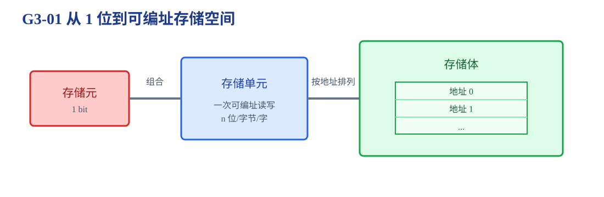
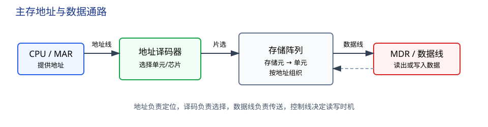
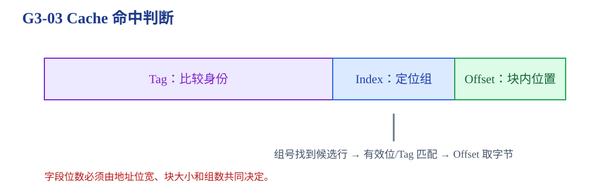
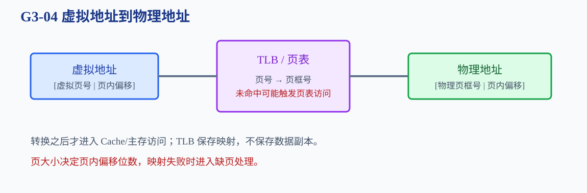

# 第3章 存储系统

数据怎样从一个地址进入存储层次，并在需要时被更快、更准确地取出？

<strong>本章主线：</strong>先从存储元和可编址单元建立容量语言，再进入地址译码、芯片扩展和多体存储；最后解释 Cache、TLB、页表和虚拟地址转换。做题时始终区分“存多少”“一次读多少”“怎样选中”和“怎样加速”。

[返回全书知识树](00_全书知识树.md) · [返回书籍入口](../计算机组成_目录总图.md)

## 本章知识树

<strong style="color:#2563EB;">存储系统：从一个存储位到一条地址与数据通路</strong>
<ul style="list-style:none;margin:6px 0;padding-left:18px;border-left:1px solid #CBD5E1;">
<li>├─ <strong>存储层次</strong>
<ul style="list-style:none;margin:0 0 6px 4px;padding-left:18px;border-left:1px solid #E2E8F0;"><li>├─ <a href="#memory-cell">存储元、单元、存储体</a></li><li>└─ <a href="#memory-types">SRAM、DRAM、ROM</a></li></ul></li>
<li>├─ <strong>主存组织</strong>
<ul style="list-style:none;margin:0 0 6px 4px;padding-left:18px;border-left:1px solid #E2E8F0;"><li>├─ <a href="#addressing">地址线与译码</a></li><li>├─ <a href="#chip-expansion">位扩展、字扩展与芯片组织</a></li><li>└─ <a href="#interleaving">高位/低位交叉多体存储</a></li></ul></li>
<li>├─ <strong>Cache</strong>
<ul style="list-style:none;margin:0 0 6px 4px;padding-left:18px;border-left:1px solid #E2E8F0;"><li>├─ <a href="#cache">局部性与地址划分</a></li><li>├─ <a href="#cache-mapping">直接映射、全相联、组相联</a></li><li>└─ <a href="#cache-policy">命中、替换和写策略</a></li></ul></li>
<li>└─ <strong>虚拟存储器</strong>
<ul style="list-style:none;margin:0 0 6px 4px;padding-left:18px;border-left:1px solid #E2E8F0;"><li>├─ <a href="#virtual-memory">页表、TLB 与地址转换</a></li><li>└─ <a href="#memory-access-chain">一次访问的完整链条</a></li></ul></li>
</ul>

## 先看结论

1. <strong>容量、字长、地址位数是三个不同量。</strong>若有 $2^m$ 个可编址单元、每单元 $n$ 位，则容量为 $2^m n$ 位，地址至少需要 $m$ 位。
2. 存储元保存 1 位，存储单元是可编址位置，存储体由大量单元按地址组织；MAR 给出地址，MDR 传递数据。
3. 位扩展增加每个字的位数，字扩展增加可存储的字数；目标芯片规格通常需要两者组合。
4. Cache 字段的划分依赖地址单位、块大小、组数和相联度；不能把 Cache 行数直接当成组数。
5. TLB 缓存页表项，Cache 缓存数据块；TLB 命中不等于 Cache 命中。
6. <strong>多体存储、Cache 和虚拟存储器的快慢结论都依赖题目给出的周期、映射和异常处理约定。</strong>

## 1. 存储层次：从一位到可编址空间

存储元保存 1 位信息；若干存储元组成一个存储单元，存储单元是主存按地址访问的基本单位；多个单元按地址排列形成存储体。若有 $2^m$ 个可编址单元、每单元 $n$ 位，则：

$$\text{容量}=2^m\times n\ \text{bit}$$

**短例 1：容量计算。**某存储器有 12 根地址线、每单元 16 位，则可编址单元数为 $2^{12}=4096$，容量为 $4096\times16=65536$ 位，即 8 KiB。若题目改为按字节编址，地址对应的基本单位就变成 1 字节，换算必须重新进行。

### SRAM、DRAM 与 ROM

| 类型 | 保存方式与特点 | 复习时关注 |
|---|---|---|
| SRAM | 触发器保存，速度快、密度较低 | 常作为 Cache 的基础存储 |
| DRAM | 电容存储，需要刷新，密度高 | 主存、刷新周期、读写时序 |
| ROM | 正常运行时主要读出，写入方式依类型而定 | 固件或只读数据，不等于“永远不能改” |

<strong>边界：</strong>“易失性”描述断电后能否保持，“只读”描述正常工作时的写入方式，不能把二者当成同一个分类维度。

## 2. 主存组织：地址线、译码器和数据线

一次主存访问的抽象通路是：CPU 将地址送入 MAR → 地址线进入译码器 → 译码器选中目标单元或芯片 → 数据沿数据线进出 MDR。译码器负责“选中谁”，数据线负责“传什么”，控制线负责“何时读写”。

### 地址单位和容量

若按字节编址，地址 0、1、2 分别指向三个字节；若按字编址，一个地址指向一个机器字。给出总容量和编址单位后，先统一到字节或位，再反推地址位数。地址位数为 $m$ 时，可编址位置数为 $2^m$，不等于容量本身。

### 位扩展、字扩展和芯片组织

- **位扩展：**单片字长不够，多片并联；它们共享地址线和片选线，各自负责不同数据位。
- **字扩展：**单片字数不够，增加高位地址译码和片选，让不同芯片负责不同地址区间。
- **同时扩展：**先算目标的“字数 × 每字位数”，再分别求并联片数和片选片数。

**短例 2：芯片扩展。**若已有 $1K\times8$ 芯片，要组成 $4K\times16$ 存储器：字长从 8 位到 16 位需要 2 片并联；字数从 1K 到 4K 需要 4 组；总芯片数为 $2\times4=8$ 片。低位地址线接各片，高位地址线进入片选译码器。

<strong>易错：</strong>位扩展解决“每个字不够宽”，字扩展解决“可存的字不够多”；不能只看芯片总容量而跳过两种方向。

### 多体存储：连续地址如何分散

多体存储把主存分成多个独立存储体，以提高连续访问时的并行性：

- **高位交叉：**地址高位选择体号，连续地址可能仍集中在同一体，适合按区段分配。
- **低位交叉：**地址低位选择体号，连续地址轮流落入不同体，常用于连续访问并行化。

计算多体存储时间时，必须区分**启动周期**和**访问周期**。连续访问能否重叠，取决于题目是否允许各体独立启动。

## 3. Cache：把局部性变成较低平均访问时间

Cache 位于 CPU 与主存之间，按块装入数据，利用：

- 时间局部性：刚访问过的数据近期可能再次访问；
- 空间局部性：访问一个地址后，邻近地址可能很快被访问。

一次 Cache 访问通常要经历：由地址中的组号找到候选行 → 检查有效位 → 比较 Tag → 命中后用 Offset 选出块内字节或字。

若主存地址为 $m$ 位、块大小为 $2^b$ 字节、Cache 有 $2^s$ 组，则块内偏移占 $b$ 位；直接映射或组相联时组号占 $s$ 位；剩余 $m-b-s$ 位是 Tag。

### 三种映射

| 映射 | 一个主存块可放置的位置 | 题型关注 |
|---|---|---|
| 直接映射 | 唯一 Cache 行 | 组号由块号取模得到，冲突较直接 |
| 全相联 | 任意行 | 需要比较所有有效 Tag，替换自由度最大 |
| 组相联 | 某一组内任意行 | 先定位组，再在组内比较 Tag |

### 命中、替换与写策略

- **有效位：**区分该行是否装有有效块。
- **替换策略：**不命中且目标位置已满时，按题目给出的随机、FIFO、LRU 等规则选择被替换块。
- **写直达：**写 Cache 的同时更新下一级，简单但流量较大。
- **写回：**只先写 Cache，用脏位记录修改，替换时再写回下一级。

平均访问时间常写成：

$$T_{avg}=T_{hit}+(1-h)T_{miss}$$

其中 $h$ 是命中率；不同题目对“命中时间是否包含在失效代价中”的口径可能不同，必须看定义。

## 4. 虚拟存储器：页表和 TLB 完成地址转换

虚拟地址通常分为虚拟页号和页内偏移。页表把虚拟页号映射到物理页框号，页内偏移在基本分页模型中保持不变；TLB 缓存最近使用的页表项，命中时可以少访问一次页表。

### 一次访问的完整链条

CPU 产生虚拟地址 → 查 TLB → TLB 未命中时查页表 → 得到物理地址 → 查 Cache → Cache 未命中时访问主存 → 若页面不在主存则触发缺页处理。

<strong>边界：</strong>TLB 存的是地址转换结果，Cache 存的是数据块；TLB 命中仍可能 Cache 未命中，Cache 命中也不意味着不需要考虑虚拟地址映射。

## 5. 典型方法与短例

<strong>方法入口：</strong>先统一地址单位，再判断容量、字段、映射和访问层次。

### 容量和地址位数

先统一“按字节/按字”编址，再写 $\text{容量}=\text{可编址单元数}\times\text{每单元位数}$。若问地址位数，先求单元数量，再取 $\log_2$。

### Cache 字段题

1. 明确主存地址单位和块大小。
2. 求块内 Offset 位数。
3. 根据组数求 Index 位数。
4. 剩余高位是 Tag。
5. 再按映射方式判断命中、冲突和替换。

**短例 3：字段划分。**若主存地址 32 位、块大小 $2^4$ 字节、Cache 有 $2^8$ 组，则 Offset 为 4 位、Index 为 8 位、Tag 为 20 位。若为 4 路组相联，还要确认题目给出的 $2^8$ 是组数而不是总行数。

## 6. 易错与边界

- MAR 是地址寄存器，MDR 是数据寄存器；地址线宽度和数据线宽度对应不同问题。
- 低位交叉和高位交叉的体号位不同，不能凭“低位更快”直接套结论。
- Cache 命中只说明数据在 Cache 中，不说明写回策略下主存副本已经同步。
- 页内偏移通常保持不变，但页大小、页表层数和异常处理按题目模型为准。
- SRAM/DRAM 的实现细节用于理解速度和刷新差异，不能替代题目给出的主存时序。

## 7. 跨章节连接

<strong>跨章关联：</strong>

- [第1章](01_计算机系统概述.md#register-roles)：MAR/MDR 在整机取指中的位置。
- [第4章](04_指令系统.md#effective-address)：寻址方式产生有效地址后进入本章存储通路。
- [第5章](05_中央处理器.md#memory-stage)：访存阶段如何调用 Cache 和主存。
- [第6章](06_总线.md#transaction)：CPU、DMA 和 I/O 访问主存时共享总线。
- [第7章](07_输入输出系统.md#dma)：DMA 使用主存地址和数据通路。
