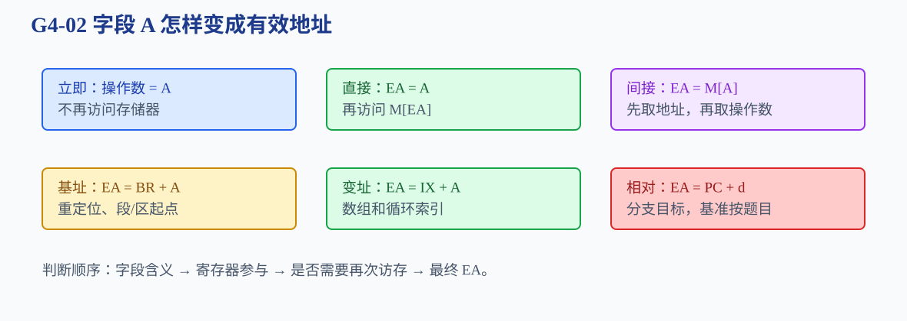

# 第4章 指令系统

一条机器指令怎样同时说明“做什么”“对谁做”，并在需要时改变程序的下一步？

<strong>本章主线：</strong>先拆指令格式，再理解地址码数量和隐含操作数；随后按寻址方式求有效地址和访存次数，最后区分数据传送、运算、控制转移和 I/O 指令。

[返回全书知识树](00_全书知识树.md) · [返回书籍入口](../计算机组成_目录总图.md)

## 本章知识树

<strong style="color:#2563EB;">指令：操作码决定动作，寻址方式决定操作数在哪里</strong><ul style="list-style:none;margin:6px 0;padding-left:18px;border-left:1px solid #CBD5E1;"><li>├─ <strong>指令格式</strong><ul style="list-style:none;margin:0 0 6px 4px;padding-left:18px;border-left:1px solid #E2E8F0;"><li>├─ <a href="#instruction-format">操作码、地址码和指令字长</a></li><li>└─ <a href="#address-count">零地址到三地址指令</a></li></ul></li><li>├─ <strong>寻址方式</strong><ul style="list-style:none;margin:0 0 6px 4px;padding-left:18px;border-left:1px solid #E2E8F0;"><li>├─ <a href="#addressing-modes">立即、直接、间接、寄存器</a></li><li>└─ <a href="#indexed-modes">基址、变址、相对寻址</a></li></ul></li><li>├─ <strong>有效地址</strong><ul style="list-style:none;margin:0 0 6px 4px;padding-left:18px;border-left:1px solid #E2E8F0;"><li>└─ <a href="#effective-address">字段 → EA → 操作数/目标</a></li></ul></li><li>└─ <strong>控制流和 I/O</strong><ul style="list-style:none;margin:0 0 6px 4px;padding-left:18px;border-left:1px solid #E2E8F0;"><li>└─ <a href="#control-flow">传送、运算、转移、I/O</a></li></ul></li></ul>

## 先看结论

1. 操作码说明做什么；地址字段只是编码的一部分，不一定就是有效地址。
2. 立即寻址的字段本身是操作数；直接寻址的字段是地址；间接寻址还要再访问一次才能得到地址。
3. 基址寻址强调重定位，变址寻址强调数组或循环索引，PC 相对寻址常用于分支。
4. 指令字长、操作码位数、地址码数量和寻址方式共同决定格式，不能只看操作码。
5. 求有效地址后还要判断是否访存、访存几次以及操作数最终来自哪里。

## 1. 指令格式：字段如何分工

一条指令通常包含操作码、寻址方式字段和一个或多个地址/寄存器字段。指令字长为 $L$ 位时，各字段位数之和不能超过 $L$。若操作码有 $k$ 位，最多能表示 $2^k$ 种编码；若采用扩展操作码，还要按题目规则分配不同长度。

### 零地址、单地址、二地址和三地址

地址码数量表示显式写出的操作数位置数量，不等于所有操作数数量。栈型机器常用零地址指令，累加器型机器可能隐含一个操作数，通用寄存器型机器常用二地址或三地址形式。

**短例 1：格式位数。**若指令字长 32 位、操作码 8 位、地址码 3 个且每个地址字段 8 位，剩余 0 位不能再无条件放入寻址方式字段；题目若还要求寻址方式，必须减少地址字段位数、采用扩展格式或另行给出格式。

## 2. 寻址方式：字段怎样得到操作数

| 方式 | 关系 | 额外访存 | 常见用途 |
|---|---|---:|---|
| 立即 | 操作数 $=A$ | 0 | 常数、掩码 |
| 直接 | $EA=A$，操作数在 $M[EA]$ | 1 | 简单存储访问 |
| 间接 | $EA=M[A]$ | 至少 2 | 指针、多级地址 |
| 寄存器 | 操作数在指定寄存器 | 0 | 临时数据、快速运算 |

### 基址、变址和相对寻址

| 方式 | 有效地址 | 典型用途 |
|---|---|---|
| 基址 | $EA=BR+A$ | 程序重定位、结构起点 |
| 变址 | $EA=IX+A$ | 数组元素、循环索引 |
| 相对 | $EA=PC+\Delta$ | 分支、位置相关代码 |

## 3. 有效地址：真正要访问的位置

有效地址 EA 是执行访存或转移时真正使用的地址。读题时按“字段含义 → 寄存器值 → EA → 操作数/目标 → 访存次数”顺序判断。

**短例 2：**若 $R_1=1000$、字段 $A=24$：基址寻址得 $EA=1024$；若 PC 下一条地址为 2000，相对寻址得 $EA=2024$。两者都表现为“寄存器 + 常数”，但功能和基准不同。

**短例 3：访存次数。**若 $M[100]=500$：直接寻址先访问 $M[100]$ 得操作数；间接寻址先访问 $M[100]$ 得 $EA=500$，再访问 $M[500]$ 得操作数。字段相同，访存次数和结果不同。

## 4. 指令类型与控制流

- 数据传送：寄存器与主存或 I/O 接口之间搬运数据。
- 算术逻辑：调用 ALU 完成加减、与或、比较、移位。
- 控制转移：条件分支、无条件跳转、调用和返回，改变 PC。
- I/O 指令：在独立编址模型中访问端口；在统一编址模型中可用普通访存指令访问接口寄存器。

控制转移先判断条件，再决定 PC 保持顺序值还是装入目标地址。相对寻址的优点是程序整体移动时仍能保持相对距离。

## 5. 典型方法

<strong>方法入口：</strong>先拆字段，再判断寻址方式、有效地址和访存次数。

### 有效地址四步法

1. 写出操作码之外的字段含义。
2. 判断字段是立即数、寄存器号还是地址。
3. 代入基址、变址、PC 或存储器内容求 EA。
4. 判断是否还需访存，以及访问几次。

## 6. 易错与边界

<strong>边界：</strong>地址字段、有效地址、操作数和访存次数必须分开判断。

- 立即数通常不再访存；间接寻址至少需要一次额外访问得到有效地址。
- PC 相对寻址的基准可能是当前指令地址、下一条指令地址或对齐地址，以题干为准。
- 基址和变址都可能写成“寄存器 + 常数”，但题目问功能时不能混同。
- 地址字段数量不是操作数数量的绝对值，隐含操作数和寄存器操作数可能不占显式字段。
- 指令格式位数题要先确认地址字段是否表示寄存器号、主存地址还是偏移量。

## 7. 跨章节连接

<strong>跨章关联：</strong>

- [第2章](02_数据的表示和运算.md#representation)：操作码、寄存器号和地址都是位字段。
- [第3章](03_存储系统.md#addressing)：有效地址进入主存、Cache 或虚拟地址转换。
- [第5章](05_中央处理器.md#instruction-cycle)：IR 译码后由控制器驱动寻址和执行动作。
- [第7章](07_输入输出系统.md#io-addressing)：I/O 指令与接口编址方式相互关联。
