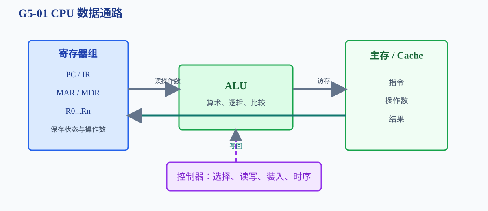
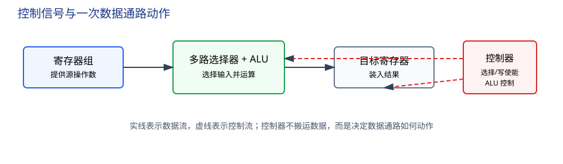
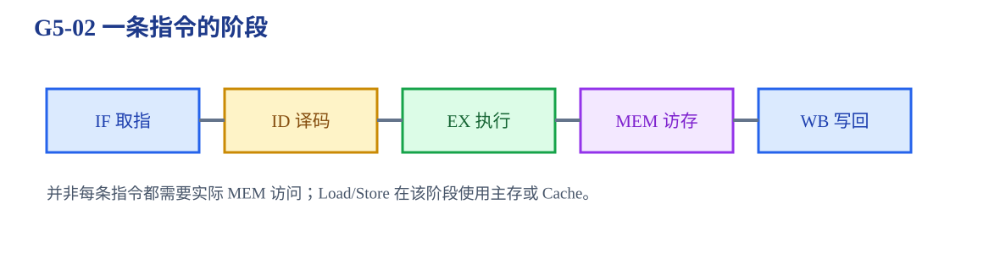

# 第5章 中央处理器

CPU 怎样把一条指令变成连续的控制信号、数据搬运和运算结果？

<strong>本章主线：</strong>先确定寄存器、ALU 和数据通路，再按取指、译码、执行、访存、写回追踪一条指令；最后讨论控制器、流水线和三类冒险。题目中先找“数据从哪里来、经过什么运算、写到哪里”，再判断控制信号和时序。

[返回全书知识树](00_全书知识树.md) · [返回书籍入口](../计算机组成_目录总图.md)

## 本章知识树

<strong style="color:#2563EB;">CPU：数据通路执行，控制器安排时序</strong><ul style="list-style:none;margin:6px 0;padding-left:18px;border-left:1px solid #CBD5E1;"><li>├─ <strong>数据通路</strong><ul style="list-style:none;margin:0 0 6px 4px;padding-left:18px;border-left:1px solid #E2E8F0;"><li>├─ <a href="#datapath">寄存器、ALU 与总线</a></li><li>└─ <a href="#micro-operations">寄存器传送级微操作</a></li></ul></li><li>├─ <strong>指令周期</strong><ul style="list-style:none;margin:0 0 6px 4px;padding-left:18px;border-left:1px solid #E2E8F0;"><li>├─ <a href="#instruction-cycle">取指、译码、执行、访存、写回</a></li><li>└─ <a href="#memory-stage">取指访存与执行访存</a></li></ul></li><li>├─ <strong>控制器</strong><ul style="list-style:none;margin:0 0 6px 4px;padding-left:18px;border-left:1px solid #E2E8F0;"><li>├─ <a href="#controller">控制信号与时序状态</a></li><li>└─ <a href="#control-implementations">硬布线与微程序控制</a></li></ul></li><li>└─ <strong>流水线</strong><ul style="list-style:none;margin:0 0 6px 4px;padding-left:18px;border-left:1px solid #E2E8F0;"><li>├─ <a href="#pipeline">吞吐率、延迟与加速比</a></li><li>└─ <a href="#hazards">结构、数据、控制冒险</a></li></ul></li></ul>

## 先看结论

1. 数据通路决定数据从哪里到哪里，控制器决定何时选择、装入、读写和运算。
2. PC、IR、MAR、MDR 保存不同内容；寄存器传送题先判断源寄存器、目标寄存器和总线方向。
3. 取指阶段取得指令，执行阶段可能再次访问存储器取得操作数或写回结果。
4. 流水线提高单位时间完成的指令数，不保证单条指令延迟一定下降。
5. 结构冒险来自资源冲突，数据冒险来自指令依赖，控制冒险来自分支改变下一条指令。
6. <strong>无访存指令可以不发起实际存储访问，但是否经过 MEM 阶段要以题目流水线模型为准。</strong>

## 1. 数据通路：寄存器和 ALU 怎样连接

典型 CPU 数据通路包含 PC、IR、MAR、MDR、通用寄存器组、ALU、状态寄存器、内部总线或多路选择器。寄存器保存状态，ALU 做运算，选择器和总线决定数据路径，控制器产生选择和写使能信号。

### 寄存器传送级微操作

把一条机器指令拆成微操作时，按“读寄存器 → 选择 ALU 输入 → 运算 → 写回/访存”列出动作。例如：

$$R_1\leftarrow R_2+R_3$$

可展开为：读出 $R_2$、$R_3$ → 送入 ALU → 控制 ALU 做加法 → 结果装入 $R_1$。

对于访存指令，还要增加：有效地址送入 MAR → 发起读/写 → MDR 接收或提供数据。

## 2. 指令周期：从取指到写回

1. <strong>取指 IF：</strong>PC 给出地址，主存或 Cache 返回指令，装入 IR，PC 通常前移。
2. <strong>译码 ID：</strong>解析操作码和寻址字段，读取寄存器，形成控制信号。
3. <strong>执行 EX：</strong>ALU 运算、比较、计算有效地址或确定分支条件。
4. <strong>访存 MEM：</strong>Load 读数据，Store 写数据；无访存指令可不发起实际存储访问。
5. <strong>写回 WB：</strong>把运算结果或访存结果写入目标寄存器。

### 取指访存和执行访存

取指访存取得“指令字”，执行访存取得“操作数”或写回“结果”。例如 LOAD R1,[R2+8]：EX 阶段计算 $R_2+8$，MEM 阶段访问存储器，WB 阶段把数据写回 $R_1$。不能把这两次访问合并成一次。

## 3. 控制器：把指令语义变成控制信号

控制器根据 IR 的操作码、时序状态、条件码和异常状态产生控制信号，例如：选择 ALU 输入、允许寄存器写入、读写主存、更新 PC、响应中断。

控制信号至少要回答三类问题：

- 选择谁作为数据源；
- 哪个部件在当前时刻装入数据；
- ALU、主存和总线执行什么操作。

### 硬布线与微程序控制

| 实现 | 控制信号组织 | 优点 | 边界 |
|---|---|---|---|
| 硬布线控制 | 组合逻辑和时序电路直接产生 | 速度较快 | 修改和扩展复杂 |
| 微程序控制 | 控制存储器保存微指令序列 | 结构清晰、易修改 | 需要取微指令，有额外访问 |

二者实现的是同一 ISA 语义；区别在控制信号如何组织，不是“一个有控制器、另一个没有控制器”。

## 4. 流水线：重叠执行而不是缩短每条指令

把 IF、ID、EX、MEM、WB 重叠执行，理想情况下流水线填满后每个周期完成一条指令。若非流水线每条指令耗时近似为 $kT$，流水线时钟周期受最慢阶段限制，完成 $n$ 条指令的理想时间近似为：

$$T_{pipe}\approx(k+n-1)T$$

实际加速比还要扣除装入、排空和冒险产生的气泡。流水线提高吞吐率，不等于单条指令的端到端延迟一定变短。

### 三类冒险

| 冒险 | 真实原因 | 常见处理 |
|---|---|---|
| 结构冒险 | 两个阶段争用同一硬件 | 增加资源、错开访问、停顿 |
| 数据冒险 | 后一条指令依赖前一条结果 | 转发、停顿、编译器调度 |
| 控制冒险 | 分支目标或条件尚未确定 | 预测、延迟槽、冲刷 |

## 5. 典型方法与短例

<strong>方法入口：</strong>按“数据源 → ALU/访存 → 目标寄存器”列出微操作，再判断流水线依赖。

### 画数据通路题

按“读哪个寄存器 → ALU 做什么 → 访问哪里 → 写回哪里”列微操作。

<strong>短例 1：</strong>ADD R1,R2,R3：读 $R_2,R_3$ → ALU 相加 → 结果写 $R_1$。LOAD R1,[R2+8]：读 $R_2$ → ALU 计算地址 → MAR 发起访问 → MDR 接收 → 写回 $R_1$。

### 判断流水线停顿

先找读写依赖，再判断是否存在转发路径；若前一条是 Load、后一条立即使用其结果，常需要额外停顿，具体周期以题目给出的阶段和转发结构为准。

**短例 2：**`LOAD R1,[R2]` 后紧接 `ADD R3,R1,R4`，若数据在 MEM 末尾才可用，而下一条 EX 在同一周期开始，则需要插入气泡；若题目提供可用的旁路和不同阶段时序，停顿数可能不同。

### 流水线吞吐率

<strong>短例 3：</strong>5 级流水线执行 8 条独立指令，理想情况下需要 $5+8-1=12$ 个周期；若有 2 个停顿周期，则总周期变为 14，不能仍按理想加速比计算。

## 6. 易错与边界

- PC、IR、MAR、MDR 的职责来自保存内容，不能因为都出现在取指过程中就互换。
- 转发只能解决部分数据冒险，不能自动解决所有 Load-Use 或控制冒险。
- “跳过 MEM 阶段”和“不发起存储访问”不是同一句话；先看题目阶段定义。
- 微程序控制的控制存储器保存微指令，不是保存用户程序数据的主存。
- 中断和异常会改变控制流，现场保存和恢复属于 CPU 控制流程，不能只归入 I/O 搬运。

## 7. 跨章节连接

<strong>跨章关联：</strong>

- [第3章](03_存储系统.md#cache)：MEM 阶段可能先查 Cache，再访问主存。
- [第4章](04_指令系统.md#instruction-format)：IR 字段决定控制器要产生哪些信号。
- [第6章](06_总线.md#transaction)：CPU、DMA 和 I/O 访问主存时共享总线。
- [第7章](07_输入输出系统.md#interrupt)：外部中断请求进入 CPU 控制流程。
