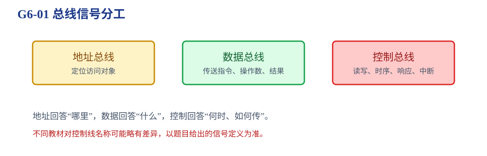
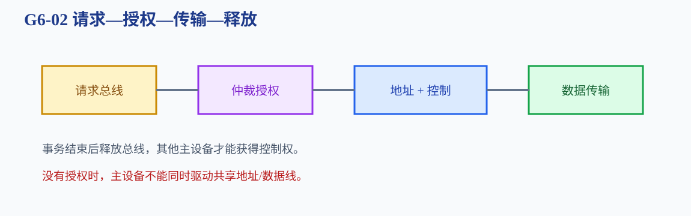
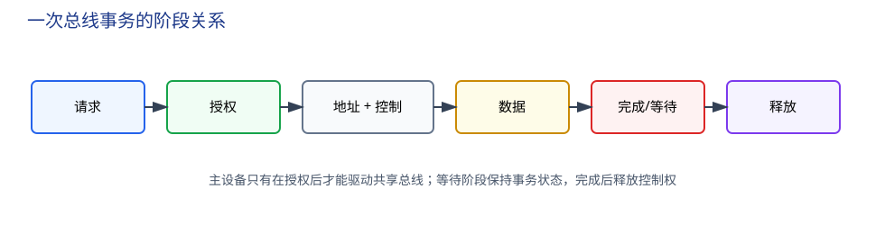

# 第6章 总线

多个部件怎样共享同一条传输通路，同时避免冲突并完成一次有顺序的传输？

<strong>本章主线：</strong>先区分地址、数据和控制信号，再判断总线结构和主从设备；随后处理仲裁、同步/异步时序和一次完整事务。总线题的核心不是背名词，而是回答“谁驱动、谁接收、什么时候有效、如何释放”。

[返回全书知识树](00_全书知识树.md) · [返回书籍入口](../计算机组成_目录总图.md)

## 本章知识树

<strong style="color:#2563EB;">总线：共享通路需要信号定义、仲裁规则和时序协议</strong><ul style="list-style:none;margin:6px 0;padding-left:18px;border-left:1px solid #CBD5E1;"><li>├─ <strong>信号与结构</strong><ul style="list-style:none;margin:0 0 6px 4px;padding-left:18px;border-left:1px solid #E2E8F0;"><li>├─ <a href="#bus-signals">地址、数据、控制信号</a></li><li>└─ <a href="#bus-structure">单总线、多总线、专用总线</a></li></ul></li><li>├─ <strong>共享控制</strong><ul style="list-style:none;margin:0 0 6px 4px;padding-left:18px;border-left:1px solid #E2E8F0;"><li>├─ <a href="#bus-roles">主设备、从设备与三态驱动</a></li><li>└─ <a href="#arbitration">集中式与分布式仲裁</a></li></ul></li><li>└─ <strong>传输事务</strong><ul style="list-style:none;margin:0 0 6px 4px;padding-left:18px;border-left:1px solid #E2E8F0;"><li>├─ <a href="#transaction">请求、授权、地址、数据、释放</a></li><li>├─ <a href="#timing">同步、异步和等待</a></li><li>└─ <a href="#bandwidth">带宽、突发传输与效率</a></li></ul></li></ul>

## 先看结论

1. 地址总线定位，数据总线传送内容，控制总线规定读写、时序和响应；数据总线通常双向。
2. 多个可能发起访问的主设备必须经过仲裁，任一时刻不能同时驱动共享总线。
3. 主设备发起事务，从设备响应事务；DMA 也是主设备，不是“绕过总线”的旁路。
4. 同步传输依赖统一时钟，异步传输依赖请求/应答握手；异步不等于没有时序。
5. 总线宽度只是一次并行传输的位数，实际带宽还取决于频率、等待、协议开销和有效传输比例。

## 1. 总线信号：地址、数据和控制

一次主存读事务可以抽象为：主设备放出地址和“读”控制信号，从设备返回数据并给出完成响应。地址和数据可能分属不同阶段；是否复用同一组线要看题目模型。

| 信号 | 解决的问题 | 常见方向 |
|---|---|---|
| 地址 | 访问哪个存储单元或 I/O 端口 | 主设备 → 从设备 |
| 数据 | 读出或写入什么内容 | 读时从设备 → 主设备，写时相反 |
| 控制 | 读/写、请求、授权、时序、完成、错误 | 双向，取决于具体信号 |

## 2. 总线结构：共享程度和并行程度

- **单总线：**结构简单，但所有部件共享一条通路，冲突和带宽瓶颈明显。
- **多总线：**CPU、主存和 I/O 可分到不同通路，减少争用，但控制更复杂。
- **专用总线：**只连接特定部件或承担特定数据流，速度和可预测性好，扩展性较弱。

结构选择是性能、成本和控制复杂度的折中，不能简单说总线越多越好。

### 主设备、从设备与三态驱动

主设备可以发起总线事务，例如 CPU、DMA 控制器；从设备响应事务，例如主存或 I/O 接口。共享数据线常用三态驱动：未获得总线控制权的设备必须处于高阻态，不能把 0 或 1 强行驱动到线上。

<strong>边界：</strong>“设备能读写总线”不等于“设备随时可以驱动总线”。先判断它是主设备还是从设备，再判断是否已获授权。

## 3. 仲裁：谁先使用共享通路

总线仲裁一般包含请求、授权和占用三个阶段。集中式仲裁由中央仲裁器收集请求并发出授权；分布式仲裁由各主设备按优先级或自编码规则竞争。

| 仲裁方式 | 典型实现 | 优点 | 风险 |
|---|---|---|---|
| 链式查询 | 授权信号依次经过设备 | 线路简单 | 优先级固定，传播延迟累积 |
| 计数器查询 | 仲裁器按编号轮询 | 可调整起始点 | 需要集中控制逻辑 |
| 独立请求 | 每个主设备有独立请求线 | 响应快、优先级灵活 | 线路和硬件较多 |
| 分布式仲裁 | 多个主设备共同决定 | 无单一仲裁中心 | 协议复杂 |

固定优先级简单但可能让低优先级设备长期等待；轮询或时间片能改善公平性。题目若问“优先级”与“公平性”，要同时考虑响应速度和饥饿风险。

## 4. 传输事务：从请求到释放

一次总线事务可以写成：

1. 主设备提出总线请求；
2. 仲裁器发出授权；
3. 主设备驱动地址和控制信号；
4. 从设备返回数据，或接收主设备写入的数据；
5. 双方给出等待、完成或错误响应；
6. 主设备结束事务并释放总线。

### 同步、异步和等待

- **同步总线：**地址、数据和响应在统一时钟边沿或周期内有效。若从设备较慢，需要插入等待周期。
- **异步总线：**用请求、应答、完成等握手信号表示双方状态，不要求共享时钟。

“同步”不代表所有设备速度相同；“异步”也不代表可以忽略时序关系。

### 带宽、突发传输和效率

理论传输率可近似为：

$$B_{theory}=\text{总线宽度(bit)}\times\text{每秒有效传输次数}$$

实际带宽还要乘以有效周期比例，并扣除仲裁、地址、等待和响应开销。突发传输在一次地址阶段后连续传送多个数据块，可减少重复仲裁和地址发送；分离事务则允许主设备先释放总线，稍后再回来取结果。

## 5. 典型方法与短例

<strong>方法入口：</strong>先标出谁驱动、谁接收、什么时候有效，再计算带宽或判断等待。

### 带宽计算

**短例 1：**总线宽度 32 位，时钟 100 MHz，每周期传一次数据，理论传输率为 $32\times100\text{M}=3.2\text{Gbit/s}=400\text{MB/s}$。若有效周期比例为 0.75，实际有效带宽约为 300 MB/s。

### 时序题

**短例 2：**若题目给出“请求—授权—地址—数据—完成—释放”，先画横轴，再给每个阶段标出驱动者和接收者。若从设备在数据阶段后才给出完成信号，主设备必须保持事务状态，不能提前释放总线。

### DMA 竞争

**短例 3：**CPU 正在执行时 DMA 请求总线。若采用周期窃取，DMA 每次只占用一个或少数传输周期；若采用突发方式，DMA 连续占用总线直到一个数据块传完，CPU 等待时间更长但总线效率可能更高。

## 6. 易错与边界

- 总线宽度不是地址空间大小；地址线位数决定可寻址范围，数据线宽度决定一次传输多少位。
- DMA 仍需仲裁、授权和总线占用，不能因为“直接访问主存”就认为它绕过总线。
- 地址和数据分不同阶段通常隐含复用总线或分阶段传输的模型，不能对所有总线实现一概而论。
- 带宽计算要统一 bit/s 与 Byte/s，并考虑等待、仲裁和协议开销。
- 三态高阻态不是“传输 0”，而是暂时不驱动共享线路。

## 7. 跨章节连接

<strong>跨章关联：</strong>

- [第3章](03_存储系统.md#addressing)：地址和数据经过总线进入主存、Cache 或存储控制器。
- [第5章](05_中央处理器.md#datapath)：CPU 数据通路通过总线与主存和 I/O 交换信息。
- [第7章](07_输入输出系统.md#dma)：DMA 在总线仲裁后批量搬运数据。
