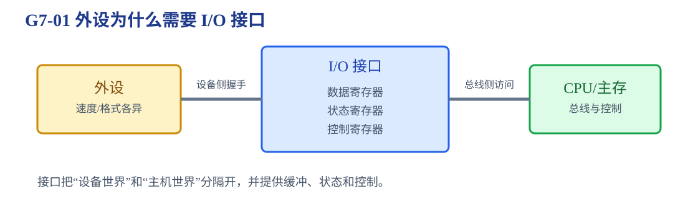
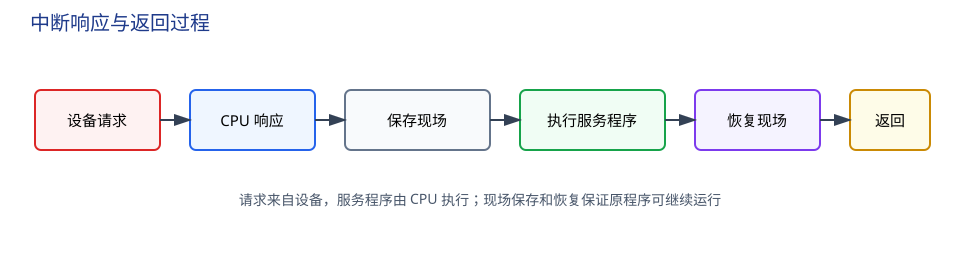
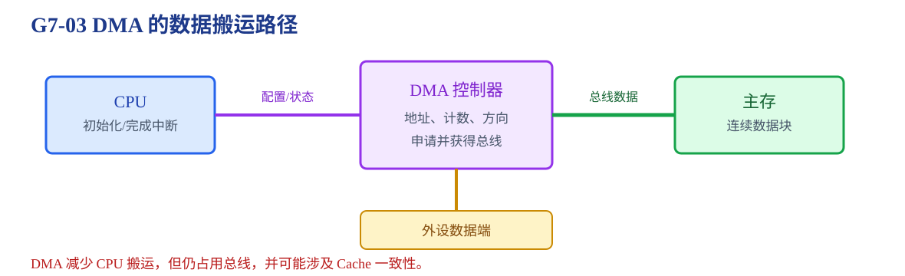
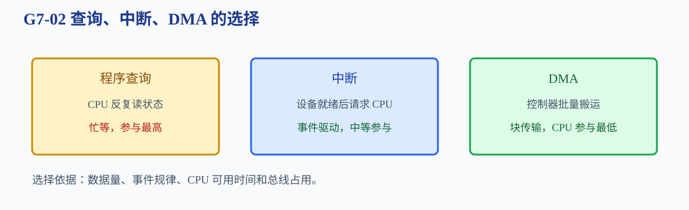

# 第7章 输入输出系统

外部设备速度、格式和事件模式各不相同，怎样通过接口与 CPU、主存交换数据？

<strong>本章主线：</strong>先认识 I/O 接口和寄存器，再比较程序查询、中断和 DMA。选择传输方式时要同时看数据量、事件是否间歇、CPU 参与程度、总线占用和完成通知。

[返回全书知识树](00_全书知识树.md) · [返回书籍入口](../计算机组成_目录总图.md)

## 本章知识树

<strong style="color:#2563EB;">I/O：接口先适配，传输方式再决定 CPU 参与程度</strong><ul style="list-style:none;margin:6px 0;padding-left:18px;border-left:1px solid #CBD5E1;"><li>├─ <strong>接口与编址</strong><ul style="list-style:none;margin:0 0 6px 4px;padding-left:18px;border-left:1px solid #E2E8F0;"><li>├─ <a href="#io-interface">数据、状态、控制寄存器</a></li><li>└─ <a href="#io-addressing">统一编址与独立编址</a></li></ul></li><li>├─ <strong>CPU 参与的传输</strong><ul style="list-style:none;margin:0 0 6px 4px;padding-left:18px;border-left:1px solid #E2E8F0;"><li>└─ <a href="#polling">程序查询</a>：CPU 主动轮询状态</li></ul></li><li>├─ <strong>事件驱动的传输</strong><ul style="list-style:none;margin:0 0 6px 4px;padding-left:18px;border-left:1px solid #E2E8F0;"><li>└─ <a href="#interrupt">中断</a>：请求、响应、服务、恢复</li></ul></li><li>└─ <strong>批量数据传输</strong><ul style="list-style:none;margin:0 0 6px 4px;padding-left:18px;border-left:1px solid #E2E8F0;"><li>└─ <a href="#dma">DMA</a>：控制器直接搬运数据</li></ul></li></ul>

## 先看结论

1. I/O 接口负责缓冲、状态反馈、控制命令、格式转换和设备时序适配。
2. 程序查询简单但可能忙等；中断适合间歇事件；DMA 适合连续、大块数据。
3. 中断改变控制流：CPU 响应请求、保存必要现场、执行服务程序并恢复原程序。
4. DMA 减少 CPU 搬运次数，但仍需初始化、总线仲裁、主存地址和完成通知。
5. <strong>“直接”描述 DMA 的数据搬运路径，不表示 DMA 不占总线、不经过接口或不需要 CPU。</strong>

## 1. I/O 接口：外设与主机之间的适配层

接口通常包含：

- 数据寄存器：保存待传送数据；
- 状态寄存器：报告就绪、忙、错误等状态；
- 控制寄存器：接收启动、清除、中断使能、传输模式等命令。

接口还可以完成串并转换、缓冲、握手、错误检测和中断/DMA 请求生成。外设通常不能直接替代接口与 CPU 内部数据通路对话。

### 统一编址与独立编址

| 方式 | 访问形式 | 特点 |
|---|---|---|
| 统一编址（存储器映射 I/O） | I/O 寄存器占用主存地址空间 | 可使用普通访存指令，地址空间被分割 |
| 独立编址（I/O 专用指令） | I/O 有独立端口地址空间 | 主存和 I/O 地址空间分开，需要专用指令 |

题目若问“某地址访问的是主存还是接口”，先看编址方式和地址空间约定。

## 2. 程序查询：CPU 主动等待

程序查询流程：CPU 读取状态寄存器 → 判断设备是否就绪 → 未就绪则继续查询 → 就绪后读写数据寄存器 → 更新计数并决定是否继续。

<strong>短例 1：</strong>若设备每隔一段时间产生一个字节，CPU 每次循环都读取状态寄存器，直到 Ready 位置 1 后再取数据。这种方式容易实现，但等待期间 CPU 不能高效处理其他任务。

程序查询适合设备简单、数据量小、实时要求不高或控制逻辑必须完全由软件掌握的情况。

## 3. 中断：设备就绪后通知 CPU

中断流程通常为：设备置位请求 → CPU 在允许的边界响应 → 保存 PC 和必要现场 → 根据向量或入口转入服务程序 → 读写接口、清除请求 → 恢复现场并返回原程序。

### 中断中的关键对象

- <strong>中断请求：</strong>接口或设备提出服务需求；
- <strong>中断响应：</strong>CPU 在满足屏蔽、优先级和当前状态后接受请求；
- <strong>中断向量：</strong>把中断类型映射到服务程序入口；
- <strong>现场保存：</strong>至少要保存能够恢复原程序执行所需的状态，具体范围依体系结构而定；
- <strong>优先级与屏蔽：</strong>决定多个请求同时到来时先服务谁，以及哪些请求暂时不能打断当前程序。

<strong>边界：</strong>中断请求来自设备或接口，但中断服务程序由 CPU 执行；设备不会直接执行 CPU 指令。

<strong>短例 2：</strong>键盘按键是低频、到来时间不确定的事件。若采用中断，CPU 不必持续轮询，按键到来后由接口请求 CPU，服务程序读取数据寄存器并清除请求。

## 4. DMA：控制器直接搬运数据

DMA 控制器开始前由 CPU 写入起始地址、传送计数、方向和控制信息；随后 DMA 申请总线，获得授权后在设备与主存之间批量传送，结束时通常用中断通知 CPU。

### DMA 的基本过程

1. CPU 初始化 DMA 地址寄存器、计数器和方向。
2. 设备准备好数据，DMA 发出总线请求。
3. 仲裁器授权，DMA 驱动地址、控制和数据通路。
4. 每次传输后地址递增、计数递减。
5. 计数归零时 DMA 释放总线并产生完成中断。

### DMA 方式

| 方式 | 总线占用 | CPU 影响 | 典型特点 |
|---|---|---|---|
| 突发 DMA | 连续占用一段时间 | CPU 等待较久 | 块传输效率高 |
| 周期窃取 | 每次占用一个或少数周期 | CPU 被间歇打断 | 兼顾 CPU 与设备 |
| 透明 DMA | 只在 CPU 不使用总线时传输 | 影响较小 | 传输时机受限 |

<strong>短例 3：</strong>磁盘连续读入一大块数据时，DMA 先由 CPU 配置起始地址和长度，然后批量传输；CPU 只在初始化和完成中断时参与，数据搬运不必逐字执行指令。

## 5. 典型方法与方式选择

<strong>方法入口：</strong>按数据量、事件模式、CPU 参与程度和总线占用选择查询、中断或 DMA。

判断查询、中断、DMA 时按以下顺序：

1. 数据量很小、设备简单吗？是则程序查询可能足够。
2. 是否是间歇事件、到来时间不确定？是则优先考虑中断。
3. 是否连续传输大块数据、CPU 不应逐字搬运？是则考虑 DMA。
4. 题目若强调优先级、屏蔽和现场保存，重点是中断；若强调块长、总线占用和传输周期，重点是 DMA。

## 6. 易错与边界

- 统一编址和独立编址是地址空间组织方式，不等于查询、中断、DMA 三种传输方式。
- DMA 的“直接”是设备与主存直接搬运，不是绕过总线，也不表示不需要接口。
- 中断现场保存范围取决于体系结构，不能把某一种实现的寄存器集合当成所有题目的固定答案。
- 查询方式占用 CPU 时间，不代表传输速率一定最低；还要结合设备速度和软件开销。
- DMA 完成后通常仍需要中断或状态寄存器通知 CPU，不能把“搬完”与“程序已经知道”混为一谈。

## 7. 跨章节连接

<strong>跨章关联：</strong>

- [第3章](03_存储系统.md#addressing)：DMA 使用主存地址，数据最终进入存储层次。
- [第5章](05_中央处理器.md#controller)：中断响应和 I/O 控制信号由 CPU 控制器协调。
- [第6章](06_总线.md#transaction)：查询、中断和 DMA 都可能发起或占用总线事务。
