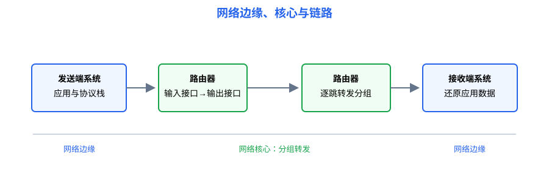
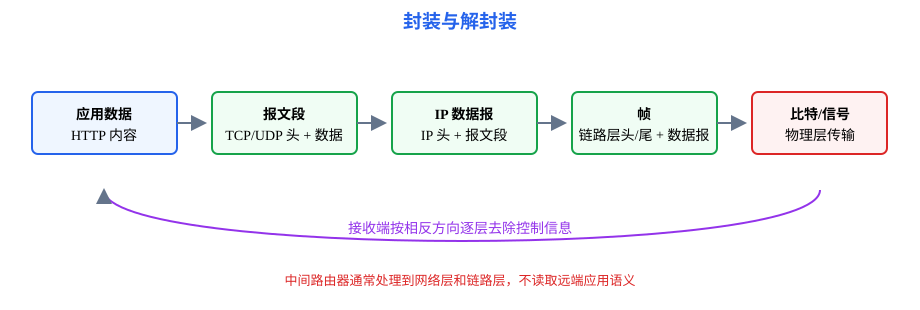

# 第1章 计算机网络体系结构：为什么要分层，数据怎样穿过网络

<strong>本章要解决的问题：</strong>
网络由哪些部分组成？为什么要分层？一段应用数据如何从发送端变成链路上的比特，并在接收端还原？

<strong>本章一句话主线：</strong>

网络组成 → 分组交换 → 分层模型 → 服务/接口/协议 → 封装解封装 → 时延与吞吐量。

408 主线

[返回全书知识树](00_全书知识树.md) · [返回计算机网络入口](../计算机网络_目录总图.md)

## 本章知识树

<strong style="color:#4b8ee8;">体系结构：把复杂通信拆成可组合的层</strong>
<ul style="list-style:none;margin:6px 0 0 8px;padding:0 0 0 18px;border-left:2px solid #94A3B8;">
<li>─ <strong><a href="#network-model">网络组成</a></strong>
<ul style="list-style:none;margin:0 0 6px 4px;padding-left:18px;border-left:1px solid #CBD5E1;">
<li>─ <a href="#edge-core">网络边缘与核心</a></li>
<li>─ <a href="#packet-switching">分组交换</a></li>
</ul></li>
<li>─ <strong><a href="#layering">分层模型</a></strong>
<ul style="list-style:none;margin:0 0 6px 4px;padding-left:18px;border-left:1px solid #CBD5E1;">
<li>─ <a href="#osi-tcp">OSI 与 TCP/IP</a></li>
<li>─ <a href="#service-protocol">服务、接口与协议</a></li>
</ul></li>
<li>─ <strong>封装与性能</strong>
<ul style="list-style:none;margin:0 0 0 4px;padding-left:18px;border-left:1px solid #CBD5E1;">
<li>─ <a href="#encapsulation">封装与解封装</a></li>
<li>─ <a href="#delay">时延</a>、<a href="#throughput">吞吐量与带宽</a></li>
</ul></li>
</ul>

## 先看结论

- 网络边缘是主机和应用，网络核心是转发分组的路由器与链路。
- 分层不是把一次通信割裂，而是让每层只依赖下层服务，并向上层提供清晰接口。
- 协议规定通信双方交换消息的格式、顺序和动作；服务描述本层对上层提供什么能力。
- 封装时每层增加自己的控制信息，解封装时按相反顺序逐层取出。
- 时延题先拆组成，吞吐量题先确认瓶颈链路和统计时间范围。

## 知识展开

## 1. 网络组成：边缘、核心和链路

### 网络边缘与核心

网络边缘包括主机、服务器和运行应用程序的终端。网络核心由路由器、交换设备和互连链路组成，主要任务是把分组从输入接口送到合适的输出接口。

### 分组交换

发送端把长消息切成多个分组，每个分组带有必要的控制信息，在共享链路上逐跳转发。分组交换提高了链路共享效率，但会产生排队、丢包和乱序等问题，后续由链路层或传输层处理。

## 2. 分层模型：先确定职责，再追踪数据

### OSI 与 TCP/IP

OSI 常分为物理层、数据链路层、网络层、运输层、会话层、表示层和应用层。TCP/IP 复习时通常将重点放在应用层、运输层、网际层和网络接口层；教材有时把网络接口进一步拆成数据链路层与物理层。

408 题目更重视层次职责和协议配合，不要求把两个模型机械一一对应。判断某个协议属于哪层时，优先看它解决的通信问题和服务对象。

### 服务、接口与协议

| 名词 | 关注点 | 例子 |
|---|---|---|
| 服务 | 本层向上层提供的功能 | 可靠字节流、尽力而为的数据报 |
| 接口 | 上下层如何调用或交付 | 端口、原语、报文交付边界 |
| 协议 | 通信双方遵守的格式和动作 | TCP 确认、IP 转发、HTTP 请求 |

## 3. 封装与解封装：一段数据如何穿过各层

应用层产生数据后，运输层加入端口以及 UDP/TCP 的运输控制信息，网络层加入源/目的 IP，数据链路层加入帧头和帧尾，物理层把帧转换为信号。

常用对象名称是：

应用数据 → TCP 报文段或 UDP 用户数据报 → IP 数据报 → 帧 → 比特流

在接收端，过程反向进行。中间路由器通常只处理到网络层和数据链路层，不会读取远端应用层的完整语义。

## 4. 性能：时延、吞吐量和带宽

单个分组经过一条链路的时延常拆为：

$$
d=d_{\mathrm{proc}}+d_{\mathrm{queue}}+d_{\mathrm{trans}}+d_{\mathrm{prop}}
$$

其中传输时延约为

$$
d_{\mathrm{trans}}=\frac{L}{R}
$$

$L$ 是分组长度，$R$ 是链路发送速率；传播时延约为

$$
d_{\mathrm{prop}}=\frac{D}{v}
$$

$D$ 是传播距离，$v$ 是信号传播速度。

### 吞吐量与带宽

带宽可表示信道的频带范围或最大传输能力，吞吐量是实际单位时间交付的数据量。多条串联链路的端到端吞吐量通常受瓶颈链路限制；不能只看某一条标称速率最高的链路。

带宽时延积表示链路中理论上可能同时在途的数据量：

$$
\mathrm{BDP}=R\,d_{\mathrm{prop}}
$$

<strong>使用信号：</strong>题目问“链路上最多有多少 bit 正在传播”或比较窗口是否足以填满链路时，先用带宽乘传播时延；它不是吞吐量，也不是单个分组的传输时延。

## 结构图 / 过程图

本章图示分别表达“网络由哪些对象组成”和“数据在层间如何加头、去头”。读图时始终区分端系统、路由器、链路和协议控制信息。

## 典型方法与短例

### 短例1：封装对象判断

应用产生一段 HTTP 数据。运输层可能把它交给 TCP 形成报文段，网络层把报文段放入 IP 数据报，数据链路层再把数据报放入帧。若题目问“路由器转发时保留什么”，优先回答源/目的 IP；若问“下一跳如何在局域网送达”，再考虑 MAC 地址。

### 短例2：链路时延

一个 $12000$ bit 的分组通过 $10$ Mbit/s 链路，传播距离为 $2000$ km，信号速度取 $2\times10^8$ m/s，忽略处理和排队时延：

$$
d_{\mathrm{trans}}=\frac{12000}{10\times10^6}=1.2\text{ ms}
$$

$$
d_{\mathrm{prop}}=\frac{2\times10^6}{2\times10^8}=10\text{ ms}
$$

总时延为 $11.2$ ms。不能把传输时延和传播时延都理解成“数据在路上移动的距离”。

## 易错与边界

- 分层模型是职责划分，不等于每个现实协议都能严格塞入唯一盒子。
- 路由器转发分组，不等于它替端系统完成应用层请求。
- 带宽是能力指标，吞吐量是实际结果；排队和瓶颈会让两者不同。
- 传输时延由分组长度和发送速率决定，传播时延由距离和传播速度决定。

## 跨章节连接

- 封装后的比特如何变成信号，见[第2章](02_物理层.md)。
- 帧如何在相邻节点可靠传输，见[第3章](03_数据链路层.md)。
- IP 数据报如何寻址和转发，见[第4章](04_网络层.md)。
- TCP/UDP 和应用协议分别见[第5章](05_传输层.md)与[第6章](06_应用层.md)。
