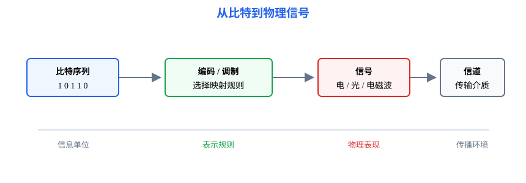

# 第2章 物理层：把比特变成可以通过信道的信号

<strong>本章要解决的问题：</strong>
比特如何表示为信号？信道能传多快？不同设备如何共享同一条传输介质？

<strong>本章一句话主线：</strong>

比特与数据 → 信号 → 编码/调制 → 信道与介质 → 复用 → 交换 → 速率与时延。

408 主线

[返回全书知识树](00_全书知识树.md) · [返回计算机网络入口](../计算机网络_目录总图.md)

## 本章知识树

<strong style="color:#4b8ee8;">物理层：信号、信道与传输能力</strong>
<ul style="list-style:none;margin:6px 0 0 8px;padding:0 0 0 18px;border-left:2px solid #94A3B8;">
<li>─ <strong><a href="#signal">比特与信号</a></strong>
<ul style="list-style:none;margin:0 0 6px 4px;padding-left:18px;border-left:1px solid #CBD5E1;">
<li>─ <a href="#encoding">数字编码</a></li>
<li>─ <a href="#modulation">模拟调制</a></li>
</ul></li>
<li>─ <strong><a href="#channel">信道与介质</a></strong>
<ul style="list-style:none;margin:0 0 6px 4px;padding-left:18px;border-left:1px solid #CBD5E1;">
<li>─ <a href="#media">传输介质</a></li>
<li>─ <a href="#capacity">信道容量</a></li>
</ul></li>
<li>─ <strong>复用与交换</strong>
<ul style="list-style:none;margin:0;padding-left:18px;border-left:1px solid #CBD5E1;">
<li>─ <a href="#multiplexing">频分、时分、波分、码分复用</a></li>
<li>─ <a href="#switching">电路、报文、分组交换</a></li>
</ul></li>
</ul>

## 先看结论

- 比特是信息单位，信号是承载比特的物理表现；编码和调制解决的是“如何表示”。
- 比特率是每秒传输的比特数，波特率是每秒变化的码元数；多比特码元时二者不相等。
- Nyquist 给出理想无噪信道的上限，Shannon 给出有噪信道的容量上限。
- 传输时延由数据量和速率决定，传播时延由距离和传播速度决定。
- 复用共享一条物理介质，交换决定数据经过哪些转发节点；两者不是同一概念。

## 知识展开

## 1. 比特与信号

### 数字编码

数字编码把离散比特映射成电平、跳变或脉冲序列。题目常比较编码的同步能力、带宽占用、直流分量和抗干扰特点。

### 模拟调制

模拟调制通过改变载波的振幅、频率或相位承载数字信息。ASK、FSK、PSK 和 QAM 的差别，本质上是改变载波的不同参数或同时改变多个参数。

## 2. 信道与传输介质

### 传输介质

双绞线成本低、部署广；光纤带宽大、抗电磁干扰；无线介质便于移动接入但更容易受共享和干扰影响。题目比较介质时，要同时看带宽、距离、抗干扰、成本和部署条件。

### 信道容量

无噪声、带宽为 \(B\)、每个码元有 \(V\) 种离散电平时，Nyquist 公式可写为

$$
C=2B\log_2V
$$

有噪声信道的 Shannon 容量为

$$
C=B\log_2(1+S/N)
$$

其中 \(S/N\) 是信噪比。两者都给出理论上限，实际系统还会受编码、设备和协议开销影响。

<strong>使用信号：</strong>题目给带宽、码元状态数或信噪比时，先判断是理想无噪模型还是有噪模型，再选择 Nyquist 或 Shannon；(S/N) 要先换成线性值。

## 3. 复用与交换

### 复用

| 方式 | 划分资源 | 典型理解 |
|---|---|---|
| 频分复用 FDM | 不同频带 | 同时占用不同频段 |
| 时分复用 TDM | 不同时隙 | 按时间轮流发送 |
| 波分复用 WDM | 不同光波长 | 光纤中并行承载多个波长 |
| 码分复用 CDM | 不同码序列 | 通过码的相关性区分用户 |

### 三种交换

- **电路交换：** 先建立专用通路，适合持续、稳定的数据流，但建立和释放有固定开销。
- **报文交换：** 整个报文作为存储转发单位，缓存需求大，时延可能较高。
- **分组交换：** 把报文拆成分组，适合突发数据和共享链路，是互联网的基本方式。

## 4. 速率与时延

码元速率为 \(S\) baud、每个码元携带 \(\log_2V\) bit 时，比特率为

$$
R=S\log_2V
$$

长度为 \(L\) bit 的数据在速率 \(R\) 的链路上传输，传输时延为

$$
d_{\mathrm{trans}}=\frac{L}{R}
$$

## 结构图 / 过程图

本章先区分“数据如何表示”为信号，再区分“多路数据如何共享”介质；不要把编码、复用和交换当作同一层次的动作。

## 典型方法与短例

### 短例1：码元与比特率

若每个码元有 4 种状态，码元速率为 2 Mbaud，则每个码元携带 \(\log_2 4=2\) bit，比特率为 \(4\) Mbit/s。

### 短例2：传输时间

发送 \(8\) Mbit 数据，链路速率为 \(2\) Mbit/s，则传输时延为

$$
d_{\mathrm{trans}}=\frac{8}{2}=4\text{ s}
$$

这不包含传播时延；若题目给出距离和传播速度，还要另行计算并相加。

## 易错与边界

- 波特率和比特率只有在每个码元携带 1 bit 时才相等。
- Nyquist 不考虑噪声，Shannon 需要使用线性信噪比而不是直接代入分贝值。
- 传输介质决定信号如何传播，交换方式决定节点如何转发，不能互换。
- 带宽时延积是链路中“在途数据量”的量级，不等于吞吐量。

## 跨章节连接

- 物理层把帧转换为信号，帧的结构和差错控制见[第3章](03_数据链路层.md)。
- 物理速率和传播时延会影响[第1章](01_计算机网络体系结构.md)的性能计算。
- MTU 是物理/链路承载能力对[第4章](04_网络层.md)分片的约束。
