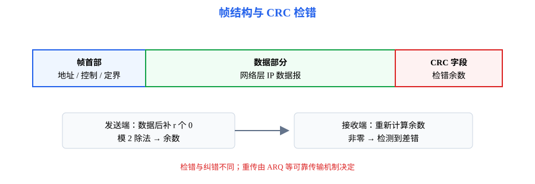
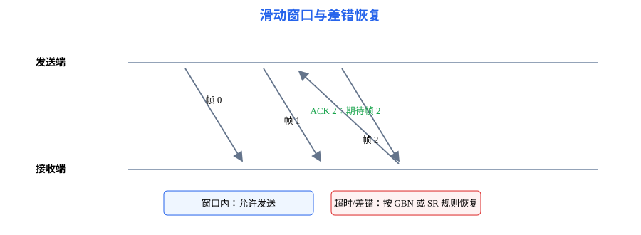

# 第3章 数据链路层：一条链路怎样成帧、检错并共享介质

<strong>本章要解决的问题：</strong>
网络层数据报如何在一条相邻链路上传输？帧边界如何确定，差错如何发现和恢复，多台设备又如何共享介质？

<strong>本章一句话主线：</strong>

帧 → 成帧与透明传输 → 差错检测 → 链路级可靠传输 → 流量控制 → 滑动窗口/ARQ → 介质访问 → 以太网与 WLAN。

408 主线

[返回全书知识树](00_全书知识树.md) · [返回计算机网络入口](../计算机网络_目录总图.md)

## 本章知识树

<strong style="color:#4b8ee8;">数据链路层：相邻节点之间的帧传输</strong>
<ul style="list-style:none;margin:6px 0 0 8px;padding:0 0 0 18px;border-left:2px solid #94A3B8;">
<li>─ <strong>帧与差错</strong>
<ul style="list-style:none;margin:0 0 6px 4px;padding-left:18px;border-left:1px solid #CBD5E1;">
<li>─ <a href="#framing">成帧与透明传输</a></li><li>─ <a href="#crc">CRC 检错</a></li>
</ul></li>
<li>─ <strong><a href="#reliability">可靠传输与流量控制</a></strong>
<ul style="list-style:none;margin:0 0 6px 4px;padding-left:18px;border-left:1px solid #CBD5E1;">
<li>─ <a href="#stop-wait">停止等待</a></li><li>─ <a href="#sliding-window">滑动窗口与 ARQ</a></li>
</ul></li>
<li>─ <strong><a href="#mac">介质访问与局域网</a></strong>
<ul style="list-style:none;margin:0;padding-left:18px;border-left:1px solid #CBD5E1;">
<li>─ <a href="#csma">CSMA/CD、CSMA/CA</a></li><li>─ <a href="#ethernet">以太网与 WLAN</a></li>
</ul></li>
</ul>

## 先看结论

- 成帧为网络层数据报划定链路传输边界；透明传输保证数据内容不会被误认为帧控制标志。
- CRC 擅长检测突发差错，但检错本身不等于纠错，也不保证所有差错都能发现。
- 停止等待、滑动窗口和 ARQ 用序号、确认与超时重传协调链路级可靠性。
- 数据链路层的可靠性覆盖一段链路；TCP 可靠性覆盖端到端进程通信。
- 传统共享式以太网使用 CSMA/CD；无线局域网通常使用 CSMA/CA，避免碰撞检测困难。

## 知识展开

## 1. 帧：成帧与透明传输

数据链路层把网络层数据报放入帧中，帧通常包含首部、数据部分和校验相关字段。成帧可以通过长度字段、特殊定界符或编码约束识别帧边界。

透明传输指无论数据内容如何，接收端都能正确恢复原始数据。若数据中可能出现与定界符相同的比特模式，需要采用字符填充、比特填充或其他成帧规则。

### CRC 差错检测

发送端把比特串看作多项式，按生成多项式做模 2 除法，把余数附加到帧尾；接收端对收到的比特串复算余数，非零余数表示检测到差错。

<strong style="color:#16A34A">计算步骤</strong>

1. 生成多项式次数为 $r$，原数据后补 $r$ 个零；
2. 用生成多项式按模 2 长除法求余数；
3. 把余数替换补零位置，形成待发送码字；
4. 接收端重算余数，判断是否检测到差错。

<strong style="color:#DC2626">条件：</strong>模 2 减法等价于异或；题目必须明确生成多项式和位序。

## 2. 链路级可靠传输与流量控制

可靠传输依靠序号区分新旧帧、确认说明接收状态、超时触发重传。流量控制的目标是避免发送速度超过接收方处理能力；它与网络拥塞控制目标不同。

### 停止等待

发送一个帧后等待确认，再发送下一个。若确认丢失或超时，发送方可能重传，因此接收方必须借助序号识别重复帧，避免重复交付。

### 滑动窗口与 ARQ

滑动窗口允许多个未确认帧同时在途。回退 N 帧（GBN）通常在出错后重传窗口中的后续帧；选择重传（SR）可分别缓存并重传出错帧。具体窗口上限取决于序号空间和协议规则。

若序号字段为 $m$ bit，常见教材模型下：GBN 的发送窗口不超过 $2^m-1$，接收窗口通常为 1；SR 为避免新旧帧序号重叠，发送窗口和接收窗口通常都不超过 $2^{m-1}$。题目若给出不同的确认或缓存规则，以题设为准。

## 3. 介质访问与局域网

共享信道需要规定谁可以发送。静态划分可以预先分配时隙或频带，随机访问则由站点竞争使用信道。

### CSMA/CD 与 CSMA/CA

- <strong>CSMA/CD：</strong>发送前侦听，发送中检测碰撞，碰撞后停止并退避；用于传统共享式以太网。
- <strong>CSMA/CA：</strong>尽量在发送前避免碰撞，通过侦听、随机退避和可选控制帧降低冲突概率；常见于 WLAN。
- 全双工交换式以太网没有传统共享介质碰撞场景，因此不使用 CSMA/CD 处理碰撞。

### 以太网与 WLAN

以太网帧通过 MAC 地址在局域网链路中交付，交换机依据转发表选择输出端口。无线局域网的信道共享、隐藏站和确认机制与有线以太网不同，不能把 CSMA/CD 原样套到 Wi-Fi。

## 结构图 / 过程图

帧图说明“链路层传什么”，窗口图说明“帧如何可靠推进”。CRC 只能检测错误，是否重传由 ARQ 协议和确认/超时机制决定。

## 典型方法与短例

### 短例1：CRC

数据为 1101，生成多项式为 1011（次数 $r=3$）。数据后补零得到 1101000，模 2 除以 1011，余数为 001，因此发送码字为 1101001。

### 短例2：序号与窗口

若序号字段为 3 bit，则序号空间大小为 8。对于 GBN，发送窗口最大可取 $2^3-1=7$，接收窗口通常为 1；若题目指定 SR，发送窗口和接收窗口通常都不超过序号空间的一半，即 4。

### 短例3：介质访问选择

有线共享总线中发送站可以边发送边检测电气碰撞，可使用 CSMA/CD；无线站难以可靠地边发边听，因此采用 CSMA/CA 的避碰思路。

## 易错与边界

- CRC 检错不等于纠错；接收方发现差错后是否重传，取决于上层协议机制。
- 确认丢失可能导致重传，接收端必须识别重复帧。
- GBN 与 SR 的窗口约束不同，不能只记“窗口越大效率越高”。
- 传统共享以太网与交换式全双工以太网的碰撞模型不同。
- 链路层重传不能替代 TCP 端到端可靠性。

## 跨章节连接

- 帧封装的上层对象是[第4章](04_网络层.md)的 IP 数据报。
- 物理层信号和信道决定链路速率，见[第2章](02_物理层.md)。
- TCP 的端到端可靠性、流量控制和拥塞控制见[第5章](05_传输层.md)。
