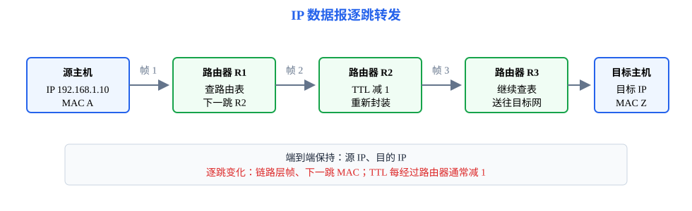
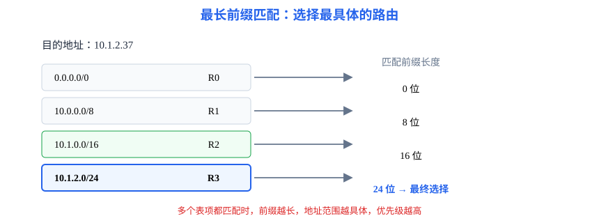

# 第4章 网络层：让数据报找到正确的下一跳

<strong>本章要解决的问题：</strong>
主机只知道目标 IP 时，如何确定网络范围、选择路由，并把数据报逐跳送到目的主机？

<strong>本章一句话主线：</strong>

IP 数据报 → IPv4 地址 → 子网与 CIDR → 路由表 → 最长前缀匹配 → 分组转发 → 控制协议 → MTU 与分片。

408 主线
现代扩展仅作短注

[返回全书知识树](00_全书知识树.md) · [返回计算机网络入口](../计算机网络_目录总图.md)

## 本章知识树

<strong style="color:#4b8ee8;">网络层：地址、路径与逐跳转发</strong>
<ul style="list-style:none;margin:6px 0 0 8px;padding:0 0 0 18px;border-left:2px solid #94A3B8;">
<li>─ <strong><a href="#datagram">IP 数据报</a></strong>：网络层传输的对象
<ul style="list-style:none;margin:0 0 6px 4px;padding-left:18px;border-left:1px solid #CBD5E1;">
<li>─ <a href="#ipv4-header">首部字段</a>：源地址、目的地址、TTL、协议号、分片字段</li>
<li>─ <a href="#addressing">IPv4 地址</a>：主机、网络和接口的标识</li>
</ul></li>
<li>─ <strong><a href="#subnet">子网与 CIDR</a></strong>：从地址中划分网络前缀和主机部分
<ul style="list-style:none;margin:0 0 6px 4px;padding-left:18px;border-left:1px solid #CBD5E1;">
<li>─ <a href="#subnet-calculation">网络地址、广播地址与主机范围</a></li>
<li>─ <a href="#vlsm">变长子网掩码</a>：按需求分配不同前缀长度</li>
</ul></li>
<li>─ <strong><a href="#routing">路由与转发</a></strong>
<ul style="list-style:none;margin:0 0 6px 4px;padding-left:18px;border-left:1px solid #CBD5E1;">
<li>─ <a href="#routing-table">路由表</a>：目的前缀、下一跳、出接口</li>
<li>─ <a href="#routing-protocols">RIP、OSPF、BGP</a>：路由计算的职责边界</li>
<li>─ <a href="#forwarding">最长前缀匹配</a>：从多个匹配项中选最具体者</li>
</ul></li>
<li>─ <strong><a href="#control-protocols">控制协议与边界</a></strong>
<ul style="list-style:none;margin:0 0 0 4px;padding-left:18px;border-left:1px solid #CBD5E1;">
<li>─ <a href="#arp">ARP</a>、<a href="#icmp">ICMP</a>、<a href="#nat">NAT</a>：支撑寻址、诊断和地址转换</li>
<li>─ <a href="#dhcp-boundary">DHCP</a>：网络参数配置，协议主归应用层</li>
</ul></li>
<li>─ <strong><a href="#fragmentation">MTU 与分片</a></strong>：链路承载能力对 IP 数据报的约束</li>
</ul>

## 先看结论

- <strong>网络层的核心对象是 IP 数据报：</strong>它携带源 IP、目的 IP 和控制字段，路由器依据目的 IP 逐跳转发。
- <strong>子网题先算范围，再算主机：</strong>先由前缀长度得到块大小和网络边界，再判断广播地址与可用主机范围。
- <strong>路由题先筛选匹配项：</strong>目的地址与多个前缀都匹配时，选择前缀最长的路由，而不是任意第一条。
- <strong>路由与转发不是一回事：</strong>路由计算或维护路径，转发依据当前路由表完成一次具体的下一跳选择。
- <strong>ARP、DHCP、DNS不要混淆：</strong>ARP解决同一链路上的 IP 到 MAC，DHCP配置主机网络参数，DNS把名称解析为地址。

## 知识展开

## 1. IP 数据报：网络层传输的对象

IP 数据报在不同链路之间被逐跳转发。路由器通常不改变源、目的 IP，但会根据当前链路重新封装数据链路层帧。

### IPv4 首部字段

复习时优先按“字段作用”记忆：

| 字段 | 作用 | 题型信号 |
|---|---|---|
| 源 IP、目的 IP | 标识端点主机所在网络 | 判断转发方向 |
| TTL | 限制数据报在网络中的生存跳数 | 每经过一个路由器通常减 1 |
| 协议号 | 指向上层承载协议，如 TCP 或 UDP | 判断分用对象 |
| 总长度 | 首部与数据的总字节数 | 判断分片和传输大小 |
| 标识、标志、片偏移 | 支持 IPv4 分片和重组 | 计算分片偏移 |
| 首部校验和 | 检查 IPv4 首部 | TTL 变化后需要重新计算 |

<strong style="color:#2563EB">核心关系</strong>

网络层把上层报文封装进 IP 数据报；数据报在每一跳上再被封装进新的链路层帧。IP 地址保持端到端寻址，MAC 地址随着每一跳变化。

<strong style="color:#DC2626">易错点：</strong>路由器转发时通常不把目的 IP 改成下一跳路由器的 IP；下一跳主要体现为链路层交付对象和路由表动作。

## 2. IPv4 地址：网络前缀与主机部分

IPv4 地址由 32 位组成。CIDR 用前缀长度表示网络部分，例如 192.168.10.0/26 表示前 26 位是网络前缀，剩余 6 位用于主机编号。

## 3. 子网与 CIDR：先确定范围，再判断主机

### 网络地址、广播地址与主机范围

若 IPv4 前缀长度为 \(p\)，主机位数为 \(h=32-p\)，则一个普通子网的地址总数为

$$
2^h
$$

通常可用主机地址数为

$$
2^h-2
$$

减去的两个地址分别是网络地址和广播地址。题目若特别说明点到点链路、全零主机号或全一主机号可特殊使用，必须以题设为准。

<strong style="color:#16A34A">计算方法</strong>

1. 写出前缀长度和主机位数；
2. 计算块大小；
3. 找到目标地址所在的网络边界；
4. 得到网络地址、广播地址和可用主机范围；
5. 最后检查题目是否有特殊地址约定。

### 变长子网掩码

VLSM 允许不同子网使用不同前缀长度。分配时先满足主机数量最多的子网，再依次划分剩余地址空间；每个子网必须从合法边界开始，不能与已有范围重叠。

## 4. 路由与转发：从目的地址到下一跳

### 路由表

路由表常见字段包括：

| 字段 | 含义 |
|---|---|
| 目的网络前缀 | 哪些目的地址可以匹配 |
| 下一跳 | 数据报交给哪个相邻路由器 |
| 出接口 | 从哪个接口发送 |
| 路由度量 | 该路径的代价或优先级 |

路由协议负责学习、计算或维护路径；转发平面只需依据当前表项处理到达的数据报。

### 路由协议边界

| 协议 | 核心思想 | 复习定位 |
|---|---|---|
| RIP | 距离向量，常以跳数衡量代价 | 小型自治系统内的基础路由协议 |
| OSPF | 链路状态，依据全网拓扑计算最短路径 | 一个自治系统内部的链路状态协议 |
| BGP | 路径向量，交换自治系统间可达性与策略 | 不同自治系统之间的域间路由 |

<strong>边界：</strong>RIP、OSPF、BGP负责路由信息的学习或计算，不等于路由器收到一个数据报后执行的最长前缀匹配；后者属于具体转发动作。

### 最长前缀匹配

当目的地址同时匹配多条路由时，选择网络前缀最长的那一条。最长前缀意味着范围更具体，优先级高于较短的汇总路由。

例如，路由表有：

| 目的前缀 | 下一跳 |
|---|---|
| 0.0.0.0/0 | R0 |
| 10.0.0.0/8 | R1 |
| 10.1.0.0/16 | R2 |
| 10.1.2.0/24 | R3 |

目的地址 10.1.2.37 同时匹配四项，最终选择 10.1.2.0/24，下一跳为 R3。

## 5. 控制协议与分层边界

### ARP

已知同一链路中的目的 IP 时，ARP 查询对应的 MAC 地址，便于把 IP 数据报交给下一跳链路设备。它位于网络层寻址与数据链路层交付的边界。

### ICMP

ICMP 承载差错报告和诊断信息，例如目的不可达、超时和回显请求。

### NAT

NAT 在网络边界处转换地址和端口，使多个内部地址共享外部地址；它改变了端到端地址可见性，题目要看清转换方向。

### DHCP 的分层边界

- **DHCP：** 为主机分配 IP、掩码、默认网关和 DNS 等参数，协议主归应用层；本章只解释它如何影响后续网络层配置，完整协议入口见[第6章](06_应用层.md#dhcp)。

## 6. MTU 与 IPv4 分片

链路层 MTU 限制单个帧可以承载的 IP 数据报大小。若 IPv4 数据报超过下一链路 MTU，可能需要分片；分片的片偏移以 8 字节为单位。

例如，一个总长度为 4000 字节、首部 20 字节的 IPv4 数据报经过 MTU 为 1500 字节的链路：

- 原数据部分为 3980 字节；
- 每个非末片最多承载 \(1500-20=1480\) 字节；
- 可分为数据 1480、1480、1020 三片；
- 片偏移分别为 \(0\)、\(1480/8=185\)、\(2960/8=370\)。

<strong>边界：</strong>除最后一片外，各片数据部分必须是 8 字节的整数倍，最后一片可以不足；IPv4 路由器是否分片还要看 DF 标志和题目模型。不要把“分片”与“链路层帧重传”混为一谈。

## 结构图 / 过程图

本章的对象关系图表达 IP 地址、路由表和下一跳；过程图表达“匹配前缀 → 选择出接口 → ARP 获取链路地址 → 重新封装并转发”的逐跳过程。

## 典型方法与短例

### 短例1：子网范围

地址块为 192.168.10.0/26。主机位数为 \(6\)，块大小为 \(2^6=64\)。因此网络地址为 192.168.10.0，广播地址为 192.168.10.63，可用主机范围为 192.168.10.1 到 192.168.10.62。

### 短例2：最长前缀匹配

目的地址 10.1.2.37 与 10.0.0.0/8、10.1.0.0/16、10.1.2.0/24 都匹配。比较前缀长度后选 /24，不能因为 /8 先出现在表中就直接转发。

### 短例3：主机到下一跳

主机 192.168.1.10/24 访问 10.1.2.37。主机先判断目的地址不在本地子网，于是把 IP 数据报交给默认网关；若不知道网关的 MAC 地址，先通过 ARP 查询，再把帧发给网关。路由器收到后查表、递减 TTL、重新封装链路层帧并继续转发。

## 易错与边界

- 网络地址和广播地址通常不能作为普通主机地址，但特殊点到点模型要看题设。
- 子网掩码决定网络范围；默认网关不是目的主机。
- 路由表匹配的是目的 IP，ARP 查询的是同一链路上的下一跳 IP。
- 路由选择与逐包转发不同；路由协议的计算结果需要落到转发表项后才参与转发。
- TTL、首部校验和、片偏移分别对应不同机制，不能混成“每跳都改变全部字段”。
- DHCP 主归应用层，不能因为它配置 IP 就把它当作网络层协议。

## 跨章节连接

- 上层 TCP/UDP 报文由本章封装为 IP 数据报，见[第5章](05_传输层.md)。
- IP 数据报在每一跳被封装为链路层帧，见[第3章](03_数据链路层.md)。
- 带宽、传播时延和 MTU 的物理约束来自[第2章](02_物理层.md)。
- DNS、DHCP 和 HTTP 产生或配置网络层访问所需的信息，见[第6章](06_应用层.md)。

## 现代实现短注

- **IPv6：**扩大地址空间并改进部分网络层机制；408 主线先掌握 IPv4 子网、路由和转发。
- **SDN：**将控制决策与转发设备分离，便于集中管理网络策略；它不改变本章的 IP 转发基本动作。
