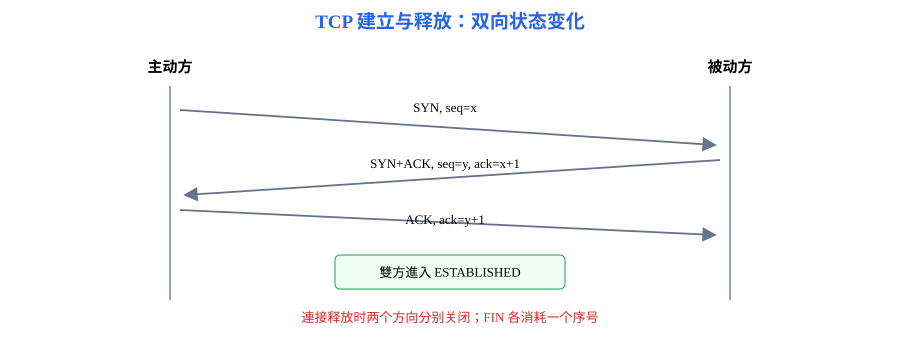
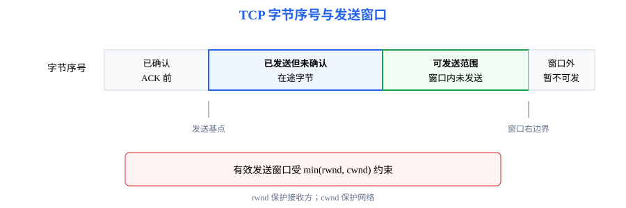

# 第5章 传输层：进程之间怎样可靠、高效地通信

<strong>本章要解决的问题：</strong>
网络层把数据送到目标主机后，如何交给正确进程？需要可靠、有序传输时，TCP 如何用连接、序号、窗口和拥塞控制完成端到端通信？

<strong>本章一句话主线：</strong>

进程间通信 → 端口 → UDP/TCP → 连接建立和释放 → 序号/确认/重传 → 滑动窗口 → 流量控制 → 拥塞控制。

408 主线

[返回全书知识树](00_全书知识树.md) · [返回计算机网络入口](../计算机网络_目录总图.md)

## 本章知识树

<strong style="color:#4b8ee8;">传输层：主机到主机之上的进程到进程通信</strong>
<ul style="list-style:none;margin:6px 0 0 8px;padding:0 0 0 18px;border-left:2px solid #94A3B8;">
<li>─ <strong>进程间通信</strong>
<ul style="list-style:none;margin:0 0 6px 4px;padding-left:18px;border-left:1px solid #CBD5E1;"><li>─ <a href="#ports">端口与复用/分用</a></li><li>─ <a href="#udp">UDP</a></li></ul></li>
<li>─ <strong><a href="#tcp-connection">TCP 连接</a></strong>
<ul style="list-style:none;margin:0 0 6px 4px;padding-left:18px;border-left:1px solid #CBD5E1;"><li>─ <a href="#tcp-fields">报文段字段</a></li><li>─ <a href="#handshake">三次握手与四次挥手</a></li><li>─ <a href="#tcp-states">TCP 状态</a></li></ul></li>
<li>─ <strong><a href="#tcp-reliability">可靠性与控制</a></strong>
<ul style="list-style:none;margin:0;padding-left:18px;border-left:1px solid #CBD5E1;"><li>─ <a href="#seq-ack">序号、确认与重传</a></li><li>─ <a href="#flow-congestion">流量控制与拥塞控制</a></li></ul></li>
</ul>

## 先看结论

- 端口标识主机中的通信端点；IP 地址定位主机，传输层端口区分主机内进程。
- UDP 提供无连接、不保证可靠交付的用户数据报服务；TCP 提供面向连接、可靠、有序的字节流服务。
- TCP 序号按字节编号；确认号通常表示接收方下一步期望收到的字节序号。
- 接收窗口限制发送方不要压垮接收进程；拥塞窗口限制发送方不要压垮网络。
- 三次握手确认双方收发能力和初始序号；连接释放要分别关闭两个方向的数据流。

## 知识展开

## 1. 进程间通信：端口与复用/分用

网络层的 IP 地址把数据报送到主机，传输层端口把数据交付给主机内对应的套接字/进程。发送端将多个应用流复用到运输层，接收端依据协议和端口信息分用。

端口号本身不是全局进程身份。通信连接通常由本地和远端地址、端口及传输协议共同区分。

### UDP：尽力而为的数据报

UDP 首部开销小，保留报文边界，不建立连接，也不自行保证可靠、有序或不重复交付。应用若需要这些性质，可以在应用层实现。

## 2. TCP：面向连接的字节流

TCP 把应用交付的字节流切分为报文段。TCP 不保留应用写入时的消息边界；接收方读到的数据块大小不一定与发送方每次写入一致。

### TCP 报文段字段

| 字段 | 作用 | 题型信号 |
|---|---|---|
| 源端口、目的端口 | 标识通信两端的进程端点 | 复用/分用、连接四元组 |
| 序号、确认号 | 按字节编号并确认下一段期望数据 | ACK 计算、重传判断 |
| 首部长度 | 指出首部和选项占用的长度 | 数据起始位置 |
| 控制位 | SYN、ACK、FIN、RST 等控制连接状态 | 握手、挥手、异常复位 |
| 接收窗口 | 通告接收方还能接收的字节量 | 流量控制 |
| 校验和 | 检查 TCP 首部和数据的差错 | 报文段完整性 |

<strong>边界：</strong>TCP 的序号和确认号是字节流语义；不能把它们当成“第几个报文段”的编号。

### 三次握手与四次挥手

三次握手的核心是双方交换并确认初始序号，同时确认彼此的发送和接收能力。四次挥手对应两个方向分别关闭；若一方暂时没有待发送数据，可以先发送 FIN，另一方向仍可能继续传输。

### TCP 状态

连接建立与释放涉及 LISTEN、SYN-SENT、SYN-RECEIVED、ESTABLISHED、FIN-WAIT、CLOSE-WAIT、LAST-ACK、TIME-WAIT 等状态。考题通常考状态迁移原因和主动/被动关闭角色，不应只孤立背状态名称。

## 3. 可靠传输：序号、确认、重传与窗口

### 序号与确认号

TCP 序号按字节计数。若报文段携带的第一个数据字节序号为 $x$，数据长度为 $L$，接收方确认成功收到该段后，累计确认号为

$$
\mathrm{ACK}=x+L
$$

确认号指出接收方下一步期望的字节序号。SYN 和 FIN 虽不携带普通数据，也各占用一个序号。

超时重传用于应对报文段或确认丢失；快速重传利用重复确认更早推测某段丢失。累计确认、乱序缓存和具体重传边界要按题目给出的 TCP 模型判断。

### 流量控制与拥塞控制

- <strong>流量控制：</strong>接收方通告接收窗口 $rwnd$，发送方据此限制未确认数据，保护接收缓存。
- <strong>拥塞控制：</strong>发送方维护拥塞窗口 $cwnd$，根据网络拥塞信号调节发送强度。
- 题目常用的有效发送窗口上界为 $\min(rwnd,cwnd)$，但还要考虑已发送未确认数据和发送缓存。

拥塞控制常见概念包括慢开始、拥塞避免、快重传和快恢复。阶段边界会依赖拥塞窗口阈值、丢包方式以及题目指定的教材模型。

## 结构图 / 过程图

握手图表达双方状态和序号同步；窗口图表达发送字节范围、接收方能力与网络拥塞限制。TCP 可靠性是端到端机制，链路层的局部重传不能替代它。

## 典型方法与短例

### 短例1：握手序号

客户端选择初始序号 100，服务器选择 500。客户端发送 SYN(seq=100)，服务器回复 SYN+ACK(seq=500, ack=101)，客户端再发送 ACK(ack=501)。SYN 各消耗一个序号，因此确认值分别加 1。

### 短例2：序号与累计确认

若某段第一个数据字节序号为 2000，数据长度为 500 字节，且接收方连续收到该段，则确认号为 2500，表示下一步期望字节 2500。

### 短例3：窗口约束

若接收窗口 $rwnd=8000$ 字节、拥塞窗口 $cwnd=5000$ 字节，则当前允许的未确认数据上界受较小者限制，为 5000 字节。若已有 1800 字节未确认，可新发送数据最多 3200 字节，忽略 MSS 和发送缓存限制。

## 易错与边界

- ACK 通常确认的是“下一个期待的序号”，不是最后一个已收到的序号。
- TCP 是字节流，不保证一次发送对应一次接收。
- 流量控制保护接收方，拥塞控制保护网络；两者窗口不可混成一个概念。
- FIN 只关闭一个方向；收到 FIN 的一方仍可以继续发送数据。
- 链路层 ARQ 局部恢复链路差错，TCP 负责端到端可靠传输。

## 跨章节连接

- TCP/UDP 承载[第6章](06_应用层.md)的 DNS、HTTP、FTP 和邮件应用。
- 传输层报文段放入[第4章](04_网络层.md)的 IP 数据报。
- 链路层窗口和 ARQ 见[第3章](03_数据链路层.md)，与本章 TCP 端到端窗口区分。
