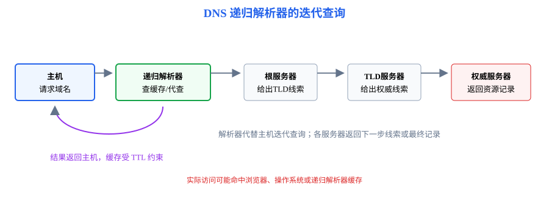
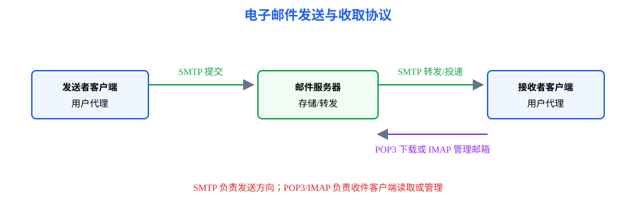
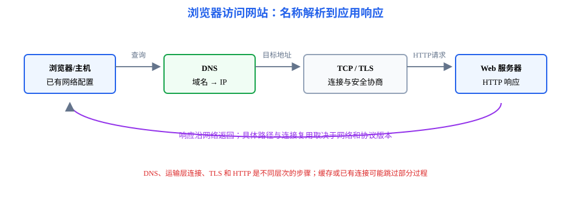

# 第6章 应用层：应用如何发起请求并获得网络服务

<strong>本章要解决的问题：</strong>
用户输入域名后，主机如何找到服务器、建立通信，并通过 DNS、HTTP、文件和邮件协议完成应用任务？

<strong>本章一句话主线：</strong>

应用服务请求 → DNS 解析 → HTTP/HTTPS 访问 → FTP 文件传输 → 电子邮件 → 数据交给 TCP/UDP。

408 主线
HTTP/2/3、QUIC、CDN 等只作现代短注

[返回全书知识树](00_全书知识树.md) · [返回计算机网络入口](../计算机网络_目录总图.md)

## 本章知识树

<strong style="color:#4b8ee8;">应用层：把网络能力组织成用户可调用的服务</strong>
<ul style="list-style:none;margin:6px 0 0 8px;padding:0 0 0 18px;border-left:2px solid #94A3B8;">
<li>─ <strong>名称与寻址</strong>
<ul style="list-style:none;margin:0 0 6px 4px;padding-left:18px;border-left:1px solid #CBD5E1;"><li>─ <a href="#dns">DNS 递归与迭代查询</a></li><li>─ <a href="#dhcp">DHCP 网络参数配置</a></li></ul></li>
<li>─ <strong>Web 服务</strong>
<ul style="list-style:none;margin:0 0 6px 4px;padding-left:18px;border-left:1px solid #CBD5E1;"><li>─ <a href="#http">HTTP 请求/响应</a></li><li>─ <a href="#https">HTTPS 与 TLS</a></li></ul></li>
<li>─ <strong>文件与邮件</strong>
<ul style="list-style:none;margin:0;padding-left:18px;border-left:1px solid #CBD5E1;"><li>─ <a href="#ftp">FTP 控制连接与数据连接</a></li><li>─ <a href="#mail">SMTP、POP3、IMAP</a></li></ul></li>
</ul>

## 先看结论

- 应用层协议面向应用进程，定义消息类型、字段、顺序和收到消息后的动作。
- DNS 把域名解析为 IP 地址；DHCP 为主机配置 IP、子网掩码、默认网关和 DNS 等参数。
- HTTP 采用请求/响应模式；HTTPS 是 HTTP 与 TLS 等安全机制的组合，不是另一套网络层协议。
- SMTP 用于邮件发送和服务器间转发；POP3/IMAP 用于收取或管理邮箱。
- DNS、DHCP 等应用层协议使用运输层服务；具体采用 UDP 还是 TCP 要根据协议规则和场景判断。

## 知识展开

## 1. DNS：名称解析到 IP 地址

域名系统把层次化域名映射到资源记录。查询可以经过本地缓存和递归解析器，再向根、顶级域和权威服务器查询；缓存可减少重复查询，但记录受 TTL 限制。

- **递归查询：**被查询方负责继续查询并返回最终结果，常见于主机向本地解析器提出请求。
- **迭代查询：**服务器返回下一步应询问的服务器线索，由查询方继续访问。
- 典型记录包括 A/AAAA 地址记录、CNAME 别名记录、MX 邮件交换记录等。

DNS 查询通常优先使用 UDP；在响应过大、区域传送或题目明确要求可靠字节流时可使用 TCP。不要把“DNS 属应用层”与“永远只用 UDP”画等号。

## 2. DHCP：自动获得网络参数

DHCP 使主机能够动态获得 IP 地址、子网掩码、默认网关、DNS 服务器等配置。常见过程可概括为 DORA：

Discover → Offer → Request → Acknowledge

新主机尚无可用地址时，发现和请求阶段可能使用广播。DHCP 属应用层协议；它配置的参数随后用于网络层寻址和转发。

## 3. HTTP/HTTPS：请求与响应

HTTP 客户端发送请求，服务器返回状态码、首部和可能的消息体。HTTP/1.1 常以持久连接复用多个请求；具体连接复用和并发行为还取决于版本及配置。

### HTTPS 与 TLS

HTTPS 使用 TLS 为 HTTP 通信提供机密性、完整性和服务器身份认证等安全能力。握手细节依 TLS 版本和密码套件而异；408 主线重点是理解 HTTPS 的分层组合关系，不把 TLS 误当成 IP 层协议。

## 4. FTP：控制连接与数据连接

FTP 使用控制连接交换命令和应答，文件传输另走数据连接。主动模式和被动模式的区别在于数据连接建立时哪一方提供监听端点；判断题要看控制连接方向与数据连接方向，不能把“客户端发起控制连接”推成“数据连接也一定由客户端主动连接服务器”。

## 5. 电子邮件：发送、转发与收取

- **SMTP：**邮件提交与邮件服务器之间的发送/转发。
- **POP3：**从服务器收取邮件，常见模型偏向下载管理。
- **IMAP：**在服务器端管理邮箱状态和文件夹，适合多设备同步访问。
- 邮件系统还包含用户代理、邮件服务器和消息格式；附件编码与邮件传输协议是不同层面的机制。

## 6. 跨层访问链：从域名到网页内容

浏览器访问网站不是单一协议动作，而是一组跨层依赖：先有本机网络参数，再解析域名，再与目标服务器通信，最后把应用请求交给传输层。

## 结构图 / 过程图

DNS 图展示名称解析中的角色和查询方向；访问链图展示 DNS、TCP/TLS 和 HTTP 的先后关系。图中展示的是常见逻辑，不代表所有解析结果均无缓存或所有 HTTP 版本都必须新建独立连接。

## 典型方法与短例

### 短例1：DNS 递归与迭代

主机把域名交给本地递归解析器。解析器若无缓存，先向根服务器询问并获得顶级域服务器线索，再继续向顶级域和权威服务器查询，最后把结果返回主机。根服务器通常不直接给出目标主机 IP。

### 短例2：浏览器访问网页

主机先通过 DHCP 等配置获得地址、默认网关和 DNS；浏览器请求域名解析；取得服务器 IP 后，运输层建立适当连接；若为 HTTPS，再进行 TLS 安全协商；之后浏览器发送 HTTP 请求，服务器返回资源。缓存、已有连接和协议版本可能改变具体握手次数。

### 短例3：邮件协议选择

用户撰写并发送邮件时使用 SMTP 提交；邮件服务器之间通常也用 SMTP 转发；收件人客户端通过 POP3 下载或用 IMAP 管理服务器邮箱。SMTP 不用于收件客户端从邮箱读取邮件。

## 易错与边界

- DNS 查询结果可能来自缓存；TTL 决定缓存有效期，不代表域名永久固定映射。
- DHCP 分配地址并不负责把域名解析成 IP，二者用途不同。
- HTTPS 仍然是 HTTP 应用通信，只是在下方增加 TLS 安全保护。
- SMTP 负责发送/转发，POP3/IMAP 负责收取/管理。
- HTTP 是无状态协议的基本模型；Cookie、会话等机制用于在应用层维护状态。
- HTTP/3 基于 QUIC，QUIC 使用 UDP 承载；它们作为现代短注，不混入 408 的 TCP 主线。

## 跨章节连接

- DNS、HTTP、FTP、邮件和 DHCP 使用[第5章](05_传输层.md)的 UDP/TCP 端口与服务。
- DHCP 配置的地址、掩码和默认网关供[第4章](04_网络层.md)寻址与转发使用。
- 应用数据向下封装的整体过程见[第1章](01_计算机网络体系结构.md)。

## 现代实现短注

- **HTTP/2：**在单连接中复用多个流并压缩首部。
- **HTTP/3 / QUIC：**在 UDP 之上实现传输能力，减少部分连接建立与队头阻塞问题。
- **CDN：**把内容部署到靠近用户的边缘节点，缩短访问路径并分担源站负载。
