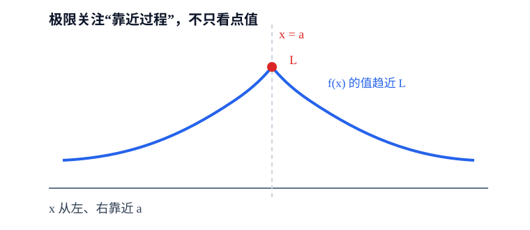
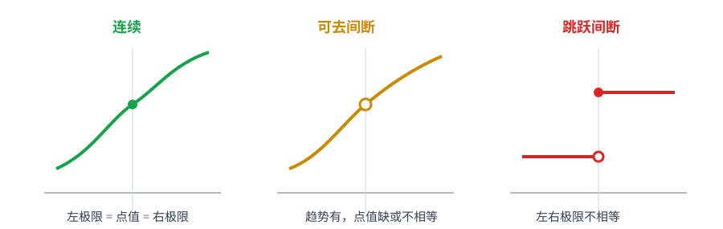

# 第1章 函数、极限与连续

> **本章要解决的问题：** 函数怎样描述变量关系，极限怎样描述趋近趋势，连续又怎样把趋势和函数值接起来？

<strong style="color:#16A34A;background:#F0FDF4;padding:2px 6px;border-radius:3px;">数学二主线</strong>

<strong style="color:#2563EB">主线：</strong>
函数对象 → 极限 → 无穷小比较 → 连续性 → 间断点与闭区间性质。

[返回全书公式总图](00_全书公式总图.md) · [返回高等数学入口](../高等数学_目录总图.md)

## 本章公式关系树

<strong style="color:#2563EB">函数与极限</strong>
<ul style="list-style:none;margin:6px 0 0 8px;padding:0 0 0 18px;border-left:2px solid #94A3B8;">
<li>─ <a href="#function">函数</a>：先明确对象、定义域和变量角色</li>
<li>├─ <a href="#vieta">前置代数工具：韦达定理</a>：用根和与根积处理参数方程</li>
<li>─ <a href="#limit">极限</a>：研究自变量趋近时函数值的趋势
<ul style="list-style:none;margin:0 0 6px 4px;padding-left:18px;border-left:1px solid #CBD5E1;">
<li>─ <a href="#sequence-limit">数列极限</a>：用项的趋势描述离散变化</li>
<li>─ <a href="#limit-laws">运算法则与夹逼</a>：把复杂极限拆成可处理部分</li>
<li>─ <a href="#infinitesimal">无穷小与等价替换</a>：比较趋近于零的速度</li>
<li>─ <a href="#important-limits">两个重要极限</a>：建立常用标准入口</li>
</ul></li>
<li>─ <a href="#continuity">连续</a>：极限存在且等于函数值
<ul style="list-style:none;margin:0 0 0 4px;padding-left:18px;border-left:1px solid #CBD5E1;">
<li>─ <a href="#discontinuity">间断点</a>：判断“哪里没有接上”</li>
<li>─ <a href="#closed-properties">闭区间性质</a>：有界、最值、介值与零点</li>
</ul></li>
</ul>

## 数列极限：离散变量的趋近

数列 $\{a_n\}$ 收敛于 $A$，表示当正整数 $n$ 不断增大时，数列各项可以任意接近 $A$，记作

$$
\lim_{n\to\infty}a_n=A.
$$

数列极限满足和、差、积、商等运算法则；商法则要求分母数列极限非零。夹逼定理同样适用：若最终 $a_n\le b_n\le c_n$，且两侧都趋于 $L$，则 $b_n\to L$。

<strong style="color:#16A34A">常见存在性工具：</strong>单调且有界的数列必收敛；单调性本身不够，还需有界。递推数列常通过先证有界、再证单调来判断收敛，最后将极限代回递推关系求值。

<strong style="color:#DC2626">易错点：</strong>把 $n$ 当成连续变量求极限可作为辅助，但数列收敛的对象始终是整数下标对应的项。

## 先看结论

- <strong style="color:#2563EB">函数先看定义域：</strong>很多极限、连续和最值结论都默认函数在相应点或区间有定义。
- <strong style="color:#2563EB">极限不是函数值：</strong>极限描述“靠近时趋向什么”，函数值描述“该点实际取什么”；二者相等才得到连续。
- <strong style="color:#16A34A">未定式不是答案：</strong>出现 $0/0$、$\infty /\infty$ 只说明需要继续变形。
- <strong style="color:#DC2626">等价替换有边界：</strong>主要用于乘除结构的极限；在加减结构中不能无条件逐项替换。
- <strong style="color:#9333EA">闭区间三大性质有前提：</strong>函数必须在闭区间上连续，才能使用有界性、最值性和介值性。

## 1. 函数：先确定研究对象

函数把定义域中的每个自变量值，按照确定规则对应到唯一函数值。写题时先区分：

- **定义域：** 允许代入的自变量集合；
- **对应关系：** 自变量如何决定函数值；
- **值域：** 实际能取得的函数值集合；
- **复合：** 若 $y=f(u)$、$u=g(x)$，则 $y=f(g(x))$，但必须同时满足 $x$ 在 $g$ 的定义域内且 $g(x)$ 落在 $f$ 的定义域内。

<strong style="color:#DC2626">边界：</strong>定义域不是“最后算出来的范围”，而是最开始决定函数是否有意义的条件。分母不能为零、偶次根式被开方数不能为负、对数真数必须为正。

### 前置代数工具：韦达定理（非微积分主线）

对一元二次方程

$$
ax^2+bx+c=0\quad(a\ne0),
$$

若两根为 $x_1,x_2$（按重数计算），则

$$
x_1+x_2=-\frac ba,
\qquad
x_1x_2=\frac ca.
$$

<strong style="color:#2563EB">作用：</strong>不必先求出两个根，就能把“根的和、根的积”转成系数关系；常用于参数方程、根的对称式和构造新方程。

<strong style="color:#DC2626">成立条件：</strong>必须是同一个一元二次方程，且 $a\ne0$；根可以是复根，但要按重数计算。

<strong style="color:#16A34A">使用信号：</strong>题目直接给出两根的和、积，或要求确定参数而不需要分别求根。

<strong style="color:#CA8A04">短例：</strong>若方程 $x^2-(t+1)x+t=0$ 的两根为 $1,t$，则根和为 $t+1$、根积为 $t$，可直接写出方程而不必解根。

<strong style="color:#DC2626">边界：</strong>韦达定理是前置代数工具，不替代函数定义域、极限或连续性判断；涉及“两个实根”时还要另检查判别式 $\Delta\ge0$。

## 2. 极限：描述趋近趋势

$\lim_{x\to a}f(x)=L$ 的意思是：当 $x$ 充分接近 $a$ 时，$f(x)$ 可以充分接近 $L$。这里关注的是趋近过程，不要求 $x=a$ 时函数值一定存在。

图中两条路径都靠近同一个 $L$，极限才存在；若左极限和右极限不同，则双侧极限不存在。

### 左极限与右极限

$\lim_{x\to a^-}f(x)$ 只从左侧靠近，$\lim_{x\to a^+}f(x)$ 只从右侧靠近。

双侧极限存在的必要且充分条件是：左右极限都存在且相等。

<strong style="color:#DC2626">易错：</strong>“函数在 $a$ 处有定义”不能推出“极限存在”；“极限存在”也不能推出“函数值等于极限”。

## 3. 极限运算、夹逼与存在性

### 极限运算法则

当各相关极限存在时：

$$
\lim_{x\to a}[f(x)\pm g(x)]
=\lim_{x\to a}f(x)\pm\lim_{x\to a}g(x)
$$

$$
\lim_{x\to a}[f(x)g(x)]
=\left(\lim_{x\to a}f(x)\right)
\left(\lim_{x\to a}g(x)\right)
$$

$$
\lim_{x\to a}\frac{f(x)}{g(x)}
=\frac{\lim_{x\to a}f(x)}{\lim_{x\to a}g(x)},
\qquad \lim_{x\to a}g(x)\ne0
$$

<strong style="color:#2563EB">变量角色：</strong>$x$ 是趋近的自变量，$a$ 是趋近目标；$f$、$g$ 是参与运算的函数。

<strong style="color:#9333EA">来源与关联：</strong>这些法则来自极限运算的保持性，是等价替换、洛必达和泰勒处理的基础。

<strong style="color:#DC2626">成立条件：</strong>商的极限不能在分母极限为零时直接套用；若代入得到 $0/0$，应转入未定式处理。

### 夹逼定理

若在 $a$ 的某邻域内有 $g(x)\le f(x)\le h(x)$，且

$$
\lim_{x\to a}g(x)=\lim_{x\to a}h(x)=L,
$$

则 $\lim_{x\to a}f(x)=L$。

<strong style="color:#2563EB">变量角色：</strong>$g(x)$、$h(x)$ 是上下界，$f(x)$ 是待求极限的中间函数，$L$ 是两侧共同趋近的值。

<strong style="color:#9333EA">来源与关联：</strong>夹逼定理把难算的函数转成可控制的上下界，常与三角有界性和无穷小估计联用。

<strong style="color:#16A34A">使用信号：</strong>函数本身难以直接化简，但能被两个有相同极限的简单函数夹住，尤其常见于含绝对值、三角有界量和振荡因子的题。

## 4. 无穷小、无穷大与等价替换

当 $x\to a$ 时，若 $\alpha(x)\to0$，称 $\alpha(x)$ 为无穷小；若 $|f(x)|$ 无限增大，则称其为无穷大。

若 $\alpha(x)\to0$、$\beta(x)\to0$ 且

$$
\lim_{x\to a}\frac{\alpha(x)}{\beta(x)}=1,
$$

记作 $\alpha(x)\sim\beta(x)$。它们在乘除结构中可以互换，例如：

$$
\sin x\sim x,\qquad e^x-1\sim x,\qquad \ln(1+x)\sim x\quad(x\to0).
$$

<strong style="color:#2563EB">变量角色：</strong>$x$ 是趋近变量，$\alpha(x)$ 与 $\beta(x)$ 是同阶的无穷小；“$\sim$”比较的是比值极限，不是恒等相等。

<strong style="color:#9333EA">来源与关联：</strong>等价无穷小把复杂局部表达式替换为主导项，是重要极限和泰勒展开之间的桥梁。

<strong style="color:#DC2626">限制：</strong>等价无穷小不能在加减式中机械替换。例如 $\sin x-x$ 的主项发生抵消，必须保留更高阶信息或改用泰勒展开。

## 5. 两个重要极限

### 第一重要极限

$$
\lim_{x\to0}\frac{\sin x}{x}=1
$$

<strong style="color:#2563EB">变量角色：</strong>$x$ 为弧度制下的角变量，趋近点为 $0$。

<strong style="color:#9333EA">来源与关联：</strong>它给出 $\sin x\sim x$，并可迁移到 $\tan x$、$1-\cos x$ 等三角极限。

<strong style="color:#DC2626">条件：</strong>角度必须用弧度制。由它可推出 $\sin x\sim x$ 以及许多三角极限。

### 第二重要极限

$$
\lim_{x\to0}(1+x)^{1/x}=e
$$

<strong style="color:#2563EB">变量角色：</strong>$x$ 趋近于 $0$，底数 $1+x$ 必须为正；$e$ 是自然对数的底。

<strong style="color:#9333EA">来源与关联：</strong>它连接幂指型极限与指数函数，常通过取对数转化为 $\ln(1+x)/x$。

等价形式包括：

$$
\lim_{x\to\infty}\left(1+\frac1x\right)^x=e,
\qquad
\lim_{x\to0}\frac{\ln(1+x)}{x}=1.
$$

<strong style="color:#16A34A">典型方法：</strong>遇到幂指型极限，先取对数，把幂放到前面，再把问题转成乘积或商的极限。

<strong style="color:#CA8A04">短例：</strong>

$$
\lim_{x\to0}(1+2x)^{1/x}
=\left[(1+2x)^{1/(2x)}\right]^2=e^2.
$$

## 6. 连续：把极限和函数值接起来

函数 $f$ 在 $x=a$ 处连续，当且仅当：

1. $f(a)$ 有定义；
2. $\lim_{x\to a}f(x)$ 存在；
3. $\lim_{x\to a}f(x)=f(a)$。

<strong style="color:#2563EB">变量角色：</strong>$a$ 是待检查的点，$f(a)$ 是点值，$\lim_{x\to a}f(x)$ 是邻域趋势。

<strong style="color:#9333EA">来源与关联：</strong>连续性把极限连接到后续导数、中值定理和积分基本定理的成立条件。

可以把它记成一条链：

$$
\text{有函数值}
\;+
\text{有极限}
\;+
\text{二者相等}
\;\Longrightarrow\;
\text{连续}.
$$

初等函数在其定义域内连续；复合、和差积商在满足定义域条件时仍保持连续。

### 间断点分类

如果上述三条中至少一条不满足，$a$ 就是间断点。常见分类：

| 类型 | 主要特征 | 处理思路 |
|---|---|---|
| 可去间断点 | 极限存在但函数值未定义或不相等 | 重新定义点值可能补成连续 |
| 跳跃间断点 | 左右极限都存在但不相等 | 双侧极限不存在 |
| 无穷间断点 | 函数值趋于无穷 | 常伴随竖直渐近线 |
| 振荡间断点 | 附近持续振荡，极限不存在 | 不能靠补一个点值消除 |

<strong style="color:#DC2626">注意：</strong>间断点分类首先看左右极限和函数值，不要只看函数表达式“长得复杂”。

## 7. 闭区间连续函数的三大性质

若 $f$ 在闭区间 $[a,b]$ 上连续，则：

- **有界性：** 存在 $M>0$，使得 $|f(x)|\le M$；
- **最值性：** 函数能在 $[a,b]$ 上取得最大值和最小值；
- **介值性：** 若 $f(a)$ 与 $f(b)$ 之间有数 $\mu$，则存在 $\xi\in[a,b]$ 使 $f(\xi)=\mu$。

零点定理是介值性的常用形式：若 $f(a)f(b)<0$，则至少存在 $\xi\in(a,b)$ 使 $f(\xi)=0$。

<strong style="color:#DC2626">成立条件：</strong>“闭区间”和“连续”都不能漏。开区间连续函数不一定有最大最小值，例如 $f(x)=x$ 在 $(0,1)$ 上没有取得最大值和最小值。

## 8. 典型方法：遇到极限先做什么

### 方法流程

明确趋近对象与定义域 → 直接代入 → 判断是否为未定式 → 识别结构 → 选择因式分解 / 有理化 / 等价替换 / 夹逼 / 洛必达 → 检查条件和结果。

### 重要方法比较

| 结构或信号 | 优先方法 | 关键前提 | 不要犯的错 |
|---|---|---|---|
| 可约因子导致 $0/0$ | 因式分解、约分 | 约分后只研究去心邻域 | 把约分当成改变原点函数值 |
| 根式差 | 有理化 | 分子分母同乘共轭 | 忘记检查分母新表达式 |
| 乘积中有标准无穷小 | 等价替换 | 替换后仍处在乘除结构 | 在加减抵消式中直接替换 |
| 上下界趋同 | 夹逼 | 两侧界函数极限相同 | 只找到一个上界就下结论 |
| $0/0$ 或 $\infty /\infty$ 且可导 | 洛必达 | 分子分母在邻域内可导，导数商极限存在 | 把所有未定式都直接套洛必达 |

<strong style="color:#CA8A04">短例：</strong>

$$
\lim_{x\to0}\frac{1-\cos x}{x^2}
=\lim_{x\to0}\frac{2\sin^2(x/2)}{x^2}
=\frac12.
$$

这里先把 $1-\cos x$ 化成平方，再使用第一重要极限；比盲目套公式更容易检查条件。

<strong style="color:#16A34A">洛必达的核心：</strong>若分子、分母在去心邻域内可导，且原式属于 $0/0$ 或 $\infty /\infty$，并且

$$
\lim_{x\to a}\frac{f'(x)}{g'(x)}=L,
$$

则在满足定理条件时，原极限也等于 $L$。它是条件化工具，不是所有未定式的通用按钮。

## 易错与边界

- $f(a)$ 与 $\lim_{x\to a}f(x)$ 是两个对象，只有相等才连续。
- $0/0$、$\infty /\infty$ 是未定式，不是极限值。
- 等价无穷小主要服务于乘除结构；加减抵消时要保留更高阶项。
- 第一重要极限默认使用弧度制。
- 闭区间连续函数定理不能脱离“闭区间 + 连续”使用。
- 函数的定义域先于极限、连续和最值判断。

## 跨章节连接

<strong style="color:#9333EA">从本章向后：</strong>

- [第2章 导数与微分](02_导数与微分.md)：导数定义本身就是特殊极限。
- [第3章 中值定理与导数应用](03_中值定理与导数应用.md)：连续和极限为中值定理提供条件。
- [第5章 定积分](05_定积分.md#fundamental-theorem)：变上限积分把连续函数重新变成可导函数。

