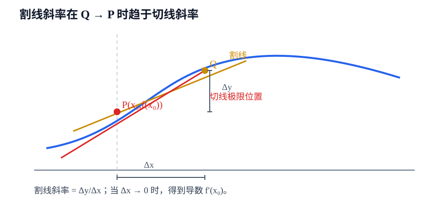
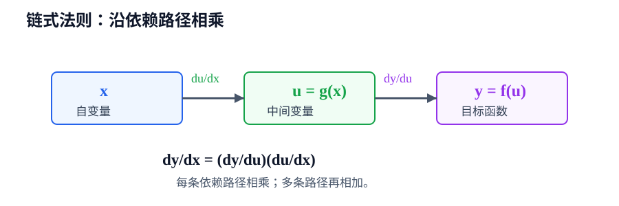

# 第2章 导数与微分

> **本章要解决的问题：** 函数在一点附近变化得有多快？怎样把这种局部变化用一个线性量近似出来？

<strong style="color:#16A34A;background:#F0FDF4;padding:2px 6px;border-radius:3px;">数学二主线</strong>

<strong style="color:#2563EB">一句话主线：</strong>
平均变化率 → 瞬时变化率 → 导数 → 求导规则 → 微分与线性近似。

[返回全书公式总图](00_全书公式总图.md) · [返回高等数学入口](../高等数学_目录总图.md)

<hr style="border:0;border-top:1px solid #D1D5DB;margin:28px 0 16px;">

## 本章公式关系树

<div style="line-height:1.9;max-width:900px;margin:12px 0 24px;">
<strong style="color:#2563EB">导数与微分</strong>
<ul style="list-style:none;margin:6px 0 0 8px;padding:0 0 0 18px;border-left:2px solid #94A3B8;">
<li>─ <a href="#derivative-definition">导数定义</a>：差商在增量趋于零时的极限
<ul style="list-style:none;margin:0 0 6px 4px;padding-left:18px;border-left:1px solid #CBD5E1;">
<li>─ <a href="#geometric-meaning">几何意义</a>：割线斜率 → 切线斜率</li>
<li>─ <a href="#tangent-normal">切线与法线</a>：由切线斜率建立直线方程</li>
<li>─ <a href="#continuity-relation">可导与连续</a>：可导一定连续，反向不成立</li>
</ul></li>
<li>─ <a href="#derivative-rules">求导规则</a>：从已知函数得到新函数
<ul style="list-style:none;margin:0 0 6px 4px;padding-left:18px;border-left:1px solid #CBD5E1;">
<li>─ <a href="#chain-rule">链式法则</a>：复合关系按路径逐层求导</li>
<li>─ <a href="#special-derivatives">特殊形式</a>：反函数、隐函数、参数方程</li>
</ul></li>
<li>─ <a href="#differential">微分</a>：导数给出的局部线性近似
<ul style="list-style:none;margin:0 0 0 4px;padding-left:18px;border-left:1px solid #CBD5E1;">
<li>─ <a href="#higher-derivative">高阶导数</a>：变化率的变化率</li>
<li>─ <a href="#linear-approximation">线性近似</a>：用 \(dy\) 近似 \(\Delta y\)</li>
</ul></li>
</ul></div>

<hr style="border:0;border-top:1px solid #D1D5DB;margin:28px 0 16px;">

## 先看结论

- <strong style="color:#2563EB">导数是差商的极限：</strong>差商表示一段区间的平均变化率，只有让区间长度趋于零，才得到一点处的瞬时变化率。
- <strong style="color:#9333EA">几何上：</strong>割线在第二个点向考察点靠近时，极限位置就是切线；导数是切线斜率。
- <strong style="color:#16A34A">复合函数按依赖路径求导：</strong>外层导数乘以内层导数，不能只求最外层。
- <strong style="color:#DC2626">可导一定连续：</strong>连续不一定可导，尖点、角点和竖直切线处必须回到定义检查。
- <strong style="color:#2563EB">微分是线性主部：</strong>\(dy=f'(x)dx\) 近似函数增量，但一般不等于有限增量 \(\Delta y\)。

<hr style="border:0;border-top:1px solid #D1D5DB;margin:28px 0 16px;">

## 1. 导数是什么：从平均变化率到瞬时变化率

<a id="derivative-definition"></a>

### 导数定义

设 \(y=f(x)\)，在 \(x_0\) 处给自变量一个增量 \(\Delta x\)，函数增量为

$$
\Delta y=f(x_0+\Delta x)-f(x_0).
$$

区间 \([x_0,x_0+\Delta x]\) 上的平均变化率是 \(\Delta y/\Delta x\)。当 \(\Delta x\to0\) 时，如果极限存在，则定义

<div style="background:#F8FAFC;border-left:3px solid #2563EB;padding:10px 14px;margin:14px 0;">
<strong style="color:#2563EB">核心公式</strong>

$$
f'(x_0)=\lim_{\Delta x\to0}\frac{f(x_0+\Delta x)-f(x_0)}{\Delta x}
      =\lim_{x\to x_0}\frac{f(x)-f(x_0)}{x-x_0}.
$$

<strong style="color:#2563EB">作用：</strong>把有限区间上的平均变化率变成一点处的瞬时变化率。

<strong style="color:#DC2626">成立条件：</strong>对应极限必须存在且为有限值；左右导数还必须相等。

<strong style="color:#16A34A">使用信号：</strong>题目要求“按定义求导”“判断某点可导”或给出分段函数的连接点。

<strong style="color:#DC2626">易错点：</strong>\(\Delta x\) 是增量，不是新的自变量；代入定义时分子和分母必须同时保留同一个 \(\Delta x\)。
</div>

<a id="geometric-meaning"></a>

### 几何意义：割线趋于切线



当 \(Q\) 沿曲线靠近 \(P\) 时，割线 \(PQ\) 的斜率趋近于切线斜率。物理上，它对应瞬时速度；经济或工程问题中，它对应边际变化率。

<a id="tangent-normal"></a>

### 切线与法线

若曲线 \(y=f(x)\) 在 \(x=x_0\) 可导，点为 \((x_0,f(x_0))\)，则切线为

$$
y-f(x_0)=f'(x_0)(x-x_0).
$$

当 \(f'(x_0)\ne0\) 时，法线斜率为 \(-1/f'(x_0)\)，所以

$$
y-f(x_0)=-\frac{1}{f'(x_0)}(x-x_0).
$$

若切线水平，法线是竖直直线 \(x=x_0\)，不能把斜率公式用于分母为零的情况。

<a id="continuity-relation"></a>

### 可导与连续

若 \(f\) 在 \(x_0\) 可导，则

$$
\lim_{x\to x_0}[f(x)-f(x_0)]
=\lim_{x\to x_0}\left[\frac{f(x)-f(x_0)}{x-x_0}(x-x_0)\right]=0,
$$

所以 \(\lim_{x\to x_0}f(x)=f(x_0)\)，函数在该点连续。

<strong style="color:#DC2626">边界：</strong>连续只说明函数值接得上，不保证斜率存在。例如 \(f(x)=|x|\) 在 \(0\) 连续，但左右导数分别为 \(-1\) 和 \(1\)，所以不可导。

<hr style="border:0;border-top:1px solid #D1D5DB;margin:28px 0 16px;">

## 2. 怎样求导：公式与依赖关系

<a id="derivative-rules"></a>

### 四则运算

若 \(u=u(x)\)、\(v=v(x)\) 可导，则

$$
(u\pm v)'=u'\pm v',\qquad (uv)'=u'v+uv',
$$

$$
\left(\frac{u}{v}\right)'=\frac{u'v-uv'}{v^2},\qquad v\ne0.
$$

<strong style="color:#16A34A">使用步骤：</strong>先拆出加减、乘积或商，再对每个因子使用已知导数。

<strong style="color:#DC2626">易错点：</strong>\((uv)'\) 不是 \(u'v'\)；商的分母条件必须保留。

### 基本初等函数

$$
(x^\alpha)'=\alpha x^{\alpha-1},\qquad (e^x)'=e^x,
$$

$$
(\ln x)'=\frac1x,\qquad (\sin x)'=\cos x,\qquad (\cos x)'=-\sin x.
$$

常用三角与反三角函数：

$$
(\tan x)'=\sec^2x=\frac1{\cos^2x},\qquad
(\cot x)'=-\csc^2x=-\frac1{\sin^2x},
$$

$$
(\arcsin x)'=\frac1{\sqrt{1-x^2}},\qquad
(\arccos x)'=-\frac1{\sqrt{1-x^2}},\qquad
(\arctan x)'=\frac1{1+x^2}.
$$

指数与对数的带底形式：

$$
(a^x)'=a^x\ln a\quad(a>0),\qquad
(\log_a x)'=\frac1{x\ln a}\quad(a>0,\ a\ne1).
$$

复合形式仍需再乘内层导数，例如 \((\arctan u)'=u'/(1+u^2)\)。

这些公式通常和链式法则一起使用，例如 \((\sin 3x)'=3\cos 3x\)。

<a id="chain-rule"></a>

### 链式法则：复合关系按层求导

若 \(y=f(u)\)、\(u=g(x)\)，则

<div style="background:#F8FAFC;border-left:3px solid #16A34A;padding:10px 14px;margin:14px 0;">
<strong style="color:#2563EB">核心公式</strong>

$$
\frac{dy}{dx}=\frac{dy}{du}\frac{du}{dx}=f'(g(x))g'(x).
$$

<strong style="color:#2563EB">作用：</strong>把复合函数的变化拆成“外层对内层的变化”与“内层对自变量的变化”。

<strong style="color:#DC2626">成立条件：</strong>外层函数在 \(u=g(x)\) 处可导，内层函数在 \(x\) 处可导。

<strong style="color:#16A34A">使用信号：</strong>表达式中存在“函数套函数”，如 \(\sin(x^2)\)、\(e^{\ln x}\)、\(\sqrt{1+x^2}\)。

<strong style="color:#DC2626">易错点：</strong>外层求导后要保留内层，最后还要乘以内层导数。
</div>



<strong style="color:#CA8A04">短例：</strong>

$$
y=\ln(1+x^2)
\quad\Longrightarrow\quad
y'=\frac{1}{1+x^2}\cdot2x=\frac{2x}{1+x^2}.
$$

<a id="higher-derivative"></a>

### 高阶导数

一阶导数再求导得到二阶导数：

$$
y''=\frac{d}{dx}\left(\frac{dy}{dx}\right),\qquad
y^{(n)}=\frac{d^n y}{dx^n}.
$$

二阶导数常用于判断凹凸和极值，但具体应用放在第3章。

<a id="special-derivatives"></a>

### 反函数、隐函数和参数方程

**反函数。** 若 \(y=f(x)\) 可逆且 \(f'(x)\ne0\)，则

$$
\frac{dy}{dx}=\frac{1}{dx/dy}.
$$

**隐函数。** 若 \(F(x,y)=0\)，对 \(x\) 求导时要把 \(y\) 看作 \(y(x)\)。例如

$$
x^2+y^2=1
\quad\Longrightarrow\quad
2x+2yy'=0
\quad\Longrightarrow\quad
y'=-\frac{x}{y}.
$$

**参数方程。** 若 \(x=\varphi(t)\)、\(y=\psi(t)\)，且 \(dx/dt\ne0\)，则

$$
\frac{dy}{dx}=\frac{dy/dt}{dx/dt}.
$$

<strong style="color:#DC2626">变量提醒：</strong>隐函数中 \(y\) 依赖 \(x\)；参数方程中真正的自变量是 \(t\)，不能把 \(dy/dt\) 直接写成 \(dy/dx\)。

<hr style="border:0;border-top:1px solid #D1D5DB;margin:28px 0 16px;">

## 3. 微分：导数给出的线性近似

<a id="differential"></a>

### 微分定义

函数增量为

$$
\Delta y=f(x+\Delta x)-f(x).
$$

如果 \(f\) 在 \(x\) 可导，则

$$
\Delta y=f'(x)\Delta x+o(\Delta x).
$$

取其中的线性主部，定义微分

<div style="background:#F8FAFC;border-left:3px solid #9333EA;padding:10px 14px;margin:14px 0;">
<strong style="color:#2563EB">核心公式</strong>

$$
dy=f'(x)dx.
$$

<strong style="color:#2563EB">作用：</strong>用容易计算的线性量近似函数的微小变化。

<strong style="color:#DC2626">成立条件：</strong>函数在所考察点可导，且 \(dx\) 足够小，才适合把 \(dy\) 当作 \(\Delta y\) 的近似。

<strong style="color:#16A34A">使用信号：</strong>题目要求估算根式、幂函数或其他函数在小改变量下的变化。

<strong style="color:#DC2626">易错点：</strong>\(dy\) 是线性近似量，通常不等于真实增量 \(\Delta y\)；\(dx\) 是人为取定的微小变化量。
</div>

<a id="linear-approximation"></a>

### 线性近似短例

取 \(f(x)=\sqrt{x}\)，在 \(x_0=4\) 附近估算 \(\sqrt{4.01}\)：

$$
f'(x)=\frac1{2\sqrt{x}},\qquad f'(4)=\frac14,
$$

$$
dy\approx\Delta y\approx f'(4)\cdot0.01=0.0025,
$$

因此 \(\sqrt{4.01}\approx2.0025\)。

<strong style="color:#CA8A04">检查：</strong>近似点应选在已知函数值容易计算的位置；改变量越小，线性近似通常越可靠。

<hr style="border:0;border-top:1px solid #D1D5DB;margin:28px 0 16px;">

## 4. 典型方法：先识别函数关系，再选择规则

```text
看表达式结构
→ 判断是显函数、复合函数、隐函数还是参数方程
→ 选基本公式、四则法则或链式法则
→ 明确求导变量与定义域
→ 保留内层并逐层计算
→ 用代入、极限定义或结果形式检查
```

### 方法比较

| 任务信号 | 主要方法 | 需要先确认 | 常见错误 |
|---|---|---|---|
| 普通显式表达式 | 基本公式 + 四则法则 | 各项定义域 | 把乘积求导写成逐项相乘 |
| 函数套函数 | 链式法则 | 外层、内层及其定义域 | 漏乘内层导数 |
| \(F(x,y)=0\) | 隐函数求导 | \(y\) 是否依赖 \(x\) | 把 \(y\) 当常数 |
| \(x(t),y(t)\) | 参数方程求导 | \(dx/dt\ne0\) | 把 \(dy/dt\) 当作 \(dy/dx\) |
| \(x\) 有小增量 | 微分近似 | 函数可导、改变量小 | 把 \(dy\) 当成精确增量 |

## 易错与边界

- \(\Delta y/\Delta x\) 是平均变化率，\(f'(x_0)\) 是它在 \(\Delta x\to0\) 时的极限。
- 可导一定连续，连续不一定可导。
- 链式法则必须把每一层的导数都乘上。
- 隐函数求导时，\(y\) 是 \(x\) 的函数；参数方程求导时，先对 \(t\) 求导。
- \(dy=f'(x)dx\) 是微分关系；只有在局部小变化下，才用它近似 \(\Delta y\)。

## 跨章节连接

<strong style="color:#9333EA">向后连接：</strong>第1章的极限给出导数定义；连续性是本章可导结论和后续中值定理的条件基础。

<strong style="color:#9333EA">向前连接：</strong>

- [第3章 中值定理与导数应用](03_中值定理与导数应用.md)：用 \(f'\) 判断单调、极值和凹凸。
- [第4章 不定积分](04_不定积分.md)：从导数反求原函数。
- [第5章 定积分](05_定积分.md)：变上限积分把累积函数与导数联系起来。
