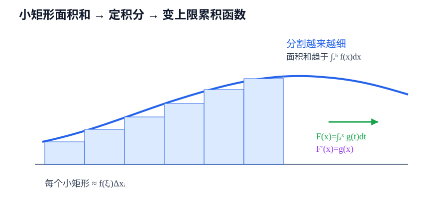

# 第5章 定积分

> **本章要解决的问题：** 怎样把许多微小量累积成一个确定的整体量？

<strong style="color:#16A34A;background:#F0FDF4;padding:2px 6px;border-radius:3px;">数学二主线</strong>

<strong style="color:#2563EB">一句话主线：</strong>
分割与求和 → 定积分 → 变上限函数 → 微积分基本定理 → 换元与分部。

[返回全书公式总图](00_全书公式总图.md) · [返回高等数学入口](../高等数学_目录总图.md)

## 本章公式关系树

<strong style="color:#2563EB">定积分</strong>
<ul style="list-style:none;margin:6px 0 0 8px;padding:0 0 0 18px;border-left:2px solid #94A3B8;">
<li>─ <a href="#definition">定义</a>：分割区间、取样、求和并取极限</li>
<li>─ <a href="#properties">性质</a>：线性、区间可加、保序与估计</li>
<li>─ <a href="#mean-value">积分中值定理</a>：区间平均值由某点函数值取得</li>
<li>─ <a href="#variable-limit">变上限函数</a>：累积函数的导数回到被积函数</li>
<li>─ <a href="#fundamental-theorem">微积分基本定理</a>：原函数端点差计算定积分</li>
<li>─ <a href="#definite-methods">定积分换元与分部</a>：改变计算结构</li>
</ul>

## 先看结论

- <strong style="color:#2563EB">定积分是带权求和的极限：</strong>每个函数值都要乘以对应的小区间长度。
- <strong style="color:#2563EB">变上限积分把累积变成函数：</strong>上限改变，累积量随之改变。
- <strong style="color:#16A34A">基本定理连接导数和积分：</strong>定积分可以转化为原函数的端点差。
- <strong style="color:#DC2626">积分值是带符号的：</strong>函数图像在 \(x\) 轴下方时，积分贡献为负。
- <strong style="color:#9333EA">定积分换元要同步改变上下限：</strong>不能只替换被积函数而保留旧变量边界。

## 1. 定积分是什么：分割、求和、取极限

将 \([a,b]\) 分成小区间，取样点 \(\xi_i\)，形成和

$$
\sum_{i=1}^{n}f(\xi_i)\Delta x_i.
$$

当分割不断加细且最大区间长度趋于零时，若这些和趋于同一极限，则定义

<strong style="color:#2563EB">核心公式</strong>

$$
\int_a^b f(x)dx=\lim_{\max\Delta x_i\to0}\sum_{i=1}^{n}f(\xi_i)\Delta x_i.
$$

<strong style="color:#2563EB">作用：</strong>把局部量的无限累积定义成整体量。

<strong style="color:#DC2626">成立条件：</strong>函数在区间上可积；连续函数一定可积。

<strong style="color:#16A34A">使用信号：</strong>题目从“分割、微元、和的极限”出发，或要求解释积分的几何/物理意义。

<strong style="color:#DC2626">易错点：</strong>定积分不是把函数值直接相加，\(dx\) 体现每个小区间的宽度。

## 2. 定积分的基本性质

线性和区间可加性：

$$
\int_a^b(\alpha f+\beta g)dx
=\alpha\int_a^b fdx+\beta\int_a^b gdx,
$$

$$
\int_a^b fdx=\int_a^c fdx+\int_c^b fdx.
$$

若 \(f(x)\le g(x)\)，则

$$
\int_a^b f(x)dx\le\int_a^b g(x)dx.
$$

由此可得到积分估计：若 \(m\le f(x)\le M\)，则 \(m(b-a)\le\int_a^b fdx\le M(b-a)\)。

## 3. 积分中值定理：平均值落在函数值范围内

若 \(f\) 在 \([a,b]\) 上连续，则存在 \(\xi\in[a,b]\)，使

$$
\int_a^b f(x)\,dx=f(\xi)(b-a),
\qquad
f(\xi)=\frac{1}{b-a}\int_a^b f(x)\,dx.
$$

<strong style="color:#2563EB">作用：</strong>把定积分的平均值表示成区间内某一点的函数值。

<strong style="color:#DC2626">成立条件：</strong>连续性是常用的充分条件；区间长度必须满足 \(b>a\)。

<strong style="color:#16A34A">使用信号：</strong>题目出现“平均值”“存在一点 \(\xi\)”或需要估计积分大小。

<strong style="color:#DC2626">易错点：</strong>该定理给出存在性，不告诉你 \(\xi\) 的具体位置；带符号积分也不能直接当几何面积。

## 4. 变上限函数：累积到哪里，函数就到哪里

若 \(g\) 在 \([a,b]\) 上连续，定义

$$
F(x)=\int_a^x g(t)dt.
$$

则

<strong style="color:#2563EB">核心公式</strong>

$$
F'(x)=g(x).
$$

<strong style="color:#2563EB">作用：</strong>把“从固定起点累积到 \(x\)”的函数求导，恢复为当前位置的函数值。

<strong style="color:#DC2626">成立条件：</strong>被积函数在相应区间连续。

<strong style="color:#16A34A">使用信号：</strong>看到积分上限是变量，或题目要求求 \(F'(x)\)、\(F''(x)\)。

<strong style="color:#DC2626">易错点：</strong>\(t\) 是积分变量，\(x\) 是上限变量；不要把 \(t\) 当成最终函数的自变量。

若上下限都随 \(x\) 变化，且函数满足相应连续、可导条件，则莱布尼茨公式为

$$
\frac{d}{dx}\int_{\alpha(x)}^{\beta(x)}f(x,t)\,dt
=f\bigl(x,\beta(x)\bigr)\beta'(x)-f\bigl(x,\alpha(x)\bigr)\alpha'(x)
+\int_{\alpha(x)}^{\beta(x)}\frac{\partial f}{\partial x}(x,t)\,dt.
$$

若被积函数不显含 \(x\)，中间积分项为零：

$$
\frac{d}{dx}\int_{\alpha(x)}^{\beta(x)}g(t)\,dt
=g\bigl(\beta(x)\bigr)\beta'(x)-g\bigl(\alpha(x)\bigr)\alpha'(x).
$$

<strong style="color:#DC2626">使用边界：</strong>上限项为正、下限项为负；每一项还要乘对应端点函数的导数。

## 5. 微积分基本定理

若 \(F'(x)=f(x)\)，则

<strong style="color:#2563EB">核心公式</strong>

$$
\int_a^b f(x)dx=F(b)-F(a).
$$

<strong style="color:#2563EB">作用：</strong>把定积分计算转化为原函数的端点代入。

<strong style="color:#DC2626">成立条件：</strong>被积函数在区间上满足定积分存在条件，\(F\) 是其原函数。

<strong style="color:#16A34A">使用信号：</strong>已经能找到原函数，或题目要求直接计算确定积分。

<strong style="color:#DC2626">易错点：</strong>端点代入顺序是上限减下限；不要把几何面积和带符号积分混为一谈。

## 6. 定积分换元与分部

换元时若 \(u=\varphi(x)\)，不仅替换被积函数和 \(dx\)，还应把上下限改成对应的 \(u\) 值：

$$
\int_a^b f(\varphi(x))\varphi'(x)dx
=\int_{\varphi(a)}^{\varphi(b)}f(u)du.
$$

分部积分：

$$
\int_a^b u\,dv=[uv]_a^b-\int_a^b v\,du.
$$

<strong style="color:#DC2626">检查：</strong>定积分换元可以不换回 \(x\)，但上下限必须与当前积分变量一致。

## 7. 典型方法：从累积对象写出积分

确定累积对象 → 找微元/小区间 → 写出函数值 × 微元 → 确定上下限 → 选择直接计算、换元或分部 → 检查符号和单位。

## 易错与边界

- 积分变量是哑变量：\(\int_a^b f(t)dt=\int_a^b f(x)dx\)。
- 交换上下限会使积分变号。
- 面积通常需要分段或取绝对值，不能直接把负面积当正面积。
- 变上限积分求导前，检查被积函数的连续性。

## 跨章节连接

<strong style="color:#9333EA">知识衔接：</strong>本章既承接原函数，也为面积和多变量累积提供基础。

- [第4章 不定积分](04_不定积分.md)：提供原函数和积分方法。
- [第6章 定积分应用](06_定积分应用.md)：把面积、体积、弧长等问题翻译成积分。
- [第9章 多元函数](09_多元函数微分及其应用.md)：一维累积思想推广到多个变量。
