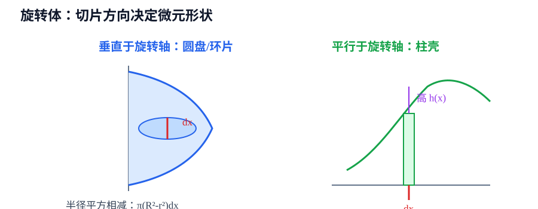

# 第6章 定积分应用

> **本章要解决的问题：** 怎样把面积、体积、弧长和物理量翻译成定积分？

<strong style="color:#16A34A;background:#F0FDF4;padding:2px 6px;border-radius:3px;">数学二主线</strong>

<strong style="color:#2563EB">一句话主线：</strong>
确定对象 → 选择切片方向 → 写出微元 → 确定区间 → 累积并检查单位。

[返回全书公式总图](00_全书公式总图.md) · [返回高等数学入口](../高等数学_目录总图.md)

## 本章公式关系树

<strong style="color:#2563EB">定积分应用</strong>
<ul style="list-style:none;margin:6px 0 0 8px;padding:0 0 0 18px;border-left:2px solid #94A3B8;">
<li>─ <a href="#area">平面图形面积</a>：上下差或左右差 × 微元</li>
<li>─ <a href="#volume">旋转体体积</a>：圆盘/环片或柱壳</li>
<li>─ <a href="#arc-length">弧长</a>：微小弧段由勾股关系得到</li>
<li>─ <a href="#physical">物理应用</a>：密度、功、压力等局部量累积</li>
</ul>

## 先看结论

- <strong style="color:#2563EB">应用题先找微元：</strong>先说明“一小片是什么”，再写积分表达式。
- <strong style="color:#16A34A">面积依赖切片方向：</strong>垂直切片用上下函数差，水平切片用左右函数差。
- <strong style="color:#16A34A">旋转体方法来自微元形状：</strong>垂直于轴形成圆盘/环片，平行于轴形成柱壳。
- <strong style="color:#DC2626">积分区间来自交点和定义域：</strong>函数上下关系改变时必须分段。
- <strong style="color:#CA8A04">单位检查很有用：</strong>面积、体积、质量和功的量纲可以发现漏写半径、厚度或密度。

## 1. 平面图形面积

若在 \([a,b]\) 上 \(f(x)\ge g(x)\)，则

<strong style="color:#2563EB">核心公式</strong>

$$
A=\int_a^b[f(x)-g(x)]dx.
$$

<strong style="color:#2563EB">作用：</strong>把每条竖直切片的面积累积起来。

<strong style="color:#DC2626">成立条件：</strong>在整个积分区间内，上下关系不能写反；交点决定区间。

<strong style="color:#16A34A">使用信号：</strong>区域边界能写成 \(y=f(x)\)、\(y=g(x)\)。

<strong style="color:#DC2626">易错点：</strong>积分给出带符号面积；若图形跨过 \(x\) 轴或上下关系改变，要分段处理。

水平切片时写成

$$
A=\int_c^d[x_{右}(y)-x_{左}(y)]dy.
$$

<strong style="color:#16A34A">步骤：</strong>求交点 → 判断上下/左右 → 选择切片方向 → 写微元 → 确定上下限。

## 2. 旋转体体积

### 圆盘与环片法

绕 \(x\) 轴旋转时，若外半径为 \(R(x)\)、内半径为 \(r(x)\)，则

$$
V=\pi\int_a^b\left[R^2(x)-r^2(x)\right]dx.
$$

### 柱壳法

若竖直薄片绕 \(y\) 轴旋转，半径为 \(x\)、高为 \(h(x)\)，则

$$
V=2\pi\int_a^b xh(x)dx.
$$

若旋转轴不是坐标轴，半径应改为切片到旋转轴的距离，不能机械写成 \(x\)。

<strong style="color:#DC2626">限制：</strong>圆盘/环片和柱壳的关键不是背哪条式子，而是确认微元与旋转轴的相对方向。

## 3. 平面曲线弧长

若 \(y=f(x)\) 在 \([a,b]\) 上可导，则

$$
L=\int_a^b\sqrt{1+[f'(x)]^2}\,dx.
$$

参数方程 \(x=x(t),y=y(t)\) 时

$$
L=\int_\alpha^\beta\sqrt{[x'(t)]^2+[y'(t)]^2}\,dt.
$$

根号来自小弧段的勾股关系：\(ds\approx\sqrt{dx^2+dy^2}\)。

## 4. 物理应用

局部密度为 \(\rho(x)\) 的细线质量：

$$
m=\int_a^b\rho(x)dx.
$$

变力做功：

$$
W=\int_a^bF(x)dx.
$$

液压力等问题也遵循同一模式：写出一小片受到的局部作用，再在整个范围内累积。

### 截面体积与旋转曲面面积

若立体在位置 \(x\) 处的横截面积为 \(A(x)\)，则

$$
V=\int_a^b A(x)\,dx.
$$

截面不必是圆；先由几何条件写出 \(A(x)\)，再进行累积。

曲线 \(y=f(x)\ge0\) 绕 \(x\) 轴旋转时，旋转曲面面积为

$$
S=2\pi\int_a^b f(x)\sqrt{1+[f'(x)]^2}\,dx.
$$

<strong style="color:#DC2626">区分：</strong>曲面面积来自圆周长乘弧长微元，而旋转体体积来自圆盘、环片或柱壳微元；二者不能混用。

## 5. 典型方法：应用题的统一流程

确定研究对象 → 画出边界和坐标 → 选择切片方向 → 写出微元量 → 由交点/定义域确定区间 → 积分 → 检查符号、单位和数量级。

| 目标 | 微元 | 常用形式 | 关键检查 |
|---|---|---|---|
| 平面面积 | 矩形条 | 高 × 宽 | 上下或左右关系 |
| 旋转体体积 | 圆盘/环片 | \(\pi (R^2-r^2)dx\) | 外半径与内半径 |
| 旋转体体积 | 柱壳 | \(2\pi (半径)(高)dx\) | 平行切片方向 |
| 弧长 | 小弧段 | \(\sqrt{1+(y')^2}dx\) | 函数可导和区间 |
| 质量/功 | 密度或力 × 微元 | \(\int\rho dx\)、\(\int Fdx\) | 物理量单位 |

## 易错与边界

- 交点决定积分区间，不能只凭草图猜上下限。
- 函数相交时要分段，否则可能得到负面积。
- 旋转体若有空心部分，必须减去内圆盘体积。
- 弧长公式不是面积公式，根号不能省略。
- 面积、体积和质量的单位不同，量纲检查要与对象一致。

## 跨章节连接

<strong style="color:#9333EA">跨章关系：</strong>

- [第5章 定积分](05_定积分.md)：提供累积工具和基本定理。
- [第8章 向量与空间解析几何](08_向量与空间解析几何.md)：空间几何对象可继续用微元描述。
- [第10章 重积分](10_重积分.md)：一维切片推广到二维区域和三维体积。
