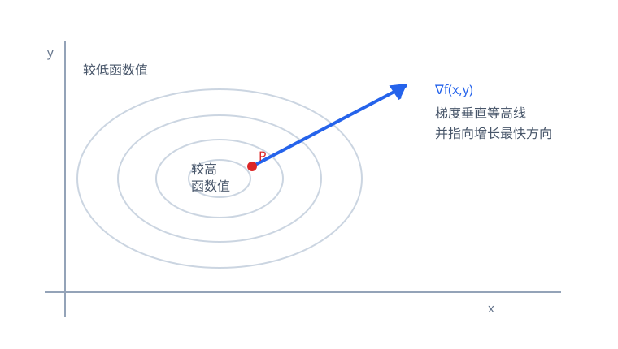

# 第9章 多元函数微分及其应用

> **本章要解决的问题：** 多个变量同时变化时，怎样刻画函数的局部变化、指定方向变化和极值？

<strong style="color:#16A34A;background:#F0FDF4;padding:2px 6px;border-radius:3px;">数学二主线</strong>

<strong style="color:#2563EB">一句话主线：</strong>
多元函数 → 偏导数 → 全微分与线性近似 → 链式法则 → 梯度/方向导数 → 多元极值。

[返回全书公式总图](00_全书公式总图.md) · [返回高等数学入口](../高等数学_目录总图.md)

<strong style="color:#2563EB">前置概念：</strong>多元函数把有序数对（或数组）映射为函数值。本章先研究二元函数 $z=f(x,y)$ 在点附近的极限与连续，再定义偏导、可微和方向导数。多元极限可能随趋近路径改变；检查若干路径只能否定极限存在，不能单独证明极限存在。

## 本章公式关系树

<strong style="color:#2563EB">多元函数的局部变化</strong>
<ul style="list-style:none;margin:6px 0 0 8px;padding:0 0 0 18px;border-left:2px solid #94A3B8;">
<li>─ <a href="#multivariable">多元函数、极限与连续</a>：先确定定义域和点附近的行为</li>
<li>─ <a href="#partial">偏导数</a>：固定其他变量，观察单方向变化率</li>
<li>─ <a href="#differentiability">可微与全微分</a>：用线性函数近似总增量</li>
<li>─ <a href="#chain-rule">链式法则</a>：沿变量依赖路径累加变化</li>
<li>─ <a href="#gradient">方向导数与梯度</a>：指定方向变化率与最快增长方向</li>
<li>─ <a href="#extrema">极值</a>：驻点、二阶判别和条件极值</li>
</ul>

## 先看结论

- <strong style="color:#2563EB">偏导数是逐方向的变化率：</strong>求 $(f_x)$ 时把 $(y)$ 暂时看作常数，但它本身不能独立描述所有方向的总变化。
- <strong style="color:#2563EB">可微意味着存在统一线性主部：</strong>$(\Delta z=f_x\Delta x+f_y\Delta y+o(\sqrt{\Delta x^2+\Delta y^2}))$。
- <strong style="color:#16A34A">链式法则沿依赖路径展开：</strong>一条路径上的导数相乘，不同路径的贡献相加。
- <strong style="color:#16A34A">梯度垂直等高线：</strong>方向导数是梯度在单位方向上的投影。
- <strong style="color:#DC2626">驻点不一定是极值：</strong>需用二阶判别；判别式为零时仍需其他方法。

## 0. 多元函数、极限与连续

二元函数可看作从定义域 $D\subseteq\mathbb R^2$ 到实数的映射：

$$
z=f(x,y),\qquad (x,y)\in D.
$$

考察 $(x,y)\to(x_0,y_0)$ 时，$(x,y)$ 可以沿平面内任意路径趋近。只有所有路径都得到同一个极限，二元极限才存在。若沿两条路径得到不同结果，即可判定极限不存在；仅检查有限条路径结果相同，不能证明极限存在。

函数在 $(x_0,y_0)$ 连续，要求该点在定义域内、函数值有定义，并且

$$
\lim_{(x,y)\to(x_0,y_0)}f(x,y)=f(x_0,y_0).
$$

<strong style="color:#16A34A">判断提示：</strong>多项式在全平面连续；有理函数在分母不为零处连续。遇到路径相关表达式，可尝试直线 $y=kx$、坐标轴或极坐标检查；要证明极限存在，则需给出对所有方向都成立的估计。

## 1. 偏导数：固定其他变量看一个方向

对 $(z=f(x,y))$，在 $(x_0,y_0)$ 处对 $x$ 的偏导数定义为

$$
f_x(x_0,y_0)=\lim_{h\to0}\frac{f(x_0+h,y_0)-f(x_0,y_0)}{h},
$$

对 $y$ 的偏导类似。求偏导时，另一个自变量视为常数。

<strong style="color:#DC2626">重要边界：</strong>两个偏导数都存在，不足以保证函数连续或可微；偏导只看坐标方向的变化，不能代替对任意方向的整体控制。

高阶偏导用重复求导得到。若二阶偏导在邻域内连续，则混合偏导通常可交换：$(f_{xy}=f_{yx})$。

## 2. 可微与全微分：总增量的线性近似

若在点附近的总增量可写成线性主部加上比距离高阶的小量，则函数在该点可微：

<strong style="color:#2563EB">核心公式</strong>

$$
\Delta z=f_x(x_0,y_0)\Delta x+f_y(x_0,y_0)\Delta y
+o\!\left(\sqrt{\Delta x^2+\Delta y^2}\right).
$$

对应的全微分为

$$
dz=f_xdx+f_ydy.
$$

<strong style="color:#2563EB">作用：</strong>给出函数在该点附近的最佳线性近似，并用于近似计算小变化。

<strong style="color:#DC2626">成立条件：</strong>全微分存在即函数在该点可微；偏导连续是常用的充分条件，但不是必要条件。

<strong style="color:#16A34A">使用信号：</strong>题目要求判定可微、写全微分，或估计小增量。

<strong style="color:#DC2626">易错点：</strong>$dz$ 是线性主部，$\Delta z$ 是真实增量；当增量足够小时才可用 $dz$ 近似 $\Delta z$。

## 3. 多元链式法则：沿依赖路径求变化

若 $(z=f(u,v))$，且 $(u=u(x,y), v=v(x,y))$，则

$$
\frac{\partial z}{\partial x}
=\frac{\partial z}{\partial u}\frac{\partial u}{\partial x}
+\frac{\partial z}{\partial v}\frac{\partial v}{\partial x}.
$$

对 $y$ 同理。若 $(z=f(x,y))$ 而 $(x=x(t),y=y(t))$，则

$$
\frac{dz}{dt}=f_x\frac{dx}{dt}+f_y\frac{dy}{dt}.
$$

<strong style="color:#16A34A">方法：</strong>先画变量依赖图；从目标变量逆着依赖关系找每条路径；路径上偏导相乘；把所有路径贡献相加。

<strong style="color:#CA8A04">短例：</strong>若 $(z=u^2+v)$、$(u=x+y)$、$(v=xy)$，则 $(z_x=2u\cdot1+1\cdot y=2(x+y)+y)$。

## 4. 方向导数与梯度

在二维单位方向 $\mathbf e=(\cos\theta,\sin\theta)$ 上，方向导数为

<strong style="color:#2563EB">核心公式</strong>

$$
D_{\mathbf e}f=\nabla f\cdot\mathbf e,
\qquad \nabla f=(f_x,f_y).
$$

<strong style="color:#2563EB">作用：</strong>计算函数沿指定方向的瞬时变化率；梯度指向增长最快方向，最大方向导数为 $(|\nabla f|)$。

<strong style="color:#DC2626">成立条件：</strong>函数在该点可微时可直接使用该公式；$\mathbf e$ 必须是单位向量。

<strong style="color:#16A34A">使用信号：</strong>题目给出方向向量或要求最大增长率、等高线法向方向。

<strong style="color:#DC2626">易错点：</strong>给出的方向向量 $\mathbf v$ 若非单位向量，应先令 $\mathbf e=\mathbf v/|\mathbf v|$。

## 5. 多元函数极值

### 无约束极值与二阶判别

内点可微极值的必要条件是 $(f_x=f_y=0)$。对驻点 $(x_0,y_0)$，令

$$
D=f_{xx}f_{yy}-f_{xy}^2.
$$

- $(D>0)$ 且 $(f_{xx}>0)$：局部极小；
- $(D>0)$ 且 $(f_{xx}<0)$：局部极大；
- $(D<0)$：鞍点；
- $(D=0)$：判别失效，不能据此下结论。

若求闭区域上的最大最小值，还要把边界纳入比较；内点驻点不是全部候选点。

### 条件极值与拉格朗日乘子

在约束 $(g(x,y)=0)$ 下，光滑约束上的候选点满足

$$
\nabla f=\lambda\nabla g.
$$

<strong style="color:#16A34A">做法：</strong>列出乘子方程和约束方程，解候选点，再根据题意比较函数值。

<strong style="color:#DC2626">边界：</strong>此条件给出候选点，不自动保证极值；还需确认约束正则性和候选点是否属于允许范围。

## 6. 典型方法：多元微分题的判断路线

| 目标 | 先做什么 | 关键条件/检查 |
|---|---|---|
| 求偏导 | 固定其余变量后求导 | 注意复合关系和自变量依赖 |
| 求全微分/判可微 | 检查总增量的线性主部 | 偏导存在本身不够 |
| 求复合偏导 | 画依赖路径 | 每条路径乘积后相加 |
| 求方向导数 | 先单位化方向向量 | 可微时用梯度点积 |
| 求局部极值 | 解驻点方程并做二阶判别 | $(D=0)$ 时另行分析 |
| 求条件极值 | 建立拉格朗日方程组 | 候选点还需筛选比较 |

## 易错与边界

- 偏导存在不等于可微；可微可以推出各偏导在该点存在，但不保证偏导函数在该点连续。
- 连续偏导是可微的常用充分条件，不要误记为必要条件；可微只保证相应偏导存在，不保证偏导函数连续。
- 方向导数公式中的方向向量必须单位化。
- 二阶判别只针对已找到的驻点；$(D=0)$ 代表无法判定。
- 闭区域上的绝对最大最小值要检查边界，拉格朗日乘子只处理光滑约束候选点。

## 跨章节连接

<strong style="color:#9333EA">知识衔接：</strong>本章把一元变化率推广到多元，并与空间向量、重积分相接。

- [第8章 向量与空间解析几何](08_向量与空间解析几何.md)：梯度向量、法向量和点积提供几何语言。
- [第10章 重积分](10_重积分.md)：多元函数在区域上的累积。
- [第3章 中值定理与导数应用](03_中值定理与导数应用.md)：一元导数应用是多元变化分析的基础类比。
