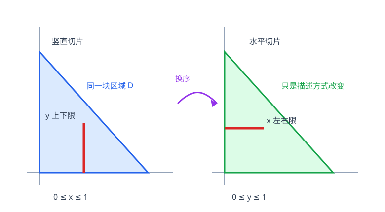

# 第10章 重积分

> **本章要解决的问题：** 怎样把平面或空间中每个位置的局部量，在整个区域上累积起来？

<strong style="color:#16A34A;background:#F0FDF4;padding:2px 6px;border-radius:3px;">数学二主线</strong>

<strong style="color:#2563EB">一句话主线：</strong>
先描述区域 → 选坐标和切片 → 写积分限与微元 → 累积 → 解释几何/物理意义。

[返回全书公式总图](00_全书公式总图.md) · [返回高等数学入口](../高等数学_目录总图.md)

## 本章公式关系树

<strong style="color:#2563EB">区域上的累积</strong>
<ul style="list-style:none;margin:6px 0 0 8px;padding:0 0 0 18px;border-left:2px solid #94A3B8;">
<li>─ <a href="#double-integral">二重积分</a>：平面区域上的累积</li>
<li>─ <a href="#iterated">累次积分与换序</a>：把区域边界写成积分限</li>
<li>─ <a href="#polar">极坐标与换元</a>：利用区域对称性并乘雅可比</li>
<li>─ <a href="#triple-integral">三重积分</a>：空间区域上的累积</li>
<li>─ <a href="#applications">面积、体积、质量与平均值</a>：解释积分对象</li>
</ul>

## 先看结论

- <strong style="color:#2563EB">积分限来自区域：</strong>先画区域、确认边界，再决定积分次序；被积函数通常不决定积分限。
- <strong style="color:#16A34A">换序是重写同一区域：</strong>竖直切片和水平切片对应不同积分限，必要时要分区域。
- <strong style="color:#16A34A">极坐标面积元带雅可比：</strong>\(dA=r\,dr\,d\theta\)，这是坐标变换的面积缩放因子。
- <strong style="color:#DC2626">坐标变换必须带雅可比：</strong>只替换 \(x,y\) 而漏掉尺度因子会算错。
- <strong style="color:#9333EA">积分表示累积：</strong>被积函数是密度时，积分得到总量；被积函数为 \(1\) 时得到区域测度。

## 1. 二重积分：平面区域上的累积

在区域 \((D)\) 上，把区域细分成小块，取样点并累加函数值乘小面积，极限记为

<strong style="color:#2563EB">核心公式</strong>

$$
\iint_D f(x,y)\,dA.
$$

<strong style="color:#2563EB">作用：</strong>将平面区域上的密度或高度累积成总量。

<strong style="color:#DC2626">成立条件：</strong>常见情形下函数连续、区域有界且边界分段光滑即可保证可积；更一般条件以可积性为准。

<strong style="color:#16A34A">使用信号：</strong>题目要求区域面积、薄片质量、曲顶柱体体积或区域平均值。

<strong style="color:#DC2626">易错点：</strong>\((dA)\) 是面积微元；它在直角坐标下可写 \((dxdy)\)，但坐标变换后形式会改变。

## 2. 累次积分：从区域写出积分限

若区域可表示为

$$
a\le x\le b,\qquad g_1(x)\le y\le g_2(x),
$$

则

$$
\iint_D f(x,y)dA
=\int_a^b\!\int_{g_1(x)}^{g_2(x)}f(x,y)\,dy\,dx.
$$

也可以反过来按 \(y\) 切片，写成先对 \(x\) 积分。若边界形式在全域不统一，应把 \(D\) 切成若干简单区域后分别积分。

<strong style="color:#16A34A">换序步骤：</strong>画出 \(D\) → 选切片方向 → 写出外层变量范围 → 写内层左右/上下边界 → 检查是否覆盖且不重复。

<strong style="color:#CA8A04">短例：</strong>三角域 \((0\le x\le1,0\le y\le x)\) 换成先对 \(x\) 积分时，应写 \((0\le y\le1, y\le x\le1)\)。

## 3. 极坐标与一般换元

极坐标关系与面积元：

<strong style="color:#2563EB">核心公式</strong>

$$
x=r\cos\theta,\qquad y=r\sin\theta,\qquad dA=r\,dr\,d\theta.
$$

<strong style="color:#2563EB">作用：</strong>适合圆、扇形、圆环以及被积函数含 \((x^2+y^2)\) 的问题。

<strong style="color:#DC2626">成立条件：</strong>积分范围必须准确覆盖目标区域；通常取 \((r\ge0)\) 并选择不重叠的角度范围。

<strong style="color:#16A34A">使用信号：</strong>区域边界或函数呈圆对称、径向对称。

<strong style="color:#DC2626">易错点：</strong>漏写雅可比因子 \((r)\)，或角度范围多算/漏算区域。

一般变量替换 \((x,y)=T(u,v)\) 时，面积元为

$$
dA=\left|\frac{\partial(x,y)}{\partial(u,v)}\right|du\,dv.
$$

绝对值是雅可比行列式的绝对值，反映局部面积缩放。

## 4. 三重积分：空间区域上的累积

<strong style="color:#9333EA;background:#FAF5FF;padding:2px 6px;border-radius:3px;">教材扩展</strong>三重积分在本书中保留为教材扩展，不与二重积分主线混排。

空间区域 \(\Omega\) 上的三重积分为

$$
\iiint_\Omega f(x,y,z)\,dV.
$$

直角坐标下 \(dV=dx\,dy\,dz\)；圆柱坐标下 \(dV=r\,dr\,d\theta\,dz\)；球坐标下 \(dV=\rho^2\sin\varphi\,d\rho\,d\varphi\,d\theta\)。这里约定 \(\rho\) 为到原点的距离、\(\varphi\) 为与正 \(z\) 轴的夹角、\(\theta\) 为绕 \(z\) 轴的方位角，且 \(0\le\varphi\le\pi\)、\(0\le\theta<2\pi\)。具体积分限仍由空间区域边界决定。

## 5. 积分的几何与物理应用

| 被积函数 | 积分意义 |
|---|---|
| \(1\) | 平面面积 \(\iint_D1\,dA\) 或空间体积 \(\iiint_\Omega1\,dV\) |
| 高度 \(z=f(x,y)\ge0\) | 曲顶柱体体积 \(\iint_D f\,dA\) |
| 面密度 \(\rho(x,y)\) | 薄片质量 \(\iint_D\rho\,dA\) |
| 密度 \(\rho(x,y,z)\) | 空间质量 \(\iiint_\Omega\rho\,dV\) |

区域上的平均值为 \(\displaystyle \bar f=\frac{1}{\operatorname{Area}(D)}\iint_D f\,dA\)，前提是区域面积非零。

## 6. 典型方法：重积分的决策顺序

确认积分对象 → 画区域/空间体 → 判断边界最容易按哪个方向表示 → 选直角、极/柱/球坐标 → 写微元与雅可比 → 确认积分限 → 分步计算 → 检查符号、范围和单位。

## 易错与边界

- 先定区域，再定积分限；被积函数不能替代区域分析。
- 换序后内外层变量范围都会变化，不是只交换 \(dx\) 和 \(dy\)。
- 复杂区域可能必须分块；每一块应互不重叠且合起来覆盖原区域。
- 极坐标、柱坐标、一般换元都要包含雅可比。
- 若被积函数可正可负，积分是带符号累积，不一定等于几何体积。

## 跨章节连接

<strong style="color:#9333EA">知识衔接：</strong>本章把定积分的累积推广到区域，并为区域边界上的曲线/曲面积分作准备。

- [第5章 定积分](05_定积分.md)：重积分是累积思想从一维到多维的推广。
- [第6章 定积分应用](06_定积分应用.md)：一维切片建立微元的方法在本章继续使用。
- [第9章 多元函数微分及其应用](09_多元函数微分及其应用.md)：提供被积函数、区域函数和极坐标变换所需的多元背景。
- [第11章 曲线积分与曲面积分](11_曲线积分与曲面积分.md)：把区域累积推广到曲线和曲面。
