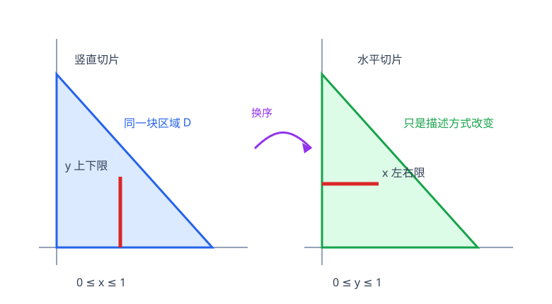

# 第10章 重积分

> **本章要解决的问题：** 怎样把平面或空间中每个位置的局部量，在整个区域上累积起来？

<strong style="color:#16A34A;background:#F0FDF4;padding:2px 6px;border-radius:3px;">数学二主线</strong>

<strong style="color:#2563EB">一句话主线：</strong>
先描述区域 → 选坐标和切片 → 写积分限与微元 → 累积 → 解释几何/物理意义。

[返回全书公式总图](00_全书公式总图.md) · [返回高等数学入口](../高等数学_目录总图.md)

## 本章知识树

**区域上的累积**

- **平面区域**：先确定区域，再选切片方向或坐标。
  - [二重积分](#double-integral)：把平面区域上的局部量累积成整体量。
  - [累次积分与换序](#iterated)：按竖直或水平切片写积分限，复杂区域必要时分块。
  - [极坐标与换元](#polar)：区域呈圆形或径向结构时换坐标，并补上雅可比。
- **空间区域（教材扩展）**：把切片思想推广到三维。
  - [三重积分](#triple-integral)：累积空间区域上的局部量。
  - [投影法](#projection-method)：投影到平面，先积高度方向。
  - [截面法](#section-method)：按高度切片，再积每层截面。
- **解释积分结果对应的实际量**
  - [面积、体积、质量与平均值](#applications)：根据被积函数和微元还原几何或物理意义。

## 先看结论

- <strong style="color:#2563EB">积分限来自区域：</strong>先画区域、确认边界，再决定积分次序；被积函数通常不决定积分限。
- <strong style="color:#16A34A">换序是重写同一区域：</strong>竖直切片和水平切片对应不同积分限，必要时要分区域。
- <strong style="color:#16A34A">极坐标面积元带雅可比：</strong>$dA=r\,dr\,d\theta$，这是坐标变换的面积缩放因子。
- <strong style="color:#DC2626">坐标变换必须带雅可比：</strong>只替换 $x,y$ 而漏掉尺度因子会算错。
- <strong style="color:#9333EA">积分表示累积：</strong>被积函数是密度时，积分得到总量；被积函数为 $1$ 时得到区域测度。

## 1. 二重积分：平面区域上的累积

在区域 $D$ 上，把区域细分成小块，取样点并累加函数值乘小面积，极限记为

<strong style="color:#2563EB">核心公式</strong>

$$
\iint_D f(x,y)\,dA.
$$

<strong style="color:#2563EB">作用：</strong>将平面区域上的密度或高度累积成总量。

<strong style="color:#DC2626">成立条件：</strong>常见情形下函数连续、区域有界且边界分段光滑即可保证可积；更一般条件以可积性为准。

<strong style="color:#16A34A">使用信号：</strong>题目要求区域面积、薄片质量、曲顶柱体体积或区域平均值。

<strong style="color:#DC2626">易错点：</strong>$dA$ 是面积微元；它在直角坐标下可写 $dxdy$，但坐标变换后形式会改变。

### 对称性：先看区域，再看被积函数

对称性能在写积分限之前就把积分化简，是二重积分最省时间的一步，但必须区域与函数一起用。

- $D$ 关于 $y$ 轴对称：若 $f(-x,y)=-f(x,y)$，则 $\iint_D f\,dA=0$；若 $f(-x,y)=f(x,y)$，则 $\iint_D f\,dA=2\iint_{D_1}f\,dA$，其中 $D_1$ 是 $D$ 在 $x\ge0$ 的一半。
- $D$ 关于 $x$ 轴对称：把条件换成 $f(x,-y)=\pm f(x,y)$，结论同样成立。
- $D$ 关于原点对称：$f(-x,-y)=-f(x,y)$ 时积分为 $0$；偶对称时取一半区域的两倍。
- 轮换对称：若 $D$ 关于直线 $y=x$ 对称，则 $\iint_D f(x,y)\,dA=\iint_D f(y,x)\,dA$，两个难算的积分可以相加后再算。

<strong style="color:#DC2626">易错点：</strong>只区域对称、函数不对称时不能直接判零；反过来，函数有奇偶性但区域不对称同样不能用。

## 2. 累次积分：从区域写出积分限

若区域可表示为

$$
a\le x\le b,\qquad g_1(x)\le y\le g_2(x),
$$

则

$$
\iint_D f(x,y)dA
=\int_a^b\!\int_{g_1(x)}^{g_2(x)}f(x,y)\,dy\,dx.
$$

也可以反过来按 $y$ 切片，写成先对 $x$ 积分。若边界形式在全域不统一，应把 $D$ 切成若干简单区域后分别积分。

<strong style="color:#16A34A">换序步骤：</strong>画出 $D$ → 选切片方向 → 写出外层变量范围 → 写内层左右/上下边界 → 检查是否覆盖且不重复。

<strong style="color:#CA8A04">短例：</strong>三角域 $0\le x\le1,0\le y\le x$ 换成先对 $x$ 积分时，应写 $0\le y\le1, y\le x\le1$。

## 3. 极坐标与一般换元

极坐标关系与面积元：

<strong style="color:#2563EB">核心公式</strong>

$$
x=r\cos\theta,\qquad y=r\sin\theta,\qquad dA=r\,dr\,d\theta.
$$

<strong style="color:#2563EB">作用：</strong>适合圆、扇形、圆环以及被积函数含 $x^2+y^2$ 的问题。

<strong style="color:#DC2626">成立条件：</strong>积分范围必须准确覆盖目标区域；通常取 $r\ge0$ 并选择不重叠的角度范围。

<strong style="color:#16A34A">使用信号：</strong>区域边界或函数呈圆对称、径向对称。

<strong style="color:#DC2626">易错点：</strong>漏写雅可比因子 $r$，或角度范围多算/漏算区域。

一般变量替换 $(x,y)=T(u,v)$ 时，面积元为

$$
dA=\left|\frac{\partial(x,y)}{\partial(u,v)}\right|du\,dv.
$$

绝对值是雅可比行列式的绝对值，反映局部面积缩放。

## 4. 三重积分：空间区域上的累积

<strong style="color:#9333EA;background:#FAF5FF;padding:2px 6px;border-radius:3px;">教材扩展</strong>

三重积分不在数学二主线内，这里只保留定义、三种坐标下的体积微元和适用场景，不与二重积分主线混排。

空间区域 $\Omega$ 上的三重积分为

$$
\iiint_\Omega f(x,y,z)\,dV.
$$

直角坐标下 $dV=dx\,dy\,dz$；圆柱坐标下 $dV=r\,dr\,d\theta\,dz$；球坐标下 $dV=\rho^2\sin\varphi\,d\rho\,d\varphi\,d\theta$。这里约定 $\rho$ 为到原点的距离、$\varphi$ 为与正 $z$ 轴的夹角、$\theta$ 为绕 $z$ 轴的方位角，且 $0\le\varphi\le\pi$、$0\le\theta<2\pi$。具体积分限仍由空间区域边界决定。

### 两种写积分限的方式

### 投影法：先一后二

把 $\Omega$ 投影到 $xOy$ 面得到 $D$，穿过的竖直线从下曲面进入到上曲面穿出，

$$
\iiint_\Omega f\,dV
=\iint_D\left[\int_{z_1(x,y)}^{z_2(x,y)}f(x,y,z)\,dz\right]dx\,dy .
$$

### 截面法：先二后一

用高度 $z$ 去截 $\Omega$，每层截面记为 $D_z$，

$$
\iiint_\Omega f\,dV
=\int_{c}^{d}\left[\iint_{D_z}f(x,y,z)\,dx\,dy\right]dz .
$$

<strong style="color:#16A34A">选择依据：</strong>被积函数只依赖 $z$，或每层截面形状简单、面积好算时用截面法；区域上下界面写得清楚时用投影法。

## 5. 积分的几何与物理应用

| 被积函数 | 积分意义 |
|---|---|
| $1$ | 平面面积 $\iint_D1\,dA$ 或空间体积 $\iiint_\Omega1\,dV$ |
| 高度 $z=f(x,y)\ge0$ | 曲顶柱体体积 $\iint_D f\,dA$ |
| 面密度 $\rho(x,y)$ | 薄片质量 $\iint_D\rho\,dA$ |
| 密度 $\rho(x,y,z)$ | 空间质量 $\iiint_\Omega\rho\,dV$ |

区域上的平均值为 $\displaystyle \bar f=\frac{1}{\operatorname{Area}(D)}\iint_D f\,dA$，前提是区域面积非零。

## 6. 典型方法：重积分的决策顺序

确认积分对象 → 画区域/空间体 → 判断边界最容易按哪个方向表示 → 选直角、极/柱/球坐标 → 写微元与雅可比 → 确认积分限 → 分步计算 → 检查符号、范围和单位。

## 易错与边界

- 先定区域，再定积分限；被积函数不能替代区域分析。
- 换序后内外层变量范围都会变化，不是只交换 $dx$ 和 $dy$。
- 复杂区域可能必须分块；每一块应互不重叠且合起来覆盖原区域。
- 极坐标、柱坐标、一般换元都要包含雅可比。
- 若被积函数可正可负，积分是带符号累积，不一定等于几何体积。

## 跨章节连接

<strong style="color:#9333EA">知识衔接：</strong>本章把定积分的累积推广到区域，并为区域边界上的曲线/曲面积分作准备。

- [第5章 定积分](05_定积分.md)：重积分是累积思想从一维到多维的推广。
- [第6章 定积分应用](06_定积分应用.md)：一维切片建立微元的方法在本章继续使用。
- [第9章 多元函数微分及其应用](09_多元函数微分及其应用.md)：提供被积函数、区域函数和极坐标变换所需的多元背景。
- [第11章 曲线积分与曲面积分](11_曲线积分与曲面积分.md)：把区域累积推广到曲线和曲面。
