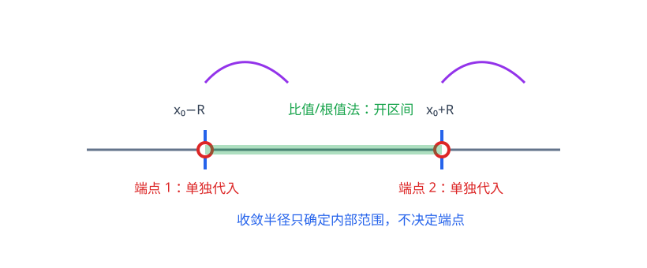

# 第12章 无穷级数

> **本章要解决的问题：** 无穷多个数相加何时收敛到确定值，函数又能否表示为幂级数？

<strong style="color:#9333EA;background:#FAF5FF;padding:2px 6px;border-radius:3px;">教材扩展</strong>

<strong style="color:#2563EB">一句话主线：</strong>
部分和 → 收敛性 → 选择判别法 → 幂级数收敛半径 → 端点检查 → 泰勒展开。

[返回全书公式总图](00_全书公式总图.md) · [返回高等数学入口](../高等数学_目录总图.md)

## 本章公式关系树

<strong style="color:#2563EB">无穷级数</strong>
<ul style="list-style:none;margin:6px 0 0 8px;padding:0 0 0 18px;border-left:2px solid #94A3B8;">
<li>─ <a href="#definition">数项级数</a>：部分和极限定义收敛</li>
<li>─ <a href="#positive">正项级数</a>：比较、比值、根值、积分判别</li>
<li>─ <a href="#alternating">交错与绝对收敛</a>：利用符号和绝对值判断</li>
<li>─ <a href="#power-series">幂级数</a>：收敛半径与端点</li>
<li>─ <a href="#taylor">泰勒级数</a>：以多项式级数近似函数</li>
</ul>

## 先看结论

- <strong style="color:#2563EB">级数看部分和：</strong>\((\sum a_n)\) 收敛，定义为部分和 \((S_N=\sum_{n=1}^N a_n)\) 有有限极限。
- <strong style="color:#DC2626">通项趋零只是必要条件：</strong>\((a_n\not\to0)\) 可判发散；\((a_n\to0)\) 不能单独判收敛。
- <strong style="color:#16A34A">判别法要匹配结构：</strong>正项、交错、幂级数分别有适合的比较或极限工具。
- <strong style="color:#16A34A">幂级数先求半径，再逐端点检查：</strong>半径只决定内部绝对收敛范围。
- <strong style="color:#DC2626">泰勒式等于函数需要余项趋零：</strong>形式上写出系数不等于已经证明函数等于级数。

## 1. 数项级数：部分和的极限

定义部分和 \((S_N=\sum_{n=1}^{N}a_n)\)。若 \((S_N\to S)\)，则

$$
\sum_{n=1}^{\infty}a_n=S.
$$

若级数收敛，则必须 \((a_n\to0)\)。这是发散判别的快速入口，不是收敛判别。

几何级数

$$
\sum_{n=0}^{\infty}q^n
=\frac{1}{1-q},\qquad |q|<1.
$$

当 \(|q|\ge1\) 时不收敛。调和级数 \(\sum_{n=1}^{\infty}\frac1n\) 虽然通项趋零，仍发散。

## 2. 正项级数：用大小比较判断

正项级数的部分和单调递增，因此关键是判断其是否有上界。

### p级数：常用比较基准

$$
\sum_{n=1}^{\infty}\frac{1}{n^p}
\;=\;
\begin{cases}
\text{收敛},&p>1,\\
\text{发散},&p\le 1.
\end{cases}
$$

<strong style="color:#16A34A">使用信号：</strong>通项可与 \(1/n^p\) 比较，或化简后与其同阶时，用它作为比较判别的基准。

### 比较判别

若最终有 \(0\le a_n\le b_n\)，且 \(\sum b_n\) 收敛，则 \(\sum a_n\) 收敛；若 \(a_n\ge b_n\ge0\) 且 \(\sum b_n\) 发散，则 \(\sum a_n\) 发散。

若 \(a_n,b_n>0\)，且

$$
\lim_{n\to\infty}\frac{a_n}{b_n}=c,\qquad 0<c<\infty,
$$

则 \(\sum a_n\) 与 \(\sum b_n\) 同敛散。它适合比较复杂通项与 \(1/n^p\) 的渐近阶。

### 比值与根值判别

若极限存在，令

<strong style="color:#2563EB">判别结论</strong>

$$
L=\lim_{n\to\infty}\frac{a_{n+1}}{a_n}
\quad\text{或}\quad
L=\lim_{n\to\infty}\sqrt[n]{a_n}.
$$

- \((L<1)\)：级数收敛；
- \((L>1)\)：级数发散；
- \((L=1)\)：判别法不能给出结论。

<strong style="color:#16A34A">使用信号：</strong>项中有阶乘、指数或 \((n)\) 次幂时，优先试比值或根值。

<strong style="color:#DC2626">易错点：</strong>极限等于 \(1\) 不是“收敛”，而是无结论。

### 积分判别

若 \(f(x)\) 在 \([1,\infty)\) 上连续、正且单调递减，并令 \(a_n=f(n)\)，则

$$
\sum_{n=1}^{\infty}a_n
\quad\text{与}\quad
\int_1^\infty f(x)\,dx
$$

同敛散。它适合把级数与反常积分互相转化；若正性、连续性或最终单调递减不满足，不能直接使用。

## 3. 交错级数、绝对收敛与条件收敛

若 \(b_n\ge0\) 单调递减且 \(b_n\to0\)，则交错级数 \(\sum_{n=1}^{\infty}(-1)^{n-1}b_n\) 收敛；其余项误差不超过下一项绝对值。

若 \(\sum|a_n|\) 收敛，则 \(\sum a_n\) 绝对收敛，从而原级数收敛。若原级数收敛但绝对值级数发散，则为条件收敛。

<strong style="color:#DC2626">边界：</strong>交错判别要求绝对值项最终单调趋零；只交替变号并不足够。

## 4. 幂级数：收敛半径与区间

幂级数以 \((x_0)\) 为中心：

$$
\sum_{n=0}^{\infty}a_n(x-x_0)^n.
$$

存在收敛半径 \((R\in[0,\infty])\)：当 \((|x-x_0|<R)\) 时绝对收敛；当 \((|x-x_0|>R)\) 时发散；边界点需分别判断。

若可用比值求半径，则

$$
R=\lim_{n\to\infty}\left|\frac{a_n}{a_{n+1}}\right|,
$$

在该极限存在时使用。更一般地，柯西-阿达马公式为

$$
\frac{1}{R}=\limsup_{n\to\infty}\sqrt[n]{|a_n|},
$$

并采用 \(1/0=\infty\)、\(1/\infty=0\) 的约定。实际求收敛区间后，端点须代回原级数。

<strong style="color:#16A34A">步骤：</strong>求收敛半径 → 写出开区间 → 分别代入左端点、右端点 → 用数项级数判别法 → 合并区间端点。

## 5. 幂级数的运算与泰勒展开

在幂级数收敛区间内部，可以逐项求导和逐项积分，所得级数的收敛半径保持不变；端点的收敛性可能改变。

若 \(f\) 在包含 \(x_0\) 与 \(x\) 的区间上有直到 \(n+1\) 阶的连续导数，则有限阶泰勒公式为

$$
f(x)=\sum_{k=0}^{n}\frac{f^{(k)}(x_0)}{k!}(x-x_0)^k
+\frac{f^{(n+1)}(\xi)}{(n+1)!}(x-x_0)^{n+1},
$$

其中 \(\xi\) 介于 \(x_0\) 与 \(x\) 之间。将阶数 \(n\) 继续增大后，只有当余项趋于零时，才能断定函数等于对应的无穷级数；有任意阶导数本身并不足以保证这一点。

常用麦克劳林展开：

$$
e^x=\sum_{n=0}^{\infty}\frac{x^n}{n!},\qquad
\sin x=\sum_{n=0}^{\infty}(-1)^n\frac{x^{2n+1}}{(2n+1)!},
$$

$$
\cos x=\sum_{n=0}^{\infty}(-1)^n\frac{x^{2n}}{(2n)!},\qquad
\frac{1}{1-x}=\sum_{n=0}^{\infty}x^n\quad(|x|<1).
$$

## 6. 典型方法：级数判别路线

| 级数形态 | 先尝试 | 结论边界 |
|---|---|---|
| 通项不趋于零 | 通项判别 | 可直接判发散 |
| 正项且像熟悉基准级数 | 比较/极限比较 | 比较方向必须正确 |
| 含阶乘、指数、幂 | 比值/根值 | 极限为 \(1\) 时无结论 |
| 正负交替 | 交错判别 | 绝对值项需最终递减趋零 |
| 含 \((x-x_0)^n\) | 幂级数半径法 | 两端点各自检查 |
| 要展开函数 | 泰勒/常用展开 | 确认所需阶数和收敛范围 |

## 易错与边界

- \((a_n\to0)\) 不能推出级数收敛；先用它只能快速排除发散。
- 比值、根值判别的极限为 \(1\) 时必须换方法。
- 幂级数端点不由收敛半径决定，左、右端点可能一收一散。
- 逐项求导、积分的结论保证在收敛区间内部成立，不自动包含端点。
- 泰勒多项式近似与无穷级数恒等不是一回事；要检查余项或适用区间。
- 条件收敛级数重排可能改变和，不能像绝对收敛级数那样任意重排。

## 跨章节连接

<strong style="color:#9333EA">知识衔接：</strong>本章以数列极限为基础，以导数生成泰勒系数，也可用于表示微分方程解。

- [第1章 函数与极限](01_函数与极限.md)：级数收敛以数列极限为基础。
- [第2章 导数与微分](02_导数与微分.md)：泰勒系数由各阶导数给出。
- [第7章 微分方程](07_微分方程.md)：部分微分方程可用幂级数方法求解。
